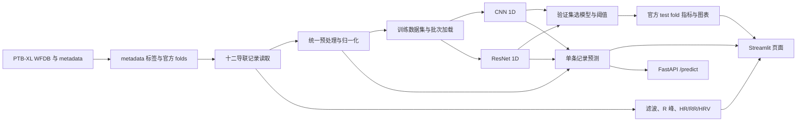

# PTB-XL 十二导联 ECG 智能分析系统

基于 PTB-XL 的教学与科研演示工程。阶段 A（数据通路与波形展示）、阶段 B（ECG 预处理、R 峰、HR/RR/HRV）、阶段 C（多标签 1D CNN 训练与独立测试）、阶段 D（单条推理与 Streamlit 演示）及阶段 E 的 API 和模型响应图已完成；本地已放置 PTB-XL 1.0.3 的完整 100 Hz 波形。

中断后继续开发可先看[项目进度](项目进度.md)。

## 医学背景与任务

心电图记录心脏电活动。标准十二导联从不同方向观察心脏，医生结合波形和临床信息判断节律及可能的异常。本项目使用 PTB-XL 的十秒十二导联记录与数据集诊断标签，演示五类诊断 superclass 的多标签分类：NORM、MI、STTC、CD、HYP。一条记录可以同时对应多个类别；模型输出是研究演示用的概率和阈值标签，不能替代医生判断，也不用于诊断或治疗决策。

## 系统架构



## 环境

本机项目环境是当前目录的 `.venv`，使用 Python 3.14.3。它由 Python `venv` 创建，**不会出现在 `conda env list` 中**。Windows PowerShell 中进入项目目录后激活已有环境：

```powershell
.\.venv\Scripts\Activate.ps1
python --version
python -c "import torch; print(torch.__version__, torch.cuda.is_available())"
```

不激活环境也能直接使用 `.\.venv\Scripts\python.exe`。VS Code 中选择解释器 `.venv\Scripts\python.exe`。本机已安装 GPU 版 PyTorch 2.12.1+cu126，并在 RTX 4060 Laptop GPU 上确认 `torch.cuda.is_available()` 为 `True`。

如需重新创建该项目环境：

```powershell
python -m venv .venv
.\.venv\Scripts\Activate.ps1
python -m pip install -r requirements-dev.txt
python -m pip install 'torch==2.12.1+cu126' --index-url https://download.pytorch.org/whl/cu126
python -m pip install -r requirements-train.txt
python -m pip install -r requirements-app.txt
python -m pip install -r requirements-api.txt
```

PyTorch 的 GPU 轮子约 2.6 GB。其他 Windows、驱动或 Python 版本应按 [PyTorch 官方安装说明](https://pytorch.org/get-started/locally/) 选择匹配的构建版本；不要修改系统 Python。

## 数据准备（阶段 A）

从 [PhysioNet PTB-XL v1.0.3](https://physionet.org/content/ptb-xl/1.0.3/) 获取数据，并按 [data/README.md](../data/README.md) 放置。本机完整数据存放于 `D:\datasets\ptb-xl`，通过 Git 忽略的 `configs/local.yaml` 设置路径，不会被 Obsidian 仓库索引。本项目提供只下载 `records100`、元数据和许可文件的脚本，每个文件按官方 SHA-256 清单校验，可重复运行以跳过已验证的文件：

```powershell
python scripts/download_ptbxl.py --workers 64
python scripts/prepare_data.py
python scripts/inspect_record.py --ecg-id 1
```

也可指定数据根目录：

```powershell
python scripts/prepare_data.py --dataset-root D:\datasets\ptb-xl
python scripts/prepare_data.py --dataset-root D:\datasets\ptb-xl --sampling-rate 500
```

默认使用官方 `strat_fold`：1–8 训练、9 验证、10 测试。数据集尚未放置时，准备脚本会指出官方来源、期望目录和缺失文件。单元测试可以在没有数据时运行：

```powershell
pytest
```

### 当前工作区的数据完成清单

- [x] 从 PhysioNet 官方公开存储获取 PTB-XL 1.0.3 的 `ptbxl_database.csv`、`scp_statements.csv`、`LICENSE.txt` 与全部 `records100` 文件。
- [x] 按官方 `SHA256SUMS.txt` 逐文件校验：元数据和许可文件 3 个，100 Hz 波形文件 43,598 个；全部通过。
- [x] 确认 21,799 个 `.dat` 和 21,799 个 `.hea` 文件，无遗留的临时下载文件。波形文件合计 536,340,888 字节。
- [x] 将原先位于 Obsidian 仓库内的数据移到 `D:\datasets\ptb-xl`，项目命令通过本机配置继续访问。
- [x] 生成官方 folds 的清单：训练 17,418、验证 2,183、测试 2,198 条；患者不跨集合。
- [x] 五类 superclass 数量与官方数据说明一致：NORM 9,514、MI 5,469、STTC 5,235、CD 4,898、HYP 2,649。
- [x] 从训练、验证、测试三个 fold 各读取一条真实记录，均得到 `1000 × 12` 波形；数据集接口返回 `[12, 1000]` 和五维标签。
- [x] 用 ECG ID 1 生成十二导联、Lead II 原始/滤波/R 峰和 RR 图。该分析仅验证程序可运行，不代表 R 峰检测的临床准确率。

## 阶段 A 完成清单

- [x] 建立配置、依赖清单、`.gitignore`、数据说明和输出目录。
- [x] 自动识别常见 PTB-XL 目录；缺少数据时提示官方来源、期望路径和必需文件。
- [x] 读取 metadata 与 SCP statements，校验元数据必需列和官方 fold 编号。
- [x] 将诊断 SCP codes 聚合为 `NORM`、`MI`、`STTC`、`CD`、`HYP` 五个独立标签，保留多标签语义。
- [x] 按官方 `strat_fold` 划分训练（1–8）、验证（9）、测试（10），检查患者是否跨集合。
- [x] 按需读取 WFDB 记录，校验采样率与标准 12 导联，并整理为 `samples × leads`。
- [x] 提供数据集接口，返回 `[12, T]` 波形及五维标签，适配 PyTorch DataLoader。
- [x] 提供 Lead II 单导联图和十二导联图，时间轴以秒标注。
- [x] 提供 `scripts/prepare_data.py`，可汇总各集合标签分布并写出 CSV manifest。
- [x] 用模拟 metadata、SCP 标签、WFDB 记录和 ECG 波形覆盖关键路径；测试结果为 **6 passed**。
- [x] 在项目虚拟环境安装阶段 A 依赖；当前环境为 Python 3.14.3。

### 阶段 A 验证边界与待办

- [x] 已用完整 100 Hz 数据验证 metadata、真实 WFDB 记录、官方 fold 清单和绘图。
- [x] 本机使用 Python 3.14.3；已验证 GPU 版 PyTorch 2.12.1+cu126、CUDA 可用及阶段 C 小规模真实数据训练。

### 对应模块

- `src/data/ptbxl.py`：路径发现、元数据与 SCP 语句读取、标签编码、官方 folds、WFDB 读取与导联排序。
- `src/data/dataset.py`：按记录懒加载，返回 `[12, T]` 波形和五维多标签向量。
- `src/visualization/ecg_plot.py`：单导联和十二导联波形图。
- `scripts/prepare_data.py`：检查 PTB-XL 文件、汇总类别并输出训练/验证/测试清单。

## 阶段 B 完成清单

- [x] 建立集中配置，并提供 `FilterConfig.from_mapping()` 从 `configs/default.yaml` 读取滤波参数。
- [x] 用两级中值滤波估计并去除基线漂移，默认窗口为 0.2 s 和 0.6 s。
- [x] 实现零相位 Butterworth 带通滤波，默认 0.5–40 Hz、4 阶、SOS 形式。
- [x] 实现可选 50/60 Hz 陷波和 Nyquist 校验；100 Hz 采样下拒绝 50 Hz 陷波，避免产生无效结果。
- [x] 实现逐记录逐导联 z-score（默认）、min-max 和保留原幅值三种归一化选择。
- [x] 实现 Pan-Tompkins 思路的 R 峰检测：5–20 Hz QRS 带通、微分、平方、移动积分、自适应阈值、不应期、T 波候选排除和局部峰值校正。
- [x] 按 R 峰索引计算 RR；按宽松的 0.3–2.0 s 信号质量范围排除明显异常 RR，报告排除数量，再计算平均/最小/最大心率。
- [x] 实现 Mean RR、SDNN、RMSSD；样本不足时不伪造 SDNN/RMSSD，并输出明确提示。
- [x] 实现原始/滤波 Lead II 对照图、R 峰标记图和 RR 间期图。
- [x] 用合成信号验证滤波、Nyquist 限制、峰值位置、HR/RR/HRV 和端到端信号分析。
- [x] 阶段 A、B 全量测试结果：**17 passed**（当前 Python 3.14.3 虚拟环境）。

### 阶段 B 使用约定与验证边界

- 绘图和量测需要保留物理幅值时，调用 `preprocess_ecg(..., normalization="none")`；默认 z-score 输出是归一化值，不应标成 mV。
- 50 Hz 陷波只能在采样率高于 100 Hz 时处理；PTB-XL `records100` 应跳过工频陷波，若需 50/60 Hz 陷波应基于 `records500` 并按一致流程处理。
- `analyze_heart_rate()` 的 0.3–2.0 s RR 范围是宽松的异常值筛选参数，不是临床判定标准。信号质量差或异常心律仍可能影响自动峰值检测。
- PTB-XL 记录只有约 10 秒。HRV 数值始终带有短记录提示，仅用于算法演示，不适合作为临床长期 HRV 评价。
- 阶段 B 的数值正确性测试使用确定性合成信号；真实 ECG ID 1 已完成读取、滤波、R 峰、HR/HRV 和绘图。观察到的 T 波误检已加入相邻低幅候选峰检查，但尚未对完整数据集测量 R 峰检测准确率或 HRV 的临床效度。

### 阶段 B 对应模块

- `src/signal_processing/filters.py`：基线漂移、带通、陷波、归一化及组合预处理。
- `src/signal_processing/rpeak.py`：可解释的 R 峰检测、RR 和心率统计。
- `src/signal_processing/hrv.py`：时域 HRV 指标与短记录提示。
- `src/visualization/ecg_plot.py`：原始/滤波波形叠图、R 峰标记和 RR 图。
- `scripts/download_ptbxl.py`：下载并逐文件校验官方 100 Hz 数据。
- `scripts/inspect_record.py`：对单条真实 ECG 运行阶段 A/B 流程并保存三张图。
- `configs/default.yaml`：滤波、R 峰和 RR 参数。
- `tests/test_stage_b.py`：滤波、峰值、量测、绘图和端到端合成信号测试。

## 阶段 C：多标签分类、训练与评估

输入为 100 Hz、10 秒、12 导联的 `[B, 12, 1000]` 张量；模型输出按 `NORM、MI、STTC、CD、HYP` 顺序排列的五个独立 logit，推理时逐类使用 sigmoid。训练、验证、测试沿用 PTB-XL 官方 fold 1–8、9、10；按记录独立预处理，患者不跨集合。默认 batch size 为 32，仅按批次送入 GPU，并使用 AMP 降低显存占用。

训练标签不均衡，故 BCEWithLogitsLoss 的五个 `pos_weight` 只从训练 fold 统计。每轮在验证 fold 计算 AUROC，以验证 macro AUROC 选择最佳检查点并早停；阈值也只在验证 fold 按每类 F1 选择。测试 fold 仅使用冻结的检查点和阈值评估一次。

```powershell
.\.venv\Scripts\python.exe scripts/train_baseline.py
.\.venv\Scripts\python.exe scripts/evaluate_model.py
```

可用 `--epochs`、`--batch-size`、`--learning-rate` 修改训练参数。`--max-samples 256 --epochs 2` 是流程检查，只生成独立的 `baseline_smoke.pt`，不作为正式测试结果。正式训练检查点输出到 `outputs/checkpoints/baseline_best.pt`；测试的指标、逐条概率和预测、ROC 曲线与每类混淆矩阵分别写入 `outputs/metrics`、`outputs/predictions`、`outputs/figures`。训练前首次预处理会创建内存映射缓存，后续运行自动复用。

可通过 `--model resnet1d` 训练独立的残差网络实验。它会生成 `resnet1d_best.pt` 和带 `resnet1d` 前缀的指标、预测与图表，不会覆盖 CNN 基线；评估和单条推理命令用 `--checkpoint outputs/checkpoints/resnet1d_best.pt` 指定它。

### 阶段 C 完成清单

- [x] 建立 12 导联输入、五个独立 logit 输出的 1D CNN；模型正向和反向传播测试通过。
- [x] 建立真实 PTB-XL 数据的预处理缓存，按批次加载，避免一次性占满 8 GB 显存。
- [x] 实现训练 fold 类别计数、`pos_weight`、GPU/CPU 自动选择、AMP、随机种子、早停和最佳模型保存。
- [x] 实现按类 AUROC、Precision、Recall、F1、混淆矩阵及 macro 指标；无正负样本的类别不伪造 AUROC。
- [x] 实现仅依赖验证 fold 的阈值选择，并将阈值随检查点保存。
- [x] 实现训练曲线、类别分布图、测试 ROC 图和每类混淆矩阵图。
- [x] 完成 256 条训练记录、128 条验证记录的真实数据小规模 GPU 训练，包含保存和重新读取检查点；此结果只用于程序验证。
- [x] 在 RTX 4060 Laptop GPU 上完成全部 17,418 条训练记录和 2,183 条验证记录的正式训练；第 16 轮触发早停，最佳模型来自第 11 轮，验证 macro AUROC 为 **0.9100**。
- [x] 使用冻结检查点和验证集阈值评估独立测试 fold 的 2,198 条记录；保存逐条概率与预测、指标 JSON、ROC 图、每类混淆矩阵图。
- [x] 阶段 A/B/C 自动测试合计 **20 passed**；完整训练与测试命令均正常退出。

### 阶段 C 真实测试结果

数据：PTB-XL 1.0.3、100 Hz、官方 test fold 10（2,198 条）。阈值在 validation fold 9 上选择，测试集未参与训练、早停或阈值选择。下表数值取自 [test_metrics_full.json](../outputs/metrics/test_metrics_full.json)：

| 类别 | AUROC | Precision | Recall | F1 | 阈值 |
| --- | ---: | ---: | ---: | ---: | ---: |
| NORM | 0.9391 | 0.7904 | 0.9200 | 0.8503 | 0.50 |
| MI | 0.9144 | 0.7486 | 0.7255 | 0.7368 | 0.65 |
| STTC | 0.9293 | 0.7336 | 0.7716 | 0.7521 | 0.55 |
| CD | 0.9157 | 0.7449 | 0.7359 | 0.7404 | 0.65 |
| HYP | 0.8400 | 0.3885 | 0.5649 | 0.4603 | 0.75 |
| **Macro** | **0.9077** | **0.6812** | **0.7436** | **0.7080** | — |

HYP 的 Precision 和 F1 明显低于其他类；不能把整体 AUROC 直接解释为每类预测都可靠。结果只反映此数据集和这次训练配置，不代表临床环境中的性能。[训练曲线](../outputs/figures/training_curve_full.png)、[ROC 曲线](../outputs/figures/test_roc_full.png)与[混淆矩阵](../outputs/figures/test_confusion_full.png)可供检查。

### ResNet1D 对照实验

在相同训练、验证和测试 folds 上训练一个独立 ResNet1D，最佳轮次也由 validation fold 选择，类别阈值也只由 validation fold 选择。官方 test fold 的一次对照结果如下：

| 模型 | 最佳轮次 | 验证 Macro AUROC | 测试 Macro AUROC | 测试 Macro F1 |
| --- | ---: | ---: | ---: | ---: |
| CNN1D | 11 | 0.9100 | 0.9077 | 0.7080 |
| ResNet1D | 11 | 0.9128 | 0.9120 | 0.7149 |

本次 ResNet1D 数值略高，但仅有单次训练和单个数据集，不能据此认定它稳定优于 CNN。HYP 仍是较弱类别（ResNet1D F1 **0.4809**）。逐类指标、图表和预测分别保存在 `outputs/metrics/test_metrics_resnet1d_full.json`、`outputs/figures/test_*_resnet1d_full.png` 和 `outputs/predictions/test_predictions_resnet1d_full.csv`。

### 阶段 C 对应模块

- `src/models/cnn1d.py`：十二导联 1D CNN。
- `src/training/data.py`：官方 folds、预处理缓存和按批次加载。
- `src/training/train.py`：训练、验证、早停与检查点。
- `src/training/evaluate.py`、`src/training/metrics.py`：独立测试和多标签指标。
- `src/visualization/metrics_plot.py`：类别分布、训练曲线、ROC 与混淆矩阵。
- `scripts/train_baseline.py`、`scripts/evaluate_model.py`：可直接运行的命令入口。

## 阶段 D：单条推理与可视化演示

单条推理使用阶段 C 的正式检查点及其中保存的采样率、导联顺序、预处理配置和每类阈值。输入必须是 10 秒、100 Hz、标准顺序的 12 导联波形，且 WFDB 单位为 mV。输出是五个相互独立的概率与超过阈值的类别；模型预测与 PTB-XL 参考标签在页面中分开显示。

在项目目录中运行：

```powershell
.\.venv\Scripts\python.exe scripts/predict_record.py --ecg-id 1
.\.venv\Scripts\python.exe -m streamlit run app/streamlit_app.py --server.address 127.0.0.1
```

启动后在浏览器打开 `http://localhost:8501`。页面包含概览、十二导联、Lead II 信号分析、AI 分类结果、模型关注区域和模型性能六个标签页；可在侧边栏选择已训练的 CNN/ResNet 模型并输入 PTB-XL ECG ID。缺少数据、模型或正式测试结果时会显示相应提示，已有功能仍可使用。

### 阶段 D 完成清单

- [x] 建立 `src/inference/predict.py`，从正式检查点加载模型，以受限方式读取权重；核对输入长度、采样率、导联顺序、mV 单位和有限数值。
- [x] 单条推理复用训练时的滤波及归一化配置，输出五类 sigmoid 概率、验证集阈值和超过阈值的类别。
- [x] 提供 `scripts/predict_record.py`；用真实 ECG ID 1 和测试集 ECG ID 9 跑通，测试集记录的类别判断与正式评估导出的预测一致。
- [x] 建立 Streamlit 页面，展示原始十二导联、原始/滤波 Lead II、R 峰、HR、RR、HRV、概率柱状图及阶段 C 的真实测试图表。
- [x] 页面明确区分参考标签与模型预测，并保留十秒 ECG 的 HRV 提示及非临床使用说明。
- [x] 用 Streamlit 页面测试执行首页和切换到 ECG ID 9，阶段 D 的五个标签页均可构建，**0 个运行异常**；本地服务健康检查返回 `ok`。阶段 E 后页面增加模型关注区域，并支持切换 CNN/ResNet。
- [x] 阶段 A–D 自动测试合计 **25 passed**；项目环境依赖检查无冲突。

### 阶段 D 对应模块

- `src/inference/predict.py`：训练配置一致的单条推理与输入校验。
- `scripts/predict_record.py`：按 ECG ID 命令行查看概率。
- `app/streamlit_app.py`：交互式十二导联 ECG 演示页面。
- `tests/test_stage_d.py`：概率、阈值标签及无效输入测试。
- `requirements-app.txt`：页面依赖。

## 阶段 E：API 与模型关注区域

FastAPI 和 Streamlit 调用同一个 `ECGPredictor`。`POST /predict` 接收 `signal`（`1000 × 12` 的 mV 数值数组）、`sampling_rate_hz`（100）、标准顺序的 `lead_names` 和十二个 `units`（`mV`）；返回五类概率、验证集阈值和超过阈值的类别。无模型时 `/health` 会报告未加载，`/predict` 返回 503；无效波形返回 422。

先在一个终端启动服务，再在另一终端发送一条真实 PTB-XL 记录：

```powershell
.\.venv\Scripts\python.exe -m uvicorn api.main:app --host 127.0.0.1 --port 8000
.\.venv\Scripts\python.exe scripts/call_api.py --ecg-id 9
```

接口说明可在 `http://127.0.0.1:8000/docs` 查看。`GET /health` 返回服务状态、模型是否加载和设备；以上真实请求已确认模型在 CUDA 上运行，概率与命令行单条推理一致。

Streamlit 的“模型关注区域”标签页可选择 NORM、MI、STTC、CD 或 HYP，显示原始 Lead II 波形和该类别的时间响应。图的计算方法为输入梯度乘以预处理后的输入，取绝对值后按十二导联平均，再做短时间平滑和单条记录内归一化。也可生成独立图片：

```powershell
.\.venv\Scripts\python.exe scripts/explain_record.py --ecg-id 9 --class-name NORM
```

图中的着色反映模型对输入的相对响应，不代表病变定位、临床因果解释或医生判断。该方法不评价显著性是否医学上正确。

### 阶段 E 完成清单

- [x] 实现 `GET /health` 和 `POST /predict`，复用阶段 D 的单条推理模型及输入校验。
- [x] 缺少检查点时明确报告模型不可用；无效导联顺序等请求返回 422；正常请求返回五类概率和阈值标签。
- [x] 启动本地 Uvicorn 服务，并用真实 ECG ID 9 完成健康检查和预测请求；返回结果与命令行推理一致。
- [x] 实现输入梯度乘输入的时间响应，生成波形叠加图，并接入 Streamlit 第六个标签页。
- [x] 用真实测试记录 ECG ID 9 生成图像并目视检查；页面自动运行检查为 **0 个异常、6 个标签页**。
- [x] 完成 ResNet1D 独立训练实验：17,418 条训练记录、2,183 条验证记录；第 16 轮早停，最佳检查点来自第 11 轮。
- [x] 用同一官方 test fold 评估 ResNet1D：2,198 条记录，Macro AUROC **0.9120**、Macro F1 **0.7149**；完整逐类结果已保存。
- [x] 用 ResNet1D 检查点运行真实 ECG ID 9 的单条推理；模型工厂、通用评估器和推理入口可加载两种模型。
- [x] 阶段 A–E 自动测试合计 **30 passed**。

### 阶段 E 对应模块

- `api/main.py`：HTTP 服务、请求校验、健康状态。
- `src/models/resnet1d.py`：独立 ResNet1D 对照架构。
- `src/explainability/saliency.py`、`src/visualization/saliency_plot.py`：时间响应和图片。
- `scripts/call_api.py`、`scripts/explain_record.py`：真实记录的接口和解释性演示。
- `tests/test_stage_e_api.py`、`tests/test_stage_e_saliency.py`：接口和显著性计算检查。
- `requirements-api.txt`：API 与测试客户端依赖。

## 数据与清理位置

以下路径用于区分项目代码和可重建的大文件。项目与数据分开存放，数据目录不在 Obsidian 仓库内。

| 内容 | 完整路径 | 说明 |
| --- | --- | --- |
| 项目代码、文档、测试 | `D:\MyProject\college\ecg1` | 项目根目录；主要文档为 `README.md`、`项目进度.md`。 |
| 项目 Python 环境 | `D:\MyProject\college\ecg1\.venv` | 删除后需按 README 重新安装依赖。 |
| PTB-XL 训练数据 | `D:\datasets\ptb-xl` | 既有的 100 Hz PTB-XL 数据；删除后不能用现有配置重新训练，也无法按 ECG ID 读取原记录。 |
| Chapman-Shaoxing / Ningbo 解压数据 | `D:\datasets\ecg-arrhythmia` | 可选外部验证数据，完整解压后约 5.1 GB；本次未下载，目录已清理。 |
| Chapman 下载中的临时文件 | `D:\datasets\ecg-arrhythmia.zip.part` | 本次已清理；以后重新下载时可能出现。 |
| Chapman 完整压缩包 | `D:\datasets\ecg-arrhythmia.zip` | 本次未完成的 4 MB 文件已清理；以后完成解压和校验后可删除。 |
| 已训练模型 | `D:\MyProject\college\ecg1\outputs\checkpoints` | CNN/ResNet 检查点；删除后需重新训练。 |
| 外部验证结果 | `D:\MyProject\college\ecg1\outputs\external_validation\chapman` | 外部指标 JSON 和逐记录预测 CSV；可从数据与检查点重新生成。 |
| 预处理缓存 | `D:\MyProject\college\ecg1\outputs\cache` | 可重建缓存；删除后首次训练/评估会重新预处理。 |

清理时建议先保留项目文档和需要继续使用的检查点。数据目录、缓存和外部验证输出均不会被项目清理脚本自动删除。

## 阶段 F：Chapman-Shaoxing / Ningbo 外部泛化验证（可选，已暂停）

选用 [PhysioNet Chapman-Shaoxing / Ningbo 12 导联 ECG 数据集](https://physionet.org/content/ecg-arrhythmia/1.0.0/)。官方数据页说明共有 45,152 条记录，WFDB header 含 SNOMED-CT 诊断码，文件采用 CC BY 4.0；PhysioNet Challenge 2021 数据说明该来源记录为 10 秒、500 Hz。此数据来源与 PTB-XL 不同，适合做零样本外部验证。数据集说明：[PhysioNet](https://physionet.org/content/ecg-arrhythmia/1.0.0/)、[Challenge 2021 数据格式与来源](https://physionet.org/content/challenge-2021/1.0.3/)。

该数据集主要提供节律和形态诊断代码，不具备与 PTB-XL 五个 superclass 完全等价的标签。当前映射策略只对可明确映射的 MI、STTC、CD、HYP 计算指标；NORM 不计分，因为“窦性心律”不能单独证明形态正常。只有节律标签、没有形态诊断的记录，以及含有未审核诊断代码的记录会从 superclass 评估中排除。脚本会记录排除原因和未映射代码；不得把这类记录强行当作阴性。

下载至仓库外的 `D:\datasets\ecg-arrhythmia`，避免把数 GB 波形放入项目或 Obsidian 仓库：

```powershell
.\.venv\Scripts\python.exe scripts/download_chapman.py
```

对 CNN 与 ResNet1D 运行完整外部评估：

```powershell
.\.venv\Scripts\python.exe scripts/evaluate_external_chapman.py
```

也可以指定一个模型、抽取少量记录检查流程（部分运行结果不可作为性能报告）：

```powershell
.\.venv\Scripts\python.exe scripts/evaluate_external_chapman.py --checkpoint outputs/checkpoints/baseline_best.pt --max-records 100
```

评估先按标准导联顺序读取信号、将物理单位换算为 mV、抗混叠重采样 500→100 Hz，再使用各自检查点中的滤波配置和 PTB-XL 验证集阈值；不在外部数据上重新训练或调阈值。正式指标 JSON 与逐条概率 CSV 写入 `outputs/external_validation/chapman/`。运行完整数据后，应在报告中同时给出可评估记录数、排除原因、每类阳性/阴性样本数、AUROC、冻结阈值下的 F1/召回率/精确率，并说明 NORM 未评估。

### 阶段 F 清单

- [x] 核对公开来源、记录规格、访问许可及标签文件。
- [x] 实现 SNOMED-CT 代码读取与保守映射，只评估有把握的 MI、STTC、CD、HYP；不把节律标签当作 NORM。
- [x] 实现 WFDB 导联检查、单位换算和 500→100 Hz 抗混叠重采样。
- [x] 实现对正式 CNN 与 ResNet1D 检查点的零样本评估脚本；阈值沿用 PTB-XL validation fold。
- [ ] 下载并核对完整外部数据（官方下载过慢，2026-09-24 按用户决定暂停）。
- [ ] 对真实外部数据运行两种模型，复核样本覆盖率与逐类指标。
- [ ] 保存正式指标、逐条预测及本阶段最终验证结果。
- [x] 当前代码全量回归：**35 passed**，1 条既有 Starlette/httpx 弃用警告；两个新脚本编译通过。

阶段 F 是核心交付之外的扩展项。阶段 A–E、正式 PTB-XL 测试、页面与 API 均不依赖 Chapman 数据。未完成的下载残留已在最终整理时清理，若以后继续，可重新运行下载脚本。

## 后续扩展

最终交付与最短运行命令见 [项目交付说明.md](项目交付说明.md)。后续可考虑多随机种子复现实验，或在网络条件允许时继续 Chapman-Shaoxing/Ningbo 独立外部验证。

## 使用边界

本工程不是医疗器械，不用于临床诊断或治疗决策。PTB-XL 的标签、采集设备和人群会影响模型效果；自动 ECG 分析可能误判。后续生成的短时 HRV 与模型显著性结果只作算法演示。

## 参考与归属

- PTB-XL 官方数据及许可：[PhysioNet](https://physionet.org/content/ptb-xl/1.0.3/)。使用数据时请按官方要求引用。
- PTB-XL 论文：[Wagner et al., Scientific Data (2020)](https://doi.org/10.1038/s41597-020-0495-6)。
- 参考项目：[AndrewLucenko/ptb-xl-ecg-classification](https://github.com/AndrewLucenko/ptb-xl-ecg-classification)，仓库标注 MIT License。

### 参考项目分析与实现记录

| 项目 | 参考项目 | 本项目处理 |
| --- | --- | --- |
| 借鉴 | 关注官方 patient-safe folds、训练/评估分层、可复现检查点，并把推理从界面中分离。 | 沿用这些工程原则；测试集只用于模型和阈值确定后的最终评估。 |
| 重写 | 参考项目包含 PyTorch 多标签 CNN、训练与评估脚本、实验记录和 FastAPI 演示。 | 数据读取、标签、信号处理、CNN/ResNet 训练与指标、推理、API 和 Streamlit 均按本项目需求独立实现；未复制参考项目源文件、训练权重或性能结果。 |
| 扩展 | 参考项目重点在分类训练、实验跟踪和 API。 | 增加十二导联交互查看、R 峰与 HR/RR/短时 HRV、模型时间响应图、ResNet1D 对照和逐文件 SHA-256 数据校验。 |

参考项目采用 MIT License。本项目没有复制其源代码，因此不将参考项目的 MIT 许可声明为本项目代码许可；本项目代码尚未单独发布许可证。PTB-XL 数据及其许可与代码分开管理，使用或再分发数据时遵循 [PhysioNet 数据页](https://physionet.org/content/ptb-xl/1.0.3/) 的许可和引用要求。


