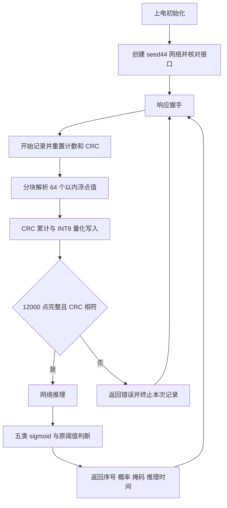

# 基于 STM32AI 的十二导联心电五类识别与部署项目

版本：完整正文，2026-10-14。本文按系统功能、数据流和工程依赖组织，模型实验按所解决的问题归类。

**当前编译部署版本为 100 Hz 单教师蒸馏轻量 CNN seed44 INT8。** 后续固件、串口联调和上板验收使用 seed44 的模型、训练标准化统计、量化参数和原部署阈值。seed43 INT8 保留为后续优化候选，尚未替换当前部署版本。

当前已有 seed44 的 VE 回退包及三个独立 VG 工程：A 文本仅推理、B 板端预处理＋推理、A 二进制 INT8 快速版。2026-10-11 在 COM8 完成 A 文本版小批真实回放：3 条不同记录加 1 次重复，芯片返回推理时间 1012–1013 ms，最大概率差约 3.006e−8。B 与 Fast 尚未实板验证；完整队列、栈峰值和长期稳定性仍待验收。原始记录和详细参数见[部署文档](STM32部署与串口验证.md#physical-inference-confirmation-20261011)及[发布说明](GitHub同步与实板验证.md)。

## 目录

1. [项目目标与任务定义](#part1)
2. [系统总体架构与软硬件分工](#part2)
3. [数据集、标签构建与数据划分](#part3)
4. [信号预处理与采样率选择](#part4)
5. [网络设计、训练策略与模型轻量化](#part5)
6. [性能评价与部署候选选择](#part6)
7. [ONNX 导出与 INT8 量化](#part7)
8. [STM32AI 转换、资源分析与 C 实现验证](#part8)
9. [STM32 固件设计与工程集成](#part9)
10. [上位机、串口协议与端到端联调](#part10)
11. [上板验证记录与后续验收](#part11)
12. [附录：配置、版本清单与证据入口](#appendix)

<a id="part1"></a>

## 1. 项目目标与任务定义

### 1.1 项目背景与边缘部署需求

本项目使用公开十二导联心电波形训练记录级识别模型，并将轻量模型转换为 STM32 可以执行的神经网络程序。课程交付的目标是形成可追溯的“真实波形回放—板端推理—结果返回—电脑展示”链路，说明模型效果和嵌入式资源之间的取舍。

边缘部署要求网络同时满足识别效果、算子支持、Flash、RAM 和通信接口约束。因此，电脑端最强网络可以作为教师，小型学生负责板端推理；网络参数少仍需经过实际转换与完整工程链接，才能判断部署空间。

### 1.2 输入、输出与分类任务

| 项目 | 当前 seed44 部署约定 |
| --- | --- |
| 输入来源 | PTB-XL 真实数据库记录，电脑预处理后回放 |
| 采样率与片段长度 | 100 Hz，10 秒，每导联 1000 点 |
| 导联顺序 | I、II、III、aVR、aVL、aVF、V1、V2、V3、V4、V5、V6 |
| 网络输入 | 训练 `[B,12,1000]`；单条导出 `[1,12,1000]` |
| 分类顺序 | NORM、MI、STTC、CD、HYP |
| 输出 | 五个 logits，图外分别计算 sigmoid 概率 |
| 判定 | 五类各自与自己的阈值比较，允许多个阳性或全部未达阈值 |

NORM 表示正常心电诊断，MI 表示心肌梗死，STTC 表示 ST/T 改变，CD 表示传导异常，HYP 表示肥厚诊断大类。任务按整条记录预测，不是逐心拍分类。五类概率无需相加为 1；界面不得以 softmax 或 argmax 取代独立判断。

### 1.3 系统功能与验收目标

电脑能够读取真实波形、显示导联、执行与训练一致的预处理并发送完整片段；STM32 能接收、量化和推理，返回五类概率、分类掩码与网络运行时间；电脑随后与相同模型的参考结果逐项比较。

验收覆盖模型版本一致性、输出一致性、完整固件资源、耗时、连续回放和异常恢复。当前以数据库回放完成板端推理验证，十二导联人体采集硬件不在本阶段交付范围内。

<a id="part2"></a>

## 2. 系统总体架构与软硬件分工

### 2.1 系统架构与完整数据流


训练链路生成冻结模型和配套参数；回放链路消费同一版本参数。每次替换模型都应重新形成整套部署包，避免只换 ONNX 而保留旧量化参数或阈值。

### 2.2 电脑端与 STM32 端的职责

| 模块 | 负责的工作 | 当前实现 |
| --- | --- | --- |
| 电脑数据处理 | WFDB 读取、单位与导联核对、片段滤波、冻结标准化 | Python 数据和信号处理模块 |
| 电脑模型开发 | 训练、验证、阈值、蒸馏、ONNX 与量化检查 | PyTorch、ONNX Runtime |
| STM32AI | 检查图、估算模型资源、生成网络 C 代码、转换验证 | ST Edge AI Core／STM32Cube.AI |
| STM32 固件 | 串口接收、CRC、逐块 INT8 量化、网络执行、后处理 | 标准外设库工程及生成网络库 |
| 电脑上位机 | 波形展示、握手、回放控制、结果核对和日志 | `start_ecg_student_viz.cmd` 对应 seed44 |

A 文本版在电脑完成片段预处理，STM32 逐块接收和量化；A Fast 在电脑量化后发送二进制 INT8。B 在 STM32 保存原始 10 秒片段，完成同一中值基线、前后向带通和冻结标准化，再量化推理。界面一次绘制一条所选导联，但发送全部十二导联。

### 2.3 开发平台与部署资源约束

最新硬件目标记录为 STM32F407VG：Cortex-M4F，最高 168 MHz，1 MiB Flash；片内 SRAM 包括 128 KiB 主 SRAM 与独立的 64 KiB CCM。CCM 与主 SRAM 分区寻址，不能作为一块连续 192 KiB 主内存使用；外设 DMA 缓冲不能直接放入 F407 的 CCM。[芯片资料](https://www.st.com/en/microcontrollers-microprocessors/stm32f407vg.html)、[RM0090](https://www.st.com/resource/en/reference_manual/dm00031020-stm32f10x-microcontrollers-stmicroelectronics.pdf)。

最初 seed44 发布工程按 F407VE 的 512 KiB Flash 限制编译，作为回退版本保留。现有 A、B、Fast 已分别生成 F407VG 独立工程并完整编译，沿用原参考工程的 8 MHz HSE、168 MHz 及 J-Link 配置。A 文本版完成小批真实推理；B、Fast 的实板和所有版本的完整稳定性验收仍待进行。芯片型号不能单独说明板载晶振频率。

<a id="part3"></a>

## 3. 数据集、标签构建与数据划分

### 3.1 PTB-XL 数据来源与组织

主数据为 PTB-XL v1.0.3，本地元数据为 21799 条记录、18869 名患者。数据库提供 10 秒十二导联波形、100 Hz 和 500 Hz 文件、诊断元数据以及官方患者划分。项目使用 `ptbxl_database.csv` 中的路径读取记录；100 Hz 读取 `filename_lr`，500 Hz 读取 `filename_hr`，不把目录残留文件自动纳入样本。[官方数据页](https://physionet.org/content/ptb-xl/1.0.3/)。

100 Hz 数据根目录为 `D:/datasets/ptb-xl`；本次高采样率实验的 500 Hz 原始文件另存于 `outputs/highrate_study_20261010/official_500hz`。新增下载仅包含官方 folds 1–9 所需的 19601 条记录，39202 个波形及头文件经过官方 SHA-256 核验。

训练集五类阳性数分别为 7596、4379、4186、3907、2119；筛选后训练集中多标签记录为 4127/17084，约 24.16%。HYP 阳性约占 12.40%，少于 NORM 的 44.46%，因此评价需同时给出宏平均和逐类结果。各类能够共现，阳性比例总和可超过 100%。

### 3.2 五类标签映射与样本纳入规则

代码解析每条 `scp_codes`，再根据 `scp_statements.csv` 的 `diagnostic` 与 `diagnostic_class` 映射到五个超类。已出现且属于目标诊断大类的代码使对应标签置 1；同类多个代码不重复计数。SCP likelihood 为 0 表示概率信息未知，不能以此删除已经出现的诊断代码。

本项目保留两套训练人群，采样率实验和 U-Net 研究均分别训练：

| 队列 | 纳入标准 | 全零标签处理 |
| --- | --- | --- |
| 筛选后 | 五个目标标签中至少一个为 1 | 排除没有任何目标超类的记录，保留排除清单 |
| 未筛选 | 保留官方划分内所有记录 | 五类全零仍以五个 0 参与训练和评价 |

筛选依据是任务标签覆盖，不是按预测错误删除难例；例如 PACE 与 MI 共现仍因 MI 阳性而保留。五类全零不自动代表正常，也不是经过临床确认的五类全部阴性。两人群的分母和任务范围不同，成绩须分别解释。

### 3.3 患者隔离与评价数据管理

| 集合 | 官方 folds | 未筛选记录 | 筛选后记录 | 使用范围 |
| --- | --- | --- | --- | --- |
| 训练 | 1–8 | 17418 | 17084 | 梯度更新、均值/标准差、正类权重、量化校准 |
| 验证 | 9 | 2183 | 2146 | 早停、检查点、模型和逐类阈值选择 |
| 历史测试 | 10 | 2198 | 2158 | 保存历史探索成绩，当前不据此继续选模 |

同一患者的记录、多导联和增强副本跟随官方划分。项目已有记录 ID、患者 ID、路径隔离审计；100 Hz 精确 `.dat` 重复扫描未发现跨集合精确重复，但尚未覆盖所有近似重复或患者标识误差。

历史研发中 fold 10 已反复评价，且部分追加研究受历史测试反馈影响。现有 fold 10 成绩只能解释为历史探索结果；近期只用 fold 9 重做选模，不能恢复 fold 10 的独立性。高采样率及 U-Net 新实验未做新 fold 10 推理。若后续需要独立泛化结论，应另行预先冻结评价方案及未参与研发的数据。

<a id="part4"></a>

## 4. 信号预处理与采样率选择

### 4.1 波形读取、导联顺序与输入张量

WFDB 读取物理信号后，检查单位 mV、采样率、12 导联名称、10 秒长度及有限值，按固定顺序排列导联。100 Hz 原波形由 `[1000,12]` 转为 `[12,1000]`；序列化时按导联依次展开：先 I 导联 1000 点，再 II 导联，直到 V6。

原始 mV 波形、滤波结果、标准化输入和量化输入分别处于不同处理阶段，缓存必须注明阶段。不能把已标准化缓存再做一次标准化，也不能把 ADC 原始计数直接作为当前网络输入。

### 4.2 当前 seed44 的去基线、滤波与标准化

seed44 输入处理依次为：0.2/0.6 秒串联中值基线估计与去除；0.5–40 Hz 四阶 Butterworth 零相位带通；训练集逐导联全局标准化。`notch_hz=null`。100 Hz 的 Nyquist 频率为 50 Hz，当前没有另设计 50 Hz 陷波。

每条导联使用该模型训练集拟合的均值与标准差：

$$x'_{c,t}=\frac{x_{c,t}-\mu_{c,train}}{\sigma_{c,train}}$$

验证、历史测试、外部数据和部署均复用冻结统计，不能重新按单条记录拟合 Z-score 或 min-max。附录保存 seed44 的十二组统计量。根目录默认配置仍有早期记录内 Z-score 设置，不能用默认文件覆盖已冻结学生参数。

零相位滤波依赖完整片段，当前属于电脑离线回放预处理。网页中的 R 峰、心率和 HRV 为辅助分析，不进入该五标签网络输入；10 秒片段的 HRV 显示也不用于证明分类效果。

### 4.3 100、250、500 Hz 的性能与部署取舍

本次只新增 250 与 500 Hz 训练，100 Hz 复用已有权重并重算验证成绩。250 Hz 对官方 500 Hz 原始 mV 波形使用 `resample_poly(up=1, down=2, window=('kaiser',8.6), padtype='line')`；其低通步骤用于降低混叠。[SciPy 方法说明](https://docs.scipy.org/doc/scipy/reference/generated/scipy.signal.resample_poly.html)。500 Hz 保留原始采样率，两组都未额外加中值去基线、带通或陷波，之后各自用训练集全局标准化。

共完成 10 次新训练：250 Hz 的 CNN、紧凑 Inception、InceptionTime 各在两训练人群训练，共 6 次；500 Hz 仅训练 CNN 和紧凑 Inception 的两人群版本，共 4 次。500 Hz InceptionTime 未完成训练，不能填入结果。所有新增运行为 seed42、30 轮上限、早停 8；两组训练人群各自在自己的原生 fold 9 选择检查点和阈值。

下表是 **FP32、原生验证人群、Macro F1（%）**；筛选后在 2146 条上评价，未筛选在 2183 条上评价。这里的 100 Hz CNN 是监督模型参照，不是当前 seed44 蒸馏固件。

| 训练／验证人群 | 网络 | 100 Hz | 250 Hz | 500 Hz |
| --- | --- | --- | --- | --- |
| 筛选后 | 监督 CNN | 75.566 | 75.430 | 75.210 |
| 筛选后 | 紧凑 Inception | 76.133 | 76.075 | 76.147 |
| 筛选后 | InceptionTime | 76.540 | 75.831 | 未做匹配实验 |
| 未筛选 | 监督 CNN | 72.024 | 74.960 | 74.874 |
| 未筛选 | 紧凑 Inception | 75.119 | 75.882 | 75.606 |
| 未筛选 | InceptionTime | 未做匹配实验 | 75.761 | 未做匹配实验 |

相应 **Macro Recall（%）** 如下：

| 训练／验证人群 | 网络 | 100 Hz | 250 Hz | 500 Hz |
| --- | --- | --- | --- | --- |
| 筛选后 | 监督 CNN | 79.300 | 78.466 | 77.420 |
| 筛选后 | 紧凑 Inception | 79.192 | 80.282 | 80.636 |
| 筛选后 | InceptionTime | 79.434 | 81.857 | — |
| 未筛选 | 监督 CNN | 74.429 | 78.567 | 79.237 |
| 未筛选 | 紧凑 Inception | 79.114 | 77.557 | 78.011 |
| 未筛选 | InceptionTime | — | 81.249 | — |

筛选后 InceptionTime 的 250 Hz Macro Recall 相对 100 Hz 增加约 2.423 个百分点，HYP Recall 增加约 5.970 个百分点；同时 Precision 下降约 3.134 个百分点，F1 下降约 0.708 个百分点。未筛选 CNN 的 250/500 Hz Recall 相对原 100 Hz 参照增加约 4.138/4.808 个百分点，但该 100 Hz 参照使用记录内标准化，新模型使用训练全局标准化，不能将全部变化归因于采样率。

500 Hz 相对 250 Hz 的 F1 变化，按筛选 CNN、未筛选 CNN、筛选紧凑 Inception、未筛选紧凑 Inception 顺序，约为 −0.221、−0.086、+0.071、−0.277 个百分点；保存的患者级配对 bootstrap 区间均包含 0。这些区间固定已选模型、预测和阈值，只描述当前验证记录的条件不确定性，未覆盖随机种子、选模或阈值搜索的不确定性。

100 Hz 与高采样率方案还存在滤波、部分训练预算、标准化差异；卷积核和步幅按采样点保持不变时，实际秒数感受野也改变。因此这是输入方案及当前网络实现的比较，不能作为只改变采样率的严格因果实验。资源部分见第 8 章。

### 4.4 训练与部署输入一致性

当前固件只接受 `[12,1000]`、共 12000 个值。250/500 Hz 的 10 秒输入分别为 30000/60000 个值，必须同步更新上位机形状检查、固件常量、模型代码、量化参数、阈值、握手及部署清单，重新编译与联调。

当前课程部署继续使用 **100 Hz seed44 INT8**。250 Hz CNN 保留为研究备选；500 Hz 在当前结构下增加内存、运算和通信成本，未显示稳定的 F1 优势，暂不进入主部署方案。

<a id="part5"></a>

## 5. 网络设计、训练策略与模型轻量化

### 5.1 网络方案与角色分工

| 网络 | 项目实现参数量 | 角色与已验证范围 |
| --- | --- | --- |
| 轻量 CNN | 111557 | 监督基线、蒸馏学生；seed44 已形成完整 INT8 固件 |
| ResNet1D | 450885 | 残差基线、标准化和内部留出比较；旧部署对照 |
| 紧凑 Inception | 267749 | 多尺度卷积；当前 seed44 的冻结教师 |
| CNN + BiGRU | 114693 | 时序对照；板端算子与完整资源未作为当前部署验证 |
| InceptionTime | 492421 | 较强教师和性能对照；seed43 优化候选的教师 |
| SE-ResNet18 | 2214977 | 深层注意力对照，未胜出相应验证选择 |
| Ribeiro 100 Hz 适配 | 2139109 | 文献结构适配对照，未成为部署主线 |
| 1D U-Net／编码器对照 | 579053／372053 | 两人群、三种子研究；仅训练与 fold 9 评价 |

这里列出的是本项目实现，InceptionTime 的单网络、U-Net 的记录级分类头以及 Ribeiro 的 100 Hz 适配各有改动，不能称为原论文完整复现。参数量用于初筛；激活峰值、算子和完整固件是最终资源依据。

当前 CNN 由四个 Conv1D—BatchNorm—ReLU—MaxPool 模块、全局平均池化和五输出线性层组成：

| 阶段 | 输入/输出通道 | 卷积核与步幅 | 100 Hz 输入下池化后长度 |
| --- | --- | --- | --- |
| 模块 1 | 12 → 32 | kernel 15，stride 2 | 250 |
| 模块 2 | 32 → 64 | kernel 7，stride 1 | 125 |
| 模块 3 | 64 → 128 | kernel 5，stride 1 | 62 |
| 模块 4 | 128 → 128 | kernel 3，stride 1 | 31 |
| 分类头 | 128 → 5 | 全局平均池化、dropout 0.2、线性层 | 五个 logits |

卷积沿时间提取各导联的联合形态，逐级池化缩短序列；全局池化避免长序列 Flatten 带来的大型全连接层。推理使用评价模式，关闭 dropout。

### 5.2 多标签训练与类别不平衡处理

训练使用 `BCEWithLogitsLoss`，对五类独立二元目标计算损失。正类权重仅从当次训练集计算：

$$w_c=\frac{N_{train}-n_{c,+}}{n_{c,+}}$$

筛选后正类权重依次为 `[1.249079,2.901347,3.081223,3.372664,7.062294]`。权重作用于阳性损失项，与优化器的 weight decay 不同。内部患者留出时，必须用当折训练记录重新拟合统计和权重。

seed44 学生配置为 AdamW、学习率 0.001、weight decay 0.0001、batch 32、最多 30 轮、早停 8、AMP、随机种子 44。最佳 checkpoint 按验证宏 AUROC 改善超过 1e−4 保存，再使用验证集完成阈值和学生候选选择。历史基线部分采用 20 轮／早停 5，不能统一写成同一训练预算。

### 5.3 面向效果改善的训练策略

训练全局标准化是已有较稳定证据的改动：早期四组患者内部留出中，global ResNet 相对原记录内标准化 ResNet 的平均 F1 增加约 3.018 个百分点，四组均胜出。这属于该对照条件下的内部证据，不直接等同于当前蒸馏 CNN 的增幅。

其他实验包括完整／平方根／无正类权重、ASL、Mixup、温和增益与噪声、更长训练策略、平均/最大池化和较强教师。收益依赖数据队列和网络，未形成所有方法都提升的结论。0.2/0.6 秒基线与 0.5–40 Hz 带通的预处理对照保留 P0；白噪声研究中，加噪学生 INT8 的干净表现下降，未替换当前 seed44 包。

U-Net 已完成两结构×两人群×三种子的 12 次训练。原生验证 F1 三种子均值：筛选后 U-Net 75.778%、编码器 75.293%；未筛选 U-Net 75.023%、编码器 75.014%。解码器的收益不稳定，且总参数量不同；尚无 ONNX、INT8、STM32AI 或完整固件结果，因此保留为结构研究，不继承学生部署资源。

### 5.4 知识蒸馏与轻量学生模型

教师生成与训练记录 ID、顺序逐条对齐的五类 logits，学生同时学习真实标签和教师软目标。教师参数冻结，不用验证或历史测试记录训练学生。代码将教师软目标视为五个独立 Bernoulli 概率：

$$L_{KD}=T^2\operatorname{BCEWithLogits}(z_s/T,\sigma(z_t/T)),\qquad L=(1-\alpha)L_{hard}+\alpha L_{KD}$$

当前 seed44 设置 `alpha=0.5`、`temperature=2`；教师为 `outputs/optimization/optimized_best.pt` 的紧凑 Inception，参数 267749。普通 CNN 与蒸馏 CNN 保持 111557 个参数，通过种子 42/43/44 的训练与验证选择形成 seed44。蒸馏改变训练目标，不增加板端网络层。

后续 seed43 使用 InceptionTime 单教师，具有另一套检查点、导出图和阈值。两次教师、种子和选择流程不同；不能将 seed43 的教师或成绩写成当前 seed44 固件的来源。

<a id="part6"></a>

## 6. 性能评价与部署候选选择

### 6.1 整体与逐类指标

每类分别计算 TP、FP、FN、TN，并得到 Precision、Recall 与 F1；Macro 指标为五类等权平均，避免大类完全主导结果。AUROC 评价概率排序，AUPRC 对阳性较少类别更有参考价值；它们与固定阈值下的分类结果不同。

$$Precision_c=\frac{TP_c}{TP_c+FP_c},\quad Recall_c=\frac{TP_c}{TP_c+FN_c},\quad F1_c=\frac{2TP_c}{2TP_c+FP_c+FN_c}$$

**当前 seed44 INT8、原部署阈值、筛选后 fold 9 的逐类结果**如下；Precision、Recall、F1 单位为 %。

| 类别   | 验证阳性数 | 原阈值  | Precision | Recall | F1     | AUROC    |
| ---- | ----- | ---- | --------- | ------ | ------ | -------- |
| NORM | 955   | 0.55 | 82.105    | 89.843 | 85.800 | 0.946334 |
| MI   | 540   | 0.60 | 73.498    | 77.037 | 75.226 | 0.933733 |
| STTC | 528   | 0.55 | 71.812    | 81.061 | 76.157 | 0.931518 |
| CD   | 495   | 0.75 | 79.915    | 76.364 | 78.099 | 0.937253 |
| HYP  | 268   | 0.65 | 64.516    | 59.701 | 62.016 | 0.908551 |

这些是数据库验证成绩，板上后续核对的是转换后输出能否保持一致。HYP Recall 约 59.701%，是当前原阈值下的限制，应与整体 F1 一并报告。

### 6.2 阈值选择与两队列评价

每类独立选择阈值。阈值降低通常提高 Recall 并增加误报，因此 Recall 的升高须结合 Precision 和 F1 判断。原 seed44 部署阈值已冻结为 `[0.55,0.60,0.55,0.75,0.65]`，当前 HEX 沿用它；后续细网格研究结果另行保存。

同一验证集若既用于选模型又用于选阈值，其成绩属于选择后验证结果。筛选与未筛选人群可以有不同阈值规则：U-Net 分别按两验证人群校准；高采样率实验仅在训练人群对应的原生验证队列选择一组阈值，再原样用于两队列评价。比较时注明具体规则，不能将跨队列结果混排成同一排行榜。

### 6.3 当前部署版本与后续候选

以下均在筛选后 fold 9 的 2146 条记录上评价，前三项指标单位为 %：

| 模型与判定版本 | 阈值 | Precision | Recall | Macro F1 | Macro AUROC |
| --- | --- | --- | --- | --- | --- |
| seed44 FP32／原部署阈值 | [0.55,0.60,0.55,0.75,0.65] | 74.581 | 77.221 | 75.771 | 0.931372 |
| seed44 INT8／原部署阈值（当前固件） | [0.55,0.60,0.55,0.75,0.65] | 74.369 | 76.801 | 75.459 | 0.931478 |
| seed44 INT8／研究细阈值 | [0.55,0.55,0.53,0.72,0.63] | 73.232 | 78.440 | 75.683 | 0.931478 |
| seed43 INT8／自身细阈值（候选） | [0.68,0.45,0.61,0.57,0.78] | 73.902 | 78.179 | 75.893 | 0.931362 |

当前固件对应 seed44 INT8 的 **F1 75.459%、Recall 76.801%**，使用原部署阈值。研究细阈值把同一 INT8 图的 F1 调整到 75.683%、Recall 到 78.440%，尚未同步现有 HEX。两行数值不同的原因是判定阈值不同，并非两份学生权重。

seed43 的细阈值验证 F1 75.893%，相对 seed44 同口径细阈值高约 0.210 个百分点，Recall 低约 0.261 个百分点。seed43 仅完成 ONNX／INT8 和 fold 9 核对，未生成新的完整固件，也未完成实板或外部验证。本项目当前编译部署继续使用 seed44。

250 Hz 监督 CNN INT8 在筛选后 fold 9 的 F1 为 75.015%，资源估算可容纳，保留作高采样率研究备选。500 Hz 的完整工程估算和收益不足以支持当前切换。较大教师优先留电脑端；部署选择须同时满足效果、量化质量、算子、资源和完整链路验证。

### 6.4 历史测试与外部验证的适用范围

seed44 使用原部署阈值在筛选后历史 fold 10 的 2158 条记录上，INT8 宏 AUROC 为 0.924276、F1 为 74.944%、Precision 为 74.243%、Recall 为 75.959%。它是历史探索成绩，不能称为新盲测或板端实测。最新候选没有可继承的独立测试成绩。

旧 seed44 在 Chapman–Shaoxing–Ningbo 冻结外部检查中，明确阳性 Recall 为 MI 93.66%、STTC 77.31%、CD 67.35%、HYP 78.91%，四类平均约 79.31%。外部诊断列表不提供可靠完整阴性，NORM 未计分；该主结果不能写成完整五类外部 F1 或临床泛化证明。外部输入按 header 对齐 mV、导联和 100 Hz，并使用原模型统计。seed43 和 U-Net 尚无相应外部结果。

<a id="part7"></a>

## 7. ONNX 导出与 INT8 量化

### 7.1 冻结模型与导出输入输出

从 seed44 最佳 checkpoint 导出评价模式的 FP32 ONNX，固定单条输入 `[1,12,1000]`，输出 `[1,5]` logits。预处理与 sigmoid／阈值后处理位于图外，导出图不能直接接收任意未经处理的心电数据。

同时保存 checkpoint SHA-256、ONNX SHA-256、导联顺序、标签顺序、预处理配置、训练均值/标准差、阈值和校准记录 ID。部署清单负责把这些产物绑定到同一版本，文件名相同并不代表内容相同。

### 7.2 PyTorch 与 ONNX 输出核对

原 seed44 的 128 条 fold 9 参考样本中，PyTorch 与 FP32 ONNX 的最大 logits 绝对误差约 `4.7684e−6`，平均约 `5.7226e−7`；保存报告按 `rtol=2e−4、atol=1e−5` 通过。转换后还需比较概率和阈值判断，不能只确认 ONNX 文件能加载。

### 7.3 训练集校准与 INT8 参数

seed44 采用静态 QDQ INT8 量化，权重为有符号对称逐通道、激活为有符号非对称逐张量。256 条校准样本仅来自筛选后训练 folds 1–8，校准种子 20260926；验证记录用来评价量化影响，不参与校准。

STM32AI 生成网络的外部输入为 S8，输出为五个 float logits。当前输入参数为 `scale=0.2008364498615265`、`zero_point=0`。板端逐块计算：

$$q=\operatorname{clip}(\operatorname{round\_to\_nearest\_even}(x'/scale)+zero\_point,-128,127)$$

这里 `x'` 是训练全局标准化后的值。舍入采用最近偶数，与参考量化器一致；输入饱和到 INT8 范围。量化 scale 不能替代标准化的十二组标准差。

### 7.4 量化效果与版本冻结

seed44 在同一原部署阈值下，验证 FP32 F1 为 75.771%、INT8 为 75.459%，下降约 0.311 个百分点；逐标签判断一致率约 99.450%。FP32 与 INT8 最大概率差约 0.099371、平均约 0.005399，最大差不能用平均误差掩盖。

高采样率 CNN 使用 128 条对应训练队列样本校准，完整 fold 9 INT8 评价复用其 FP32 阈值，没有重新搜阈值。单位为 %：

| 训练／原生验证人群 | Hz | FP32 Macro F1 | INT8 Macro F1 | INT8 Macro Recall |
| --- | --- | --- | --- | --- |
| 筛选后 | 250 | 75.430 | 75.015 | 77.916 |
| 筛选后 | 500 | 75.210 | 75.007 | 77.614 |
| 未筛选 | 250 | 74.960 | 74.764 | 78.759 |
| 未筛选 | 500 | 74.874 | 74.608 | 78.901 |

高采样率 Inception 的 INT8 图仅用 32 条训练样本作资源筛查，未完成全验证集量化评价。8 条训练校准样本执行检查中，250 Hz InceptionTime 最大概率差达 0.665142，故这份 INT8 图不列为可用部署候选；FP32 成绩不能当成它的 INT8 成绩。量化筛查图、已评价模型和完整固件分别记录。

<a id="part8"></a>

## 8. STM32AI 转换、资源分析与 C 实现验证

### 8.1 STM32AI 的转换流程

项目使用 STM32AI／ST Edge AI Core 导入 ONNX：`analyze` 检查网络和资源，`generate` 生成网络 C/H、权重和相关配置，`validate` 用相同参考输入核对生成实现。电脑端 host 验证与 STM32 target 验证是不同阶段。[ST CLI 说明](https://stm32ai-cs.st.com/assets/embedded-docs/command_line_interface.html)。

seed44 发布记录的工具版本为 `ST Edge AI Core v2.2.0-20266 2adc00962 / STM32CubeAI 10.2.0-RC1`。重生成时记录实际版本、目标、模型哈希和完整输出；旧模型检查脚本会按文件存在复用部分产物，不能把复用旧结果写成一次新的强制转换。

### 8.2 模型权重、激活与计算量

权重主要占 Flash；激活区、协议缓冲和栈占 RAM。MACC 表示乘加量，用于比较计算规模，不能直接换算板上毫秒数。ONNX 文件字节数包括图和元数据，也不等于 STM32 权重或完整固件 Flash。

下表权重、激活和 MACC 来自实际 STM32AI 报告；250/500 Hz 的完整主 SRAM 列借用旧学生的非模型开销估算，尚无新固件链接。大教师的这一列只作粗略筛查，激活自身已足以判断片内 RAM 不够。

| 网络 | Hz | INT8 权重 B | 激活 B | MACC | 完整主 SRAM B |
| --- | --- | --- | --- | --- | --- |
| CNN（seed44） | 100 | 112276 | 24000 | 14698207 | 43672（已编译） |
| 监督 CNN | 250 | 112276 | 60000 | 36773063 | 79672（估算） |
| 监督 CNN | 500 | 112276 | 120000 | 73586207 | 139672（估算） |
| 紧凑 Inception | 250 | 272564 | 720000 | 201212967 | 739672（估算） |
| 紧凑 Inception | 500 | 272564 | 1440000 | 402512415 | 1459672（估算） |
| InceptionTime | 250 | 498708 | 2155488 | 1242347383 | 2175160（估算） |

seed44 100 Hz INT8 完整固件资源为 Flash 158876 B、主 SRAM 43672 B，含 8192 B 栈。相对 VE 的 524288 B Flash、131072 B 主 SRAM，剩余分别为 365412 B、87400 B，静态空间足够。若仅按 VG 的 1 MiB Flash 容量计算剩余为 889700 B，但这是容量对照，不能当成已完成 VG 链接。

旧完整 SRAM 中模型激活为 24000 B，其他开销为 `43672−24000=19672 B`。沿用此开销时，250 Hz CNN INT8 估算为 `60000+19672=79672 B`，主 SRAM 余量 51400 B；500 Hz 估算为 `120000+19672=139672 B`，超出主 SRAM 8600 B。模型激活报告已含分配在其中的输入输出，不能重复把输入或完整固件资源相加。

CNN 从 100 Hz 到 500 Hz 的激活约增至 5 倍、MACC 约增至 5 倍，权重基本不随时间长度增加。250/500 Hz CNN FP32 激活分别为 240000/480000 B，激活自身已超过 192 KiB 总片内 SRAM。紧凑 Inception 的 100 Hz INT8 激活也为 288000 B，不能把其不能部署全部归因于 500 Hz。

500 Hz CNN 的激活本身仍低于主 SRAM 容量；理论上将 8192 B 栈和 2048 B CPU 行缓冲移入 CCM，能覆盖估算缺口，但主 SRAM 仅剩约 1640 B。这只是布局分析，尚未修改链接配置或生成 500 Hz 固件，不能保证栈峰值和完整工程足够。当前串口接收中断、发送轮询，未来若改 DMA，DMA 缓冲仍应留主 SRAM。

资源与成绩共同支持：**500 Hz 不适合作为当前 F407 工程的默认输入方案，100 Hz seed44 INT8 更适合本阶段部署。** 该结论限定于已测网络、10 秒输入和现有工程；不推导所有 500 Hz 网络都无法部署。


当前三个 VG 独立工程的完整编译资源如下，均含栈与固件其他开销；A Fast 使用独立二进制协议。B 和 Fast 的空间来自链接结果，尚未取得实板耗时。

| VG 工程 | 完整 Flash B | 完整主 SRAM B | 当前实板范围 |
|---|---:|---:|---|
| A 文本，仅推理 | 158876 | 43672 | 已完成小批真实回放 |
| B，板端预处理＋推理 | 162420 | 108368 | 待实板 |
| A Fast，二进制 INT8 | 153040 | 40664 | 待实板 |

详细包与入口见[GitHub发布说明](GitHub同步与实板验证.md)。

### 8.3 网络 C 代码与运行库生成

网络文件包括接口、结构、权重和激活配置，运行库与目标工具链配套。固件为激活区设置对齐，并通过生成接口取得输入输出地址，避免另建重复网络输入区。

初始化检查输入格式 S8、长度 12000、输出格式 float、长度 5，然后创建网络并挂接协议。协议将量化样本直接写到网络输入地址，全部片段通过 CRC 后执行 `ai_ecg_network_run`，读取 logits 并计算独立 sigmoid。

### 8.4 主机 C 与 ONNX 一致性验证

seed44 在 2026-10-03 强制重新生成并做 `validate --mode host`，128 条参考波形的 C 模型与 INT8 ONNX logits RMSE、最大误差均为报告值 0，冻结阈值逐标签一致率 100%；输出与学生串口样本参考相符。

同批 128 条记录经过实际 C 协议解析器的分块、CRC、回复模拟，分类与电脑 C 参考一致。该结果证明抽样转换和协议路径，A 文本版的小批板端计算与串口已在第 11 章记录，B／Fast、时钟精确校准、完整队列和稳定性仍待验证。报告的零误差仅适用于这次工具、模型和抽样范围。

<a id="part9"></a>

## 9. STM32 固件设计与工程集成

### 9.1 芯片、启动、时钟与工程配置

现有学生完整工程使用标准外设库、Keil ARMCC 5.06 update 4；发布构建为 0 错误、0 警告。配置为 8 MHz 外部晶振、168 MHz 主频，网络、协议和 USART1 一并编译。项目中的界面 CLOCK 字段不能代替启动代码的 HSE/PLL 实际设置。

现有 VG 工程已经完成 Device、Flash、下载算法、时钟及调试配置的适配，并分别完整编译。`package_serial_demo.py` 已支持显式选择 VE／VG，默认参数仍为 VE；生成新 VG 工程时传入明确目标，避免沿用旧默认配置。任何新板仍需按实物核对晶振、引脚和下载设置。

### 9.2 模型初始化与推理流程

启动时初始化时钟、串口和 1 ms SysTick，再初始化激活池与网络句柄。主循环接收整行协议并处理；串口中断负责收字节，浮点解析、CRC、量化和网络运行放在主循环。



只在完整输入通过检查后运行模型。网络返回批次数不是 1、或 logits 非有限值时，回复错误，不用上一条有效结果代替本次输出。

### 9.3 内存分配与完整工程资源

当前资源统计取链接 map 的 Total ROM Size 和 Total RW Size。Flash 包含网络权重、代码、常量和初始化数据；RAM 包含模型激活、协议状态、串口/行缓冲、全局变量和栈预留。不得再把 112276 B 权重或 24000 B 激活叠加到完整工程数字。

学生工程曾将栈从 1024 B 调整为 8192 B：静态已知调用链至少 1504 B，主要涉及 `strtof`，另有无法完整静态估计的回调路径。当前 8192 B 是预留容量，实际峰值仍需板端测量。VG 适配重新链接后，保存新的 map 和栈配置，不能直接沿用旧资源作为新构建测量。

### 9.4 串口接收与异常处理

固件采用每块最多 64 个浮点值，行容量 2048 B；检查请求序号、连续 offset、count、总量、数值有限性和完整记录 CRC。错误类型包括格式、无活动传输、序号、位置/数量、浮点值、额外值、CRC/不完整、网络未就绪和推理失败。

接收约 5 秒没有进展时终止当前传输；重新发送 `$B` 可以开始新记录。主循环负责超时和解析。电脑等待 ACK 后才继续发块，以降低接收缓冲溢出的风险；实际板端仍需验证超时、断线和异常后的恢复行为。

### 9.5 完整编译与部署包

**当前使用 seed44 INT8**。现有 HEX 为 `outputs/board_release/seed44_int8_stm32f407ve/ECG_Student_INT8_STM32F407VE.hex`；发布包包含源码 ZIP、使用说明和 `release_manifest.json`，源码内包含启动、外设、模型和运行库。

已有发布审计核对 HEX 行校验和、地址范围、模型和检查点哈希、源码 ZIP 完整性及工程引用。HEX 从 `0x08000000` 起，已记录范围不越过 VE 的 512 KiB Flash。现有 VG A／B／Fast 各自保存独立版本与清单，原 VE 包保留。

模型、原部署阈值、训练标准化、量化参数和串口清单必须配套。seed43 尚无完整固件，不能把它的 ONNX 复制进 seed44 包后沿用旧 HEX、旧资源或旧转换报告。

<a id="part10"></a>

## 10. 上位机、串口协议与端到端联调

### 10.1 波形回放与展示

从项目根运行 `start_ecg_student_viz.cmd`，它明确加载 seed44 的 `serial_manifest.json`。上位机从 128 条 fold 9 演示样本中选择记录，显示原始/处理波形、标签与模型结果，并发送完整十二导联输入。

项目另有 Streamlit 页面和 API，默认模型与学生固件独立。课程板端联调以学生启动器为入口；旧 ResNet 启动器使用另一套模型参数。连接前先核对清单，不以网页模型结果替代 seed44 INT8 参考输出。

### 10.2 通信参数与数据协议

串口配置为 USART1、115200、8N1、无流控、3.3 V TTL、共地：

| STM32 | USB 转串口 |
| --- | --- |
| PA9／TX | RX |
| PA10／RX | TX |
| GND | GND |

协议逐行以 CRLF 结束，数据按导联优先顺序展开：

| 命令 | 用途 | 回复 |
| --- | --- | --- |
| `$P` | 查询模型、输入形状、标签顺序、阈值和 ready | JSON `hello` |
| `$B,seq,12000` | 开始一条记录 | JSON `begin` |
| `$D,seq,offset,count,x1,...` | 发送最多 64 个浮点值 | JSON `ack`，包含 next |
| `$R,seq,crc32` | 核对总量与 CRC，执行推理 | JSON `result` |

CRC32 与 Python `zlib.crc32` 一致，针对展开后的 little-endian float32 原始字节；ASCII 使用 9 位有效数字用于 float32 往返。结果包含 seq、五个 probabilities、mask、inference_ms。mask 的 bit 0–4 依次为五类，例如 10 表示 MI 与 CD 同时阳性；mask 为 0 时显示“无标签达到阈值”。

A 原文本握手检查模型哈希、形状、类别和阈值，未完整覆盖量化参数和预处理指纹；B 增加协议和预处理哈希，Fast 协议 3 另核对量化参数。当前包清单参数相符；正式上板前应人工核对这些参数，后续完善握手。协议检查不足不能写成已经发生参数错配。

### 10.3 电脑参考与板端输出核对

参考基准使用同一 seed44 INT8 图和冻结输入，优先采用已核对的电脑 C 模型／串口样本参考。逐条保存记录 ID、实际输入、参考概率、板端概率、每类误差、阈值及分类掩码，检查返回 seq 与请求相符。

数值误差和标签一致性分开统计，接近阈值的记录单独列出。不通过时依次排查版本、预处理、展开顺序、串口往返、舍入、量化饱和和网络实现，不能重新调阈值掩盖板端不一致。

### 10.4 模拟联调与真实串口验证

已完成电脑 C 模型及协议模拟；学生发布记录的串口协议回归为 12 项通过。本次文档完善未重新执行这些历史构建或训练。模拟连通、日志里的模拟时间或导出的 HEX 都不能当成真实板端结果。

时间分成电脑预处理、串口传输/ACK、板端解析/量化、网络运行及完整回放。现有 `inference_ms` 只包围网络执行，基于 1 ms SysTick；60 秒是电脑等待结果上限，不是推理耗时。真实测速需记录主频、计时范围和样本量。

115200/8N1 下仅二进制 FP32 数据的理想传输下限，100/250/500 Hz 为 4.17/10.42/20.83 秒；当前 ASCII 协议更慢。按 8 条实际波形估算，250/500 Hz 仅数据包线速时间中位数约 33.26/66.60 秒，未含 ACK、解析或推理，属于估算。二进制 INT8 传输可减小负担，但当前未实现，不能记成已有功能。

<a id="part11"></a>

## 11. 上板验证记录与后续验收

本章记录已完成的 A 文本版小批实板核对，并保留后续批量、B 和 Fast 验收步骤。VG 独立工程已经生成并编译，原 VE 包保留。2026-10-11 的验证没有重新烧录固件，直接读取了现有板上 A 版本；不能由此推导 B 或 Fast 已完成烧录。

### 11.1 上板前确认与 VG 工程适配

1. 根据芯片丝印、板型和原理图记录 MCU 完整型号、供电、晶振、SWD 及 USART1 引脚，确定 PA9/PA10 没有与其他板载功能冲突。
2. 保留现有 VE HEX、源码 ZIP、map 和发布清单。以 seed44 为模型，适配 VG Device、启动和 Flash/链接区域、下载算法，核对 HSE 与 PLL；使用工程生成脚本显式指定 VG 目标；现有三个 VG 工程已经完成该适配。
3. 核对 ONNX 哈希、输入 `[12,1000]`、原阈值、scale、zero point、导联和十二组训练统计。补充握手参数或至少将人工核对记录存入部署清单。
4. 完整重新编译，保存编译日志、map、HEX 和哈希，检查错误/警告、Flash 地址、主 SRAM、栈预留和工程依赖。只修改芯片文字不算目标适配完成。

### 11.2 下载、启动与单样本回放

1. 使用 ST-LINK／SWD 和 STM32CubeProgrammer 或 Keil 下载匹配工程的 HEX，保存烧录与校验结果，复位运行。
2. USART1 按前章接线，选择实际 COM 口；发送 `$P`，确认 ready、模型哈希、shape、类别和原部署阈值。收到模型不符或未就绪时停止样本发送并检查固件。
3. 先发送固定样本 0，核对请求序号、ACK、总量、CRC 与五类结果；同时保存电脑 C 参考和板端回复。之后增加不同标签与阈值附近样本。

在项目根执行，COM7 替换为实际端口，结果保存到本次真实板端输出目录：

```powershell
.\start_ecg_student_viz.cmd
.\start_ecg_student_viz.cmd --headless --port COM7 --sample 0 --result-file outputs/board_release/seed44_int8_stm32f407ve/physical_serial_result.json
```

当前新增实板验证日志已记录折数、来源、模型和样本哈希、协议、预处理位置、阈值及参考/板端结果；正式验收继续配套保存对应 HEX 清单。新 VG 构建应使用独立结果目录，并由启动参数显式绑定同一 seed44 模型清单；命令输出文件名本身不证明实板验证。

### 已完成：A 文本版实板核对

2026-10-11 使用真实 COM8、115200/8N1，协议 1、preprocessing=host，握手模型哈希与 seed44 INT8 相符。回放 ECG 9、38、21826、重复 ECG 9；分别返回 1013、1013、1013、1012 ms，最大概率差分别约 1.502e−8、1.884e−9、3.006e−8、1.502e−8。完整收发 16.50–16.97 秒，包含文本传输、ACK 和推理。

独立测量最终推理命令至 result 的往返为约 1042.89–1046.14 ms，支持网络实际占用约 1 秒。四条回放的数值一致性不等于全测试集准确率或稳定性验收；全零输入仅用于计时探针，不计分类成绩。

- [原始实板回放](../outputs/serial_samples/seed44_fold10/physical_inference_check_20261011_103033.json)
- [独立计时记录](../outputs/serial_samples/seed44_fold10/physical_timing_audit_20261011_103850.json)

### 11.3 批量一致性、耗时与稳定性

先对已有 128 条冻结演示样本逐条回放，记录成功、失败、最大/平均概率误差和逐标签一致率。它们来自 fold 9，用途是转换与板端一致性，不算独立分类测试。随后重复回放，覆盖多标签和阈值附近记录。

计时分别统计传输、板端输入处理、网络推理和总流程，至少报告样本量、中位数、均值、最大值与计时方法。现有 SysTick 适合毫秒粗测；若需要更细的网络时间，可增加 DWT 周期计数并记录主频换算，此功能待实现。

测量栈高水位、主 SRAM 余量和连续运行状态，检查初始化失败、超时、不完整记录、错误 CRC、断开重连及复位后的恢复。连续回放建议先安排 1000 次作为工程稳定性检查，报告实际完成次数和错误明细；不能由静态 RAM 余量推导长期稳定性。

### 11.4 验收条件与结果归档

以下为完整工程验收条件。A 文本版已经有小批实测记录，128 条批量、B／Fast 及连续稳定性尚未完成：

| 项目 | 建议验收条件 | 当前状态 |
| --- | --- | --- |
| 版本与输入 | seed44 INT8、原阈值、输入/导联/预处理/量化参数全部与冻结清单相符 | 冻结包与 A 实板握手已核对；完整参数和其他版本继续验收 |
| 完整工程 | VG 编译无错误，Flash/主 SRAM 不越界，保存 map、栈配置与 HEX 哈希 | VE／VG A、B、Fast 已编译通过，正式验收记录待完善 |
| 数值一致性 | 128 条有效记录概率最大绝对误差建议 ≤1e−4，结果均有限；超限逐条排查 | host C 和 A 小批实板已核对；完整批量及其他版本待测 |
| 分类一致性 | 相同原阈值下逐标签一致率 100%；阈值附近差异单列，不以改阈值修补 | 实板待测 |
| 通信与恢复 | 序号/总量/CRC 相符；错误不触发有效推理；后续正常记录能恢复 | 协议模拟已检查，实板待测 |
| 运行时间 | 分项实测并报告统计，网络时间与整条回放时间分别记录 | 待测，暂不设未经测量的时延指标 |
| 栈与稳定性 | 保存栈峰值；连续回放无崩溃/错序，记录异常与恢复情况 | 待测 |

1e−4 概率容差和 1000 次回放是本文件提出的工程验收建议，并非已有工具报告或完成成绩；实施前固定条件。若不满足，保存失败记录、分析原因，修正实现后重新验证，保留原日志。

归档至少包含板型、晶振/主频、工具版本、编译与烧录日志、HEX 和模型哈希、部署清单、样本 ID、运行模式、五类参考/板端概率、阈值、误差、时间、栈及稳定性结果。完成后再把本章状态更新为“实板通过”，并保留可回退 seed44 包。

<a id="appendix"></a>

## 附录 A. 配置、代码与结果入口

| 用途 | 文件 |
| --- | --- |
| 项目入口 | [README.md](../README.md) |
| 详细训练方法与控制实验 | [模型训练与优化.md](../md/模型训练与优化.md) |
| 所有整体与逐类指标 | [各模型整体与逐类指标总表.md](../md/各模型整体与逐类指标总表.md) |
| 固件、资源与串口详细记录 | [STM32部署与串口验证.md](../md/STM32部署与串口验证.md) |
| Chapman 标签与冻结外部检查 | [Chapman_冻结模型外部验证总结.md](../md/Chapman_冻结模型外部验证总结.md) |
| 标签映射和官方划分 | [ptbxl.py](../src/data/ptbxl.py) |
| 信号滤波与标准化 | [filters.py](../src/signal_processing/filters.py) |
| 学生 CNN 结构 | [cnn1d.py](../src/models/cnn1d.py) |
| 多标签蒸馏损失 | [distillation.py](../src/training/distillation.py) |
| 训练与检查点策略 | [train.py](../src/training/train.py) |
| seed44 完整训练配置 | [config.json](../outputs/distillation/distilled_seed44/config.json) |
| seed44 训练与量化成绩 | [summary.json](../outputs/distillation/summary.json) |
| seed44 冻结学生选择 | [frozen_selection.json](../outputs/distillation/frozen_selection.json) |
| seed44 导出参数与数据来源 | [deployment_manifest.json](../outputs/distillation/distilled_export/deployment_manifest.json) |
| seed44 串口参数与标准化 | [serial_manifest.json](../outputs/distillation/distilled_export/serial_manifest.json) |
| seed44 PyTorch／ONNX 核对 | [onnx_parity.json](../outputs/distillation/distilled_export/onnx_parity.json) |
| seed44 重新转换与发布审计 | [release_audit.json](../outputs/distillation/distilled_export/recheck_20261003/release_audit.json) |
| seed44 完整固件资源 | [student_firmware_summary.json](../outputs/distillation/distilled_export/student_firmware_summary.json) |
| seed44 发布清单 | [release_manifest.json](../outputs/board_release/seed44_int8_stm32f407ve/release_manifest.json) |
| seed44 VE HEX | [ECG_Student_INT8_STM32F407VE.hex](../outputs/board_release/seed44_int8_stm32f407ve/ECG_Student_INT8_STM32F407VE.hex) |
| seed44 完整源码 ZIP | [ECG_Student_INT8_源码工程.zip](../outputs/board_release/seed44_int8_stm32f407ve/ECG_Student_INT8_源码工程.zip) |
| seed44 Keil 工程 | [ECG_Student_INT8.uvprojx](../outputs/distillation/stm32_student_project/MDK_Project/ECG_Student_INT8.uvprojx) |
| 当前学生上位机启动器 | [start_ecg_student_viz.cmd](../start_ecg_student_viz.cmd) |
| 上位机界面和命令行 | [ecg_stm32_viz.py](../scripts/ecg_stm32_viz.py) |
| 电脑串口协议 | [serial_link.py](../src/inference/serial_link.py) |
| 固件协议与输入量化 | [ecg_protocol.c](../firmware/ecg_serial/ecg_protocol.c) |
| 固件主循环参考 | [main_spl.c](../firmware/ecg_serial/main_spl.c) |
| 完整学生固件复核入口 | [verify_student_firmware.py](../scripts/verify_student_firmware.py) |
| 工程打包入口与目标配置 | [package_serial_demo.py](../scripts/package_serial_demo.py) |
| seed43 后续候选选择 | [frozen_deployment_selection.json](../outputs/validation_only_redo_20261010/frozen_deployment_selection.json) |
| seed43 导出清单 | [deployment_manifest.json](../outputs/validation_only_redo_20261010/selected_export/deployment_manifest.json) |
| 高采样率原始协议 | [protocol.json](../outputs/highrate_study_20261010/protocol.json) |
| 高采样率范围修订 | [scope_revision.json](../outputs/highrate_study_20261010/scope_revision.json) |
| 高采样率训练、成绩与实际模型资源 | [summary.json](../outputs/highrate_study_20261010/summary.json) |
| 高采样率完整审计 | [final_audit.json](../outputs/highrate_study_20261010/final_audit.json) |
| 500／250 Hz 患者配对区间 | [500_vs250_patient_bootstrap.json](../outputs/highrate_study_20261010/500_vs250_patient_bootstrap.json) |
| 高采样率教师量化执行检查 | [teacher_quantization_execution_audit.json](../outputs/highrate_study_20261010/teacher_quantization_execution_audit.json) |
| U-Net 双人群三种子结果 | [summary.json](../outputs/unet_teacher_20261010/summary.json) |
| U-Net 独立复核 | [independent_audit.json](../outputs/unet_teacher_20261010/independent_audit.json) |

运行训练或转换入口前先核对输出目录及配置，不为更新本文重新训练已完成模型。当前学生联调入口为 seed44 启动器；`verify_student_firmware.py` 固定旧学生路径并复用部分已存在文件，使用时明确复用或强制生成的范围。

## 附录 B. 当前 seed44 模型与固件对应清单

| 参数 | 冻结值 |
| --- | --- |
| seed／训练人群 | 44／筛选后 17084 条训练、2146 条验证 |
| 学生／教师 | 111557 参数 CNN／267749 参数紧凑 Inception |
| 输入 | 100 Hz、10 秒、12 导联，`[1,12,1000]` |
| 原部署阈值 | `[0.55,0.60,0.55,0.75,0.65]` |
| INT8 输入 | scale `0.2008364498615265`，zero point `0`，最近偶数舍入 |
| 预处理 | 0.2/0.6 秒中值去基线、0.5–40 Hz 四阶零相位带通、训练全局标准化 |
| 已编译目标 | 旧 VE 回退包；VG A／B／Fast 独立工程，8 MHz HSE／168 MHz CPU |
| 当前实板目标 | F407VG；A 已完成小批实板推理，B／Fast 尚待实板验证 |
| 完整固件 | Flash 158876 B，主 SRAM 43672 B，含 8192 B 栈 |

| 产物 | SHA-256 |
| --- | --- |
| seed44 checkpoint | `857ed01b867ec8342c6162bd819875f72e4d090a20d3c9effb6fbdab6509a08e` |
| seed44 INT8 ONNX | `ef31602cf10e211c13b1dd99597fd4750d8d2c7e1032dbc9e1a756d9cdf3f610` |
| 发布 VE HEX | `57d255b4dc08cce3ff8e7879ab3c37143865b384e93a31a1f182df4a959134b6` |

seed44 标准化统计如下。数值仅供阅读，程序直接读取冻结清单完整精度，不从本表复制截断值覆盖原参数。

| 导联 | 训练均值 | 训练标准差 |
| --- | --- | --- |
| I | -8.299804553e-05 | 0.1459681383 |
| II | -9.471457419e-05 | 0.1444123923 |
| III | -1.857345113e-06 | 0.136700859 |
| aVR | 8.873225928e-05 | 0.1281097394 |
| aVL | -3.922448621e-05 | 0.121551125 |
| aVF | -4.691987649e-05 | 0.1201546481 |
| V1 | 0.0001076329483 | 0.203990211 |
| V2 | 0.0001484620899 | 0.3152158398 |
| V3 | 9.360263887e-05 | 0.3045114306 |
| V4 | -1.75621602e-05 | 0.2737368428 |
| V5 | -0.0001247633908 | 0.2405499971 |
| V6 | -0.0002047560133 | 0.1919218859 |

## 附录 C. 上板记录表

| 记录项 | 当前内容／待填项 |
| --- | --- |
| 实物型号与板型 | 待实物核对，项目最新记录 F407VG |
| 晶振、HSE/PLL、实测主频 | 待记录 |
| VG 工程、HEX SHA-256、编译日期 | A／B／Fast 发布清单已保存，见各自 release_manifest.json |
| 模型 SHA-256、阈值和参数清单 | seed44 冻结包；A 实板握手已核对，B／Fast 待验证 |
| 下载器、烧录校验、串口与接线 | 待记录 |
| 样本数、成功/失败、概率误差、分类一致率 | A 三条不同记录＋一次重复相符，最大概率差约 3.006e−8；完整批量待测 |
| 传输、解析/量化、网络、总流程耗时 | A 网络返回 1012–1013 ms、总回放 16.50–16.97 秒；其他分项与版本待测 |
| 栈峰值、内存余量、连续次数、恢复结果 | 待实测 |
| 结论与失败样本、日志归档位置 | 待完成验收后填写 |

## 附录 D. 数据和工具资料

- [PTB-XL v1.0.3](https://physionet.org/content/ptb-xl/1.0.3/)：数据、元数据、版本与许可；引用版本 DOI [10.13026/kfzx-aw45](https://doi.org/10.13026/kfzx-aw45)。
- [PTB-XL 原始论文](https://doi.org/10.1038/s41597-020-0495-6)：Wagner 等，Scientific Data，2020。
- [PTB-XL 作者基准](https://github.com/helme/ecg_ptbxl_benchmarking)：任务和官方划分约定。
- [SciPy resample_poly](https://docs.scipy.org/doc/scipy/reference/generated/scipy.signal.resample_poly.html)：多相滤波重采样。
- [InceptionTime 作者实现](https://github.com/hfawaz/InceptionTime/blob/master/classifiers/inception.py)、[U-Net 原论文](https://arxiv.org/abs/1505.04597)：相关结构来源；本项目分别做了一维心电实现或分类适配。
- [STM32F407VG 官方资料](https://www.st.com/en/microcontrollers-microprocessors/stm32f407vg.html)、[RM0090](https://www.st.com/resource/en/reference_manual/dm00031020-stm32f10x-microcontrollers-stmicroelectronics.pdf)：硬件容量和内存结构。
- [ST Edge AI Core CLI](https://stm32ai-cs.st.com/assets/embedded-docs/command_line_interface.html)、[ST 转换与验证说明](https://wiki.st.com/stm32mcu/wiki/AI%3ACreating_a_project_in_STM32Cube_AI_Studio)：模型转换及 host／target 验证流程；项目复现以保存工具版本为准。

数据采用 CC BY 4.0，部署包保留许可和归属说明。ST 运行库与外设/CMSIS 文件沿用各自许可；研究模型成绩、外部标签检查及工程验收分别保留其适用范围。
