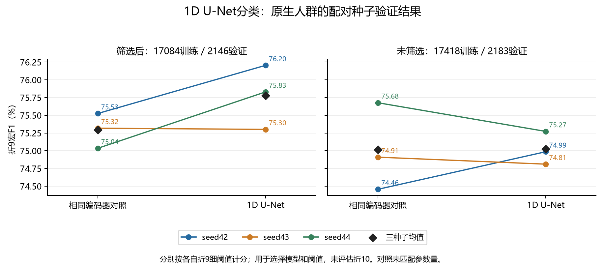
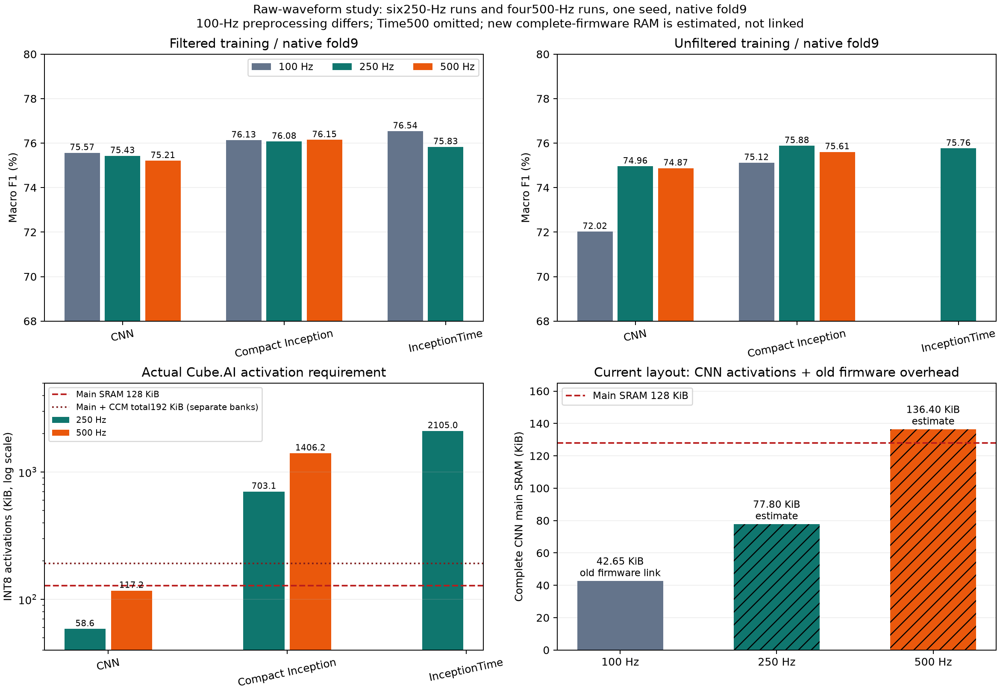

# 各模型整体与逐类指标总表

更新：2026-10-10。历史数值保持原记录，新增E15的折9双人群U-Net实验。方法和选择规则见[训练文档](模型训练与优化.md)。

<!-- validation-redo-notice-20261010:start -->
**评价状态（2026-10-10）：** 当前验证候选为单教师蒸馏CNN seed43 INT8，折9宏F1为75.893%；现有完整HEX仍为原seed44及原部署阈值。折10在历史研发中已反复使用，且部分追加方案受测试反馈影响，所有已有折10成绩按历史探索结果解释。重做没有恢复折10的独立性；新候选没有本轮独立测试或完整固件。
<!-- validation-redo-notice-20261010:end -->

- [1. 指标口径与阅读顺序](#metric-scope)
- [2. 当前纠正结果：仅fold9（2026-10-10）](#metric-current)
- [新增E15：1D U-Net双人群折9实验](#metric-unet)
- [3. 早期优化：fold9候选校准结果](#metric-early-val)
- [4. 早期优化：原始fold10历史结果](#metric-early-test)
- [5. 患者隔离四组内部留出](#metric-cv)
- [6. 筛选任务队列后重训（2026-10-01）](#metric-filter)
- [7. 筛选重训各对照逐类历史结果](#metric-filter-class)
- [8. 首轮三种子蒸馏与INT8（2026-10-01）](#metric-distill)
- [9. 真实ECG白噪声控制实验](#metric-noise)
- [10. 预处理消融与单网络教师（2026-10-07）](#metric-teacher)
- [11. 测试反馈后的三种子教师集成：历史保留](#metric-ensemble)
- [12. 追加集成派生学生：历史保留（2026-10-07）](#metric-ensemble-kd)
- [13. 学生阈值0.05→0.01（2026-10-08）](#metric-thresholds)
- [14. 26版本筛选/未筛选队列复核（2026-10-09）](#metric-cohorts)
- [15. Ribeiro适配及既有单网络对照（2026-10-09）](#metric-ribeiro)
- [16. 旧ResNet量化验证与资源（2026-10-01）](#metric-old-quant)
- [17. 实验设置与结果出处](#metric-sources)
- [18. 历史点估计的解释限制](#metric-limits)
- [附：旧版首表（2026-10-01）](#metric-old-summary)

## 1. 指标口径与阅读顺序

先看本轮折9纠正结果，再按实验阶段查历史表。表内原始数值、单位、support及阈值保持原记录；日期和原编号用于定位对应产物。

| 范围 | 分母/用途 | 解释 |
|---|---|---|
| 当前学生/单教师折9 | 2146条筛选后验证 | 调参/选模后的验证成绩，可能乐观，不是测试成绩 |
| 历史联合阈值折9 | 2183条未筛选验证 | 保持该分支原队列，不与2146条直接排名 |
| 原始历史折10 | 2198条 | 反复使用，所有已有成绩属于历史探索报告 |
| 筛选历史折10 | 2158条 | 人群定义不同；不可与2198条直接排名 |
| 四组训练池留出 | 官方训练fold两两留出 | 内部稳健性证据，共享fold9、训练池重叠 |
| 加噪 | 明确标注clean/30/20/10 dB | 同一源记录的不同信号版本，不增加独立患者数 |
| Chapman | 已知阳性/条件阴性掩码 | 单独见外部文档，不能视作完整五类测试 |

五类独立sigmoid；宏Precision、Recall、F1分别为逐类平均，宏F1不由宏P/R再求调和平均。AUROC/PR-AUC不依赖分类阈值。0–1与百分数按每张表头使用。

历史表中的“当前部署”“新学生”“推荐”均指当轮版本。原HEX只对应seed44原部署阈值；当前折9候选是单教师KD seed43 INT8。三种子追加集成及其派生seed42已撤回纠正推荐，保留为历史探索分支。

<!-- validation-redo-results-20261010:start -->
## 2. 当前纠正结果：仅fold9（2026-10-10）

以下是fold9指标，不能与历史fold10指标当作同一测试集成绩比较。普通/蒸馏6个学生均为本轮重训。教师为原单网络候选验证选择复算；不使用追加集成。

| 版本                       | 最佳epoch |    AUROC |   PR-AUC | Precision % | Recall % |   F1 % |
| ------------------------ | ------: | -------: | -------: | ----------: | -------: | -----: |
| supervised_seed42        |      10 | 0.927635 | 0.811831 |      72.244 |   79.300 | 75.566 |
| single_teacher_kd_seed42 |      17 | 0.931885 | 0.821982 |      72.136 |   79.468 | 75.560 |
| supervised_seed43        |      10 | 0.925551 | 0.807618 |      72.693 |   76.098 | 74.321 |
| single_teacher_kd_seed43 |      21 | 0.931681 | 0.819279 |      74.329 |   77.914 | 76.016 |
| supervised_seed44        |      10 | 0.924380 | 0.805446 |      71.877 |   77.502 | 74.190 |
| single_teacher_kd_seed44 |      22 | 0.931582 | 0.820955 |      72.604 |   79.611 | 75.854 |

| INT8验证比较 | AUROC | Precision % | Recall % | F1 % |
|---|---:|---:|---:|---:|
| original_seed44_int8 | 0.931478 | 73.232 | 78.440 | 75.683 |
| single_teacher_kd_seed43_int8 | 0.931362 | 73.902 | 78.179 | 75.893 |

### 教师选择与历史联合阈值重算

教师/学生及INT8使用筛选后fold9的2146条；历史联合阈值重算沿用未筛选2183条，各分支按自身原队列报告。9个教师候选及四组内部留出结果完整保存在本轮JSON；内部留出不等于独立测试。

| 版本 | 验证记录数 | AUROC | PR-AUC | Precision % | Recall % | F1 % |
|---|---:|---:|---:|---:|---:|---:|
| inception_time1d_P0_current_seed42 | 2146 | 0.934315 | 0.824197 | 75.626 | 77.274 | 76.305 |
| ensemble_equal_joint_thresholds | 2183 | 0.934598 | 0.822189 | 71.897 | 81.006 | 76.150 |

### 新学生、INT8、所选教师与联合阈值的逐类验证指标

| 版本 | 类别 | 阳性数 | 阈值 | AUROC | PR-AUC | Precision % | Recall % | F1 % |
|---|---|---:|---:|---:|---:|---:|---:|---:|
| supervised_seed42 | NORM | 955 | 0.49 | 0.942861 | 0.927135 | 81.784 | 91.204 | 86.238 |
| supervised_seed42 | MI | 540 | 0.58 | 0.923739 | 0.829219 | 69.628 | 79.815 | 74.374 |
| supervised_seed42 | STTC | 528 | 0.72 | 0.930253 | 0.781446 | 71.240 | 81.629 | 76.081 |
| supervised_seed42 | CD | 495 | 0.56 | 0.932723 | 0.861208 | 77.246 | 78.182 | 77.711 |
| supervised_seed42 | HYP | 268 | 0.74 | 0.908598 | 0.660149 | 61.324 | 65.672 | 63.423 |
| single_teacher_kd_seed42 | NORM | 955 | 0.62 | 0.948521 | 0.932111 | 82.605 | 90.995 | 86.597 |
| single_teacher_kd_seed42 | MI | 540 | 0.60 | 0.931402 | 0.838903 | 73.835 | 76.296 | 75.046 |
| single_teacher_kd_seed42 | STTC | 528 | 0.55 | 0.932430 | 0.791118 | 69.870 | 81.250 | 75.131 |
| single_teacher_kd_seed42 | CD | 495 | 0.57 | 0.932600 | 0.863589 | 76.608 | 79.394 | 77.976 |
| single_teacher_kd_seed42 | HYP | 268 | 0.67 | 0.914471 | 0.684189 | 57.764 | 69.403 | 63.051 |
| supervised_seed43 | NORM | 955 | 0.47 | 0.943839 | 0.924995 | 81.402 | 91.204 | 86.025 |
| supervised_seed43 | MI | 540 | 0.38 | 0.916548 | 0.819021 | 72.043 | 74.444 | 73.224 |
| supervised_seed43 | STTC | 528 | 0.79 | 0.933352 | 0.785505 | 73.201 | 77.083 | 75.092 |
| supervised_seed43 | CD | 495 | 0.71 | 0.927740 | 0.853065 | 77.823 | 76.566 | 77.189 |
| supervised_seed43 | HYP | 268 | 0.83 | 0.906275 | 0.655506 | 58.993 | 61.194 | 60.073 |
| single_teacher_kd_seed43 | NORM | 955 | 0.69 | 0.946515 | 0.929169 | 85.436 | 87.225 | 86.321 |
| single_teacher_kd_seed43 | MI | 540 | 0.52 | 0.929397 | 0.833634 | 72.870 | 77.593 | 75.157 |
| single_teacher_kd_seed43 | STTC | 528 | 0.59 | 0.930005 | 0.781668 | 71.000 | 80.682 | 75.532 |
| single_teacher_kd_seed43 | CD | 495 | 0.55 | 0.936582 | 0.868550 | 75.803 | 81.010 | 78.320 |
| single_teacher_kd_seed43 | HYP | 268 | 0.78 | 0.915904 | 0.683375 | 66.535 | 63.060 | 64.751 |
| supervised_seed44 | NORM | 955 | 0.34 | 0.940960 | 0.922737 | 79.178 | 92.775 | 85.439 |
| supervised_seed44 | MI | 540 | 0.64 | 0.921182 | 0.818935 | 73.609 | 75.926 | 74.749 |
| supervised_seed44 | STTC | 528 | 0.73 | 0.929558 | 0.788191 | 76.023 | 73.864 | 74.928 |
| supervised_seed44 | CD | 495 | 0.87 | 0.923433 | 0.842626 | 79.515 | 72.929 | 76.080 |
| supervised_seed44 | HYP | 268 | 0.55 | 0.906766 | 0.654741 | 51.058 | 72.015 | 59.752 |
| single_teacher_kd_seed44 | NORM | 955 | 0.60 | 0.947406 | 0.932321 | 82.879 | 89.215 | 85.930 |
| single_teacher_kd_seed44 | MI | 540 | 0.65 | 0.933709 | 0.835782 | 70.407 | 80.185 | 74.978 |
| single_teacher_kd_seed44 | STTC | 528 | 0.45 | 0.931858 | 0.789979 | 71.173 | 82.765 | 76.532 |
| single_teacher_kd_seed44 | CD | 495 | 0.68 | 0.935573 | 0.868532 | 80.417 | 77.980 | 79.179 |
| single_teacher_kd_seed44 | HYP | 268 | 0.63 | 0.909363 | 0.678159 | 58.147 | 67.910 | 62.651 |
| original_seed44_int8 | NORM | 955 | 0.55 | 0.946334 | 0.930149 | 82.105 | 89.843 | 85.800 |
| original_seed44_int8 | MI | 540 | 0.55 | 0.933733 | 0.844979 | 72.222 | 79.444 | 75.661 |
| original_seed44_int8 | STTC | 528 | 0.53 | 0.931518 | 0.796120 | 71.078 | 82.386 | 76.316 |
| original_seed44_int8 | CD | 495 | 0.72 | 0.937253 | 0.866833 | 78.112 | 78.586 | 78.348 |
| original_seed44_int8 | HYP | 268 | 0.63 | 0.908551 | 0.666584 | 62.642 | 61.940 | 62.289 |
| single_teacher_kd_seed43_int8 | NORM | 955 | 0.68 | 0.946090 | 0.927226 | 85.464 | 86.806 | 86.130 |
| single_teacher_kd_seed43_int8 | MI | 540 | 0.45 | 0.928988 | 0.830662 | 69.920 | 80.926 | 75.021 |
| single_teacher_kd_seed43_int8 | STTC | 528 | 0.61 | 0.929901 | 0.780085 | 71.261 | 80.303 | 75.512 |
| single_teacher_kd_seed43_int8 | CD | 495 | 0.57 | 0.936436 | 0.866178 | 76.848 | 79.798 | 78.295 |
| single_teacher_kd_seed43_int8 | HYP | 268 | 0.78 | 0.915396 | 0.678416 | 66.016 | 63.060 | 64.504 |
| inception_time1d_P0_current_seed42 | NORM | 955 | 0.65 | 0.947286 | 0.931750 | 84.273 | 89.215 | 86.673 |
| inception_time1d_P0_current_seed42 | MI | 540 | 0.70 | 0.930730 | 0.827347 | 74.860 | 74.444 | 74.652 |
| inception_time1d_P0_current_seed42 | STTC | 528 | 0.50 | 0.933768 | 0.801078 | 69.936 | 82.386 | 75.652 |
| inception_time1d_P0_current_seed42 | CD | 495 | 0.50 | 0.939770 | 0.870429 | 81.857 | 78.384 | 80.083 |
| inception_time1d_P0_current_seed42 | HYP | 268 | 0.70 | 0.920022 | 0.690381 | 67.206 | 61.940 | 64.466 |
| ensemble_equal_joint_thresholds | NORM | 955 | 0.47 | 0.952505 | 0.937823 | 82.358 | 91.414 | 86.650 |
| ensemble_equal_joint_thresholds | MI | 540 | 0.52 | 0.935535 | 0.847090 | 72.112 | 80.926 | 76.265 |
| ensemble_equal_joint_thresholds | STTC | 528 | 0.56 | 0.939167 | 0.808653 | 71.474 | 84.470 | 77.431 |
| ensemble_equal_joint_thresholds | CD | 495 | 0.78 | 0.931253 | 0.848973 | 74.809 | 79.192 | 76.938 |
| ensemble_equal_joint_thresholds | HYP | 268 | 0.81 | 0.914528 | 0.668406 | 58.730 | 69.030 | 63.465 |
<!-- validation-redo-results-20261010:end -->

<!-- unet-metrics-20261010:start -->

## 新增E15：1D U-Net，筛选/未筛选双训练人群（仅fold9）

已完成12次新训练及30组整体/逐类指标、30组阈值独立复核；仅折9评估。

每个模型在两套验证人群分别校准自己的0.01步长阈值；表中P/R/F1为宏平均百分数，AUROC/PR-AUC为0–1。原生人群指训练和验证采用相同纳入规则；只在各原生人群内选种子，交叉人群列不参与该选择。详细方法见[训练流程E15](模型训练与优化.md#unet-study-20261010)。

### 三种子统计（F1为均值±样本标准差，单位百分点）

| 训练人群 | 结构 | 验证人群 | 平均P % | 平均R % | F1 % | 平均AUROC |
| --- | --- | --- | --- | --- | --- | --- |
| 筛选后 | 1D U-Net | 筛选后 | 72.511 | 79.694 | 75.778 ± 0.454 | 0.930017 |
| 筛选后 | 1D U-Net | 未筛选 | 70.861 | 79.694 | 74.893 ± 0.436 | 0.926550 |
| 筛选后 | 相同编码器对照 | 筛选后 | 72.789 | 78.512 | 75.293 ± 0.246 | 0.929864 |
| 筛选后 | 相同编码器对照 | 未筛选 | 70.674 | 78.420 | 74.228 ± 0.292 | 0.926199 |
| 未筛选 | 1D U-Net | 筛选后 | 72.221 | 79.569 | 75.560 ± 0.098 | 0.928702 |
| 未筛选 | 1D U-Net | 未筛选 | 71.827 | 78.763 | 75.023 ± 0.233 | 0.927389 |
| 未筛选 | 相同编码器对照 | 筛选后 | 72.641 | 78.360 | 75.316 ± 0.645 | 0.928619 |
| 未筛选 | 相同编码器对照 | 未筛选 | 72.099 | 78.333 | 75.014 ± 0.617 | 0.928463 |

### 各结构原生人群所选种子

| 训练/验证人群 | 结构 | 种子 | 最佳轮 | 完成轮数 | P % | R % | F1 % | HYP R % |
| --- | --- | --- | --- | --- | --- | --- | --- | --- |
| 筛选后 | 1D U-Net | 42 | 17 | 25 | 74.238 | 78.840 | 76.205 | 73.134 |
| 筛选后 | 相同编码器对照 | 42 | 12 | 20 | 72.029 | 79.608 | 75.526 | 68.284 |
| 未筛选 | 1D U-Net | 44 | 28 | 30 | 72.643 | 78.340 | 75.273 | 67.164 |
| 未筛选 | 相同编码器对照 | 44 | 21 | 29 | 73.072 | 78.724 | 75.677 | 60.075 |

### 全部模型的双人群整体指标

#### 筛选后验证（2146条）

| 版本 | 训练人群 | AUROC | PR-AUC | P % | R % | F1 % | HYP R % |
| --- | --- | --- | --- | --- | --- | --- | --- |
| filtered/unet1d_seed42 | 筛选后 | 0.929320 | 0.823318 | 74.238 | 78.840 | 76.205 | 73.134 |
| filtered/unet_encoder1d_seed42 | 筛选后 | 0.930166 | 0.816584 | 72.029 | 79.608 | 75.526 | 68.284 |
| unfiltered/unet1d_seed42 | 未筛选 | 0.928324 | 0.816994 | 73.210 | 78.225 | 75.510 | 69.030 |
| unfiltered/unet_encoder1d_seed42 | 未筛选 | 0.926858 | 0.810363 | 72.232 | 77.477 | 74.707 | 58.582 |
| filtered/unet1d_seed43 | 筛选后 | 0.930262 | 0.817093 | 72.276 | 78.783 | 75.301 | 66.045 |
| filtered/unet_encoder1d_seed43 | 筛选后 | 0.930094 | 0.813456 | 75.103 | 75.958 | 75.318 | 60.448 |
| unfiltered/unet1d_seed43 | 未筛选 | 0.928952 | 0.817597 | 71.515 | 80.089 | 75.498 | 67.910 |
| unfiltered/unet_encoder1d_seed43 | 未筛选 | 0.928135 | 0.812321 | 72.098 | 78.796 | 75.250 | 65.299 |
| filtered/unet1d_seed44 | 筛选后 | 0.930468 | 0.816773 | 71.020 | 81.460 | 75.830 | 72.388 |
| filtered/unet_encoder1d_seed44 | 筛选后 | 0.929331 | 0.815966 | 71.236 | 79.969 | 75.035 | 71.269 |
| unfiltered/unet1d_seed44 | 未筛选 | 0.928831 | 0.818424 | 71.939 | 80.394 | 75.673 | 70.896 |
| unfiltered/unet_encoder1d_seed44 | 未筛选 | 0.930864 | 0.821574 | 73.593 | 78.805 | 75.991 | 60.075 |
| inception_time1d_P0_current_seed42 | 筛选后 | 0.934315 | 0.824197 | 74.151 | 79.434 | 76.540 | 66.791 |
| inception_time1d_P0_current_seed43 | 筛选后 | 0.932696 | 0.827524 | 75.707 | 77.584 | 76.466 | 64.925 |
| inception_time1d_P0_current_seed44 | 筛选后 | 0.932185 | 0.816789 | 73.110 | 79.242 | 75.854 | 69.776 |

#### 未筛选验证（2183条）

| 版本 | 训练人群 | AUROC | PR-AUC | P % | R % | F1 % | HYP R % |
| --- | --- | --- | --- | --- | --- | --- | --- |
| filtered/unet1d_seed42 | 筛选后 | 0.926028 | 0.808206 | 72.527 | 78.840 | 75.328 | 73.134 |
| filtered/unet_encoder1d_seed42 | 筛选后 | 0.926573 | 0.800116 | 70.063 | 79.608 | 74.477 | 68.284 |
| unfiltered/unet1d_seed42 | 未筛选 | 0.926860 | 0.808386 | 72.557 | 77.861 | 74.986 | 69.030 |
| unfiltered/unet_encoder1d_seed42 | 未筛选 | 0.926845 | 0.805674 | 71.758 | 77.477 | 74.456 | 58.582 |
| filtered/unet1d_seed43 | 筛选后 | 0.927015 | 0.799546 | 70.678 | 78.783 | 74.456 | 66.045 |
| filtered/unet_encoder1d_seed43 | 筛选后 | 0.926203 | 0.795348 | 71.875 | 76.968 | 74.301 | 60.448 |
| unfiltered/unet1d_seed43 | 未筛选 | 0.927168 | 0.810443 | 70.282 | 80.089 | 74.811 | 67.910 |
| unfiltered/unet_encoder1d_seed43 | 未筛选 | 0.927695 | 0.806955 | 71.466 | 78.796 | 74.909 | 65.299 |
| filtered/unet1d_seed44 | 筛选后 | 0.926607 | 0.796164 | 69.376 | 81.460 | 74.895 | 72.388 |
| filtered/unet_encoder1d_seed44 | 筛选后 | 0.925821 | 0.801230 | 70.086 | 78.684 | 73.906 | 65.299 |
| unfiltered/unet1d_seed44 | 未筛选 | 0.928139 | 0.813200 | 72.643 | 78.340 | 75.273 | 67.164 |
| unfiltered/unet_encoder1d_seed44 | 未筛选 | 0.930848 | 0.818135 | 73.072 | 78.724 | 75.677 | 60.075 |
| inception_time1d_P0_current_seed42 | 筛选后 | 0.930213 | 0.805854 | 71.945 | 79.434 | 75.370 | 66.791 |
| inception_time1d_P0_current_seed43 | 筛选后 | 0.929443 | 0.809452 | 73.942 | 77.399 | 75.527 | 64.925 |
| inception_time1d_P0_current_seed44 | 筛选后 | 0.928625 | 0.799646 | 71.094 | 79.242 | 74.786 | 69.776 |

### 全部逐类指标及该验证人群的阈值

#### 筛选后验证逐类

| 版本 | 类别 | 阳性数 | 阈值 | AUROC | PR-AUC | P % | R % | F1 % |
| --- | --- | --- | --- | --- | --- | --- | --- | --- |
| filtered/unet1d_seed42 | NORM | 955 | 0.66 | 0.945496 | 0.926367 | 83.463 | 89.843 | 86.536 |
| filtered/unet1d_seed42 | MI | 540 | 0.51 | 0.923824 | 0.842080 | 81.277 | 70.741 | 75.644 |
| filtered/unet1d_seed42 | STTC | 528 | 0.64 | 0.933102 | 0.793239 | 72.572 | 80.682 | 76.413 |
| filtered/unet1d_seed42 | CD | 495 | 0.50 | 0.932304 | 0.861982 | 76.402 | 79.798 | 78.063 |
| filtered/unet1d_seed42 | HYP | 268 | 0.73 | 0.911874 | 0.692921 | 57.478 | 73.134 | 64.368 |
| filtered/unet_encoder1d_seed42 | NORM | 955 | 0.37 | 0.945959 | 0.930848 | 80.251 | 93.613 | 86.419 |
| filtered/unet_encoder1d_seed42 | MI | 540 | 0.46 | 0.927420 | 0.833782 | 71.380 | 78.519 | 74.780 |
| filtered/unet_encoder1d_seed42 | STTC | 528 | 0.80 | 0.933677 | 0.799039 | 70.049 | 81.061 | 75.154 |
| filtered/unet_encoder1d_seed42 | CD | 495 | 0.76 | 0.936165 | 0.859568 | 79.622 | 76.566 | 78.064 |
| filtered/unet_encoder1d_seed42 | HYP | 268 | 0.73 | 0.907609 | 0.659680 | 58.842 | 68.284 | 63.212 |
| unfiltered/unet1d_seed42 | NORM | 955 | 0.53 | 0.942664 | 0.926869 | 82.139 | 90.052 | 85.914 |
| unfiltered/unet1d_seed42 | MI | 540 | 0.74 | 0.919353 | 0.818250 | 75.781 | 71.852 | 73.764 |
| unfiltered/unet1d_seed42 | STTC | 528 | 0.58 | 0.937082 | 0.801593 | 73.142 | 82.008 | 77.321 |
| unfiltered/unet1d_seed42 | CD | 495 | 0.57 | 0.937413 | 0.861859 | 77.711 | 78.182 | 77.946 |
| unfiltered/unet1d_seed42 | HYP | 268 | 0.66 | 0.905107 | 0.676397 | 57.276 | 69.030 | 62.606 |
| unfiltered/unet_encoder1d_seed42 | NORM | 955 | 0.43 | 0.942662 | 0.925412 | 81.896 | 90.471 | 85.970 |
| unfiltered/unet_encoder1d_seed42 | MI | 540 | 0.63 | 0.923288 | 0.828774 | 72.251 | 76.667 | 74.394 |
| unfiltered/unet_encoder1d_seed42 | STTC | 528 | 0.76 | 0.930923 | 0.797123 | 70.395 | 81.061 | 75.352 |
| unfiltered/unet_encoder1d_seed42 | CD | 495 | 0.72 | 0.933199 | 0.858291 | 76.000 | 80.606 | 78.235 |
| unfiltered/unet_encoder1d_seed42 | HYP | 268 | 0.87 | 0.904217 | 0.642217 | 60.618 | 58.582 | 59.583 |
| filtered/unet1d_seed43 | NORM | 955 | 0.42 | 0.945388 | 0.931734 | 80.642 | 92.042 | 85.966 |
| filtered/unet1d_seed43 | MI | 540 | 0.59 | 0.929035 | 0.832235 | 74.907 | 74.630 | 74.768 |
| filtered/unet1d_seed43 | STTC | 528 | 0.61 | 0.937750 | 0.807377 | 71.217 | 82.008 | 76.232 |
| filtered/unet1d_seed43 | CD | 495 | 0.68 | 0.933682 | 0.862721 | 78.244 | 79.192 | 78.715 |
| filtered/unet1d_seed43 | HYP | 268 | 0.60 | 0.905457 | 0.651399 | 56.369 | 66.045 | 60.825 |
| filtered/unet_encoder1d_seed43 | NORM | 955 | 0.61 | 0.947583 | 0.929056 | 82.502 | 91.832 | 86.918 |
| filtered/unet_encoder1d_seed43 | MI | 540 | 0.58 | 0.923198 | 0.817795 | 72.663 | 76.296 | 74.435 |
| filtered/unet_encoder1d_seed43 | STTC | 528 | 0.71 | 0.937671 | 0.814306 | 73.997 | 80.303 | 77.021 |
| filtered/unet_encoder1d_seed43 | CD | 495 | 0.71 | 0.936421 | 0.864986 | 84.988 | 70.909 | 77.313 |
| filtered/unet_encoder1d_seed43 | HYP | 268 | 0.78 | 0.905598 | 0.641135 | 61.364 | 60.448 | 60.902 |
| unfiltered/unet1d_seed43 | NORM | 955 | 0.48 | 0.943454 | 0.928103 | 79.746 | 91.937 | 85.409 |
| unfiltered/unet1d_seed43 | MI | 540 | 0.43 | 0.920490 | 0.816253 | 67.334 | 80.926 | 73.507 |
| unfiltered/unet1d_seed43 | STTC | 528 | 0.63 | 0.932194 | 0.798797 | 71.119 | 80.682 | 75.599 |
| unfiltered/unet1d_seed43 | CD | 495 | 0.67 | 0.936512 | 0.862466 | 77.888 | 78.990 | 78.435 |
| unfiltered/unet1d_seed43 | HYP | 268 | 0.70 | 0.912109 | 0.682368 | 61.486 | 67.910 | 64.539 |
| unfiltered/unet_encoder1d_seed43 | NORM | 955 | 0.54 | 0.942186 | 0.926165 | 82.393 | 88.691 | 85.426 |
| unfiltered/unet_encoder1d_seed43 | MI | 540 | 0.73 | 0.927394 | 0.817093 | 69.764 | 82.037 | 75.404 |
| unfiltered/unet_encoder1d_seed43 | STTC | 528 | 0.66 | 0.935299 | 0.802576 | 71.453 | 79.167 | 75.112 |
| unfiltered/unet_encoder1d_seed43 | CD | 495 | 0.74 | 0.932304 | 0.858130 | 78.156 | 78.788 | 78.471 |
| unfiltered/unet_encoder1d_seed43 | HYP | 268 | 0.76 | 0.903490 | 0.657642 | 58.725 | 65.299 | 61.837 |
| filtered/unet1d_seed44 | NORM | 955 | 0.41 | 0.943983 | 0.926905 | 80.328 | 92.356 | 85.923 |
| filtered/unet1d_seed44 | MI | 540 | 0.55 | 0.925331 | 0.824370 | 71.017 | 77.593 | 74.159 |
| filtered/unet1d_seed44 | STTC | 528 | 0.62 | 0.936229 | 0.791247 | 72.442 | 83.144 | 77.425 |
| filtered/unet1d_seed44 | CD | 495 | 0.69 | 0.935760 | 0.859983 | 74.586 | 81.818 | 78.035 |
| filtered/unet1d_seed44 | HYP | 268 | 0.70 | 0.911036 | 0.681360 | 56.725 | 72.388 | 63.607 |
| filtered/unet_encoder1d_seed44 | NORM | 955 | 0.35 | 0.945558 | 0.927990 | 78.479 | 95.079 | 85.985 |
| filtered/unet_encoder1d_seed44 | MI | 540 | 0.68 | 0.928402 | 0.835897 | 72.987 | 75.556 | 74.249 |
| filtered/unet_encoder1d_seed44 | STTC | 528 | 0.58 | 0.931912 | 0.805854 | 69.936 | 82.386 | 75.652 |
| filtered/unet_encoder1d_seed44 | CD | 495 | 0.76 | 0.934867 | 0.861718 | 82.018 | 75.556 | 78.654 |
| filtered/unet_encoder1d_seed44 | HYP | 268 | 0.65 | 0.905918 | 0.648372 | 52.762 | 71.269 | 60.635 |
| unfiltered/unet1d_seed44 | NORM | 955 | 0.49 | 0.944846 | 0.929683 | 83.498 | 88.482 | 85.918 |
| unfiltered/unet1d_seed44 | MI | 540 | 0.64 | 0.925738 | 0.823038 | 75.370 | 75.370 | 75.370 |
| unfiltered/unet1d_seed44 | STTC | 528 | 0.48 | 0.932076 | 0.800193 | 66.477 | 88.636 | 75.974 |
| unfiltered/unet1d_seed44 | CD | 495 | 0.76 | 0.933042 | 0.862326 | 77.800 | 78.586 | 78.191 |
| unfiltered/unet1d_seed44 | HYP | 268 | 0.65 | 0.908453 | 0.676881 | 56.548 | 70.896 | 62.914 |
| unfiltered/unet_encoder1d_seed44 | NORM | 955 | 0.46 | 0.944728 | 0.925593 | 79.218 | 93.403 | 85.728 |
| unfiltered/unet_encoder1d_seed44 | MI | 540 | 0.55 | 0.935394 | 0.851397 | 73.793 | 79.259 | 76.429 |
| unfiltered/unet_encoder1d_seed44 | STTC | 528 | 0.67 | 0.935371 | 0.802240 | 73.070 | 80.682 | 76.688 |
| unfiltered/unet_encoder1d_seed44 | CD | 495 | 0.67 | 0.932533 | 0.857232 | 76.437 | 80.606 | 78.466 |
| unfiltered/unet_encoder1d_seed44 | HYP | 268 | 0.86 | 0.906295 | 0.671407 | 65.447 | 60.075 | 62.646 |
| inception_time1d_P0_current_seed42 | NORM | 955 | 0.64 | 0.947286 | 0.931750 | 84.071 | 89.529 | 86.714 |
| inception_time1d_P0_current_seed42 | MI | 540 | 0.67 | 0.930730 | 0.827347 | 73.488 | 76.481 | 74.955 |
| inception_time1d_P0_current_seed42 | STTC | 528 | 0.43 | 0.933768 | 0.801078 | 67.862 | 85.985 | 75.856 |
| inception_time1d_P0_current_seed42 | CD | 495 | 0.50 | 0.939770 | 0.870429 | 81.857 | 78.384 | 80.083 |
| inception_time1d_P0_current_seed42 | HYP | 268 | 0.63 | 0.920022 | 0.690381 | 63.475 | 66.791 | 65.091 |
| inception_time1d_P0_current_seed43 | NORM | 955 | 0.37 | 0.945659 | 0.929009 | 81.419 | 91.309 | 86.081 |
| inception_time1d_P0_current_seed43 | MI | 540 | 0.59 | 0.934762 | 0.848696 | 72.562 | 81.296 | 76.681 |
| inception_time1d_P0_current_seed43 | STTC | 528 | 0.68 | 0.934581 | 0.803796 | 76.306 | 77.462 | 76.880 |
| inception_time1d_P0_current_seed43 | CD | 495 | 0.81 | 0.929163 | 0.858973 | 83.565 | 72.929 | 77.886 |
| inception_time1d_P0_current_seed43 | HYP | 268 | 0.82 | 0.919317 | 0.697147 | 64.684 | 64.925 | 64.804 |
| inception_time1d_P0_current_seed44 | NORM | 955 | 0.50 | 0.945340 | 0.928778 | 83.074 | 89.424 | 86.132 |
| inception_time1d_P0_current_seed44 | MI | 540 | 0.49 | 0.930277 | 0.839360 | 70.712 | 80.926 | 75.475 |
| inception_time1d_P0_current_seed44 | STTC | 528 | 0.64 | 0.935271 | 0.795129 | 72.517 | 82.955 | 77.385 |
| inception_time1d_P0_current_seed44 | CD | 495 | 0.86 | 0.934733 | 0.857965 | 81.532 | 73.131 | 77.103 |
| inception_time1d_P0_current_seed44 | HYP | 268 | 0.67 | 0.915302 | 0.662710 | 57.716 | 69.776 | 63.176 |

#### 未筛选验证逐类

| 版本 | 类别 | 阳性数 | 阈值 | AUROC | PR-AUC | P % | R % | F1 % |
| --- | --- | --- | --- | --- | --- | --- | --- | --- |
| filtered/unet1d_seed42 | NORM | 955 | 0.66 | 0.946567 | 0.925874 | 83.301 | 89.843 | 86.448 |
| filtered/unet1d_seed42 | MI | 540 | 0.51 | 0.918759 | 0.828435 | 78.439 | 70.741 | 74.391 |
| filtered/unet1d_seed42 | STTC | 528 | 0.64 | 0.931658 | 0.783945 | 71.838 | 80.682 | 76.004 |
| filtered/unet1d_seed42 | CD | 495 | 0.50 | 0.922788 | 0.822203 | 72.080 | 79.798 | 75.743 |
| filtered/unet1d_seed42 | HYP | 268 | 0.73 | 0.910368 | 0.680571 | 56.977 | 73.134 | 64.052 |
| filtered/unet_encoder1d_seed42 | NORM | 955 | 0.37 | 0.946742 | 0.929989 | 80.036 | 93.613 | 86.293 |
| filtered/unet_encoder1d_seed42 | MI | 540 | 0.46 | 0.920568 | 0.812602 | 68.167 | 78.519 | 72.978 |
| filtered/unet_encoder1d_seed42 | STTC | 528 | 0.80 | 0.933006 | 0.792151 | 69.481 | 81.061 | 74.825 |
| filtered/unet_encoder1d_seed42 | CD | 495 | 0.76 | 0.926387 | 0.817763 | 74.901 | 76.566 | 75.724 |
| filtered/unet_encoder1d_seed42 | HYP | 268 | 0.73 | 0.906163 | 0.648073 | 57.729 | 68.284 | 62.564 |
| unfiltered/unet1d_seed42 | NORM | 955 | 0.53 | 0.943273 | 0.925717 | 81.905 | 90.052 | 85.786 |
| unfiltered/unet1d_seed42 | MI | 540 | 0.74 | 0.918503 | 0.815384 | 75.340 | 71.852 | 73.555 |
| unfiltered/unet1d_seed42 | STTC | 528 | 0.58 | 0.936349 | 0.794513 | 72.408 | 82.008 | 76.909 |
| unfiltered/unet1d_seed42 | CD | 495 | 0.61 | 0.931451 | 0.838267 | 76.210 | 76.364 | 76.287 |
| unfiltered/unet1d_seed42 | HYP | 268 | 0.66 | 0.904723 | 0.668051 | 56.923 | 69.030 | 62.395 |
| unfiltered/unet_encoder1d_seed42 | NORM | 955 | 0.43 | 0.943875 | 0.924898 | 81.741 | 90.471 | 85.885 |
| unfiltered/unet_encoder1d_seed42 | MI | 540 | 0.63 | 0.923393 | 0.826764 | 71.875 | 76.667 | 74.194 |
| unfiltered/unet_encoder1d_seed42 | STTC | 528 | 0.76 | 0.931103 | 0.791612 | 70.164 | 81.061 | 75.220 |
| unfiltered/unet_encoder1d_seed42 | CD | 495 | 0.72 | 0.931335 | 0.851073 | 74.859 | 80.606 | 77.626 |
| unfiltered/unet_encoder1d_seed42 | HYP | 268 | 0.87 | 0.904520 | 0.634025 | 60.153 | 58.582 | 59.357 |
| filtered/unet1d_seed43 | NORM | 955 | 0.42 | 0.946313 | 0.931192 | 80.495 | 92.042 | 85.882 |
| filtered/unet1d_seed43 | MI | 540 | 0.59 | 0.925282 | 0.821455 | 73.007 | 74.630 | 73.810 |
| filtered/unet1d_seed43 | STTC | 528 | 0.61 | 0.936565 | 0.797360 | 70.407 | 82.008 | 75.766 |
| filtered/unet1d_seed43 | CD | 495 | 0.68 | 0.923693 | 0.809587 | 73.823 | 79.192 | 76.413 |
| filtered/unet1d_seed43 | HYP | 268 | 0.60 | 0.903221 | 0.638138 | 55.660 | 66.045 | 60.410 |
| filtered/unet_encoder1d_seed43 | NORM | 955 | 0.61 | 0.948423 | 0.928324 | 82.270 | 91.832 | 86.789 |
| filtered/unet_encoder1d_seed43 | MI | 540 | 0.58 | 0.917237 | 0.800825 | 69.595 | 76.296 | 72.792 |
| filtered/unet_encoder1d_seed43 | STTC | 528 | 0.71 | 0.936140 | 0.806967 | 72.978 | 80.303 | 76.465 |
| filtered/unet_encoder1d_seed43 | CD | 495 | 0.60 | 0.925424 | 0.809747 | 74.308 | 75.960 | 75.125 |
| filtered/unet_encoder1d_seed43 | HYP | 268 | 0.78 | 0.903790 | 0.630874 | 60.223 | 60.448 | 60.335 |
| unfiltered/unet1d_seed43 | NORM | 955 | 0.48 | 0.944127 | 0.927232 | 79.313 | 91.937 | 85.160 |
| unfiltered/unet1d_seed43 | MI | 540 | 0.43 | 0.916871 | 0.807444 | 65.030 | 80.926 | 72.112 |
| unfiltered/unet1d_seed43 | STTC | 528 | 0.63 | 0.931785 | 0.793993 | 70.882 | 80.682 | 75.465 |
| unfiltered/unet1d_seed43 | CD | 495 | 0.67 | 0.931653 | 0.847208 | 74.904 | 78.990 | 76.893 |
| unfiltered/unet1d_seed43 | HYP | 268 | 0.70 | 0.911403 | 0.676337 | 61.279 | 67.910 | 64.425 |
| unfiltered/unet_encoder1d_seed43 | NORM | 955 | 0.54 | 0.943193 | 0.925357 | 82.233 | 88.691 | 85.340 |
| unfiltered/unet_encoder1d_seed43 | MI | 540 | 0.73 | 0.926886 | 0.812881 | 69.219 | 82.037 | 75.085 |
| unfiltered/unet_encoder1d_seed43 | STTC | 528 | 0.66 | 0.934657 | 0.798562 | 70.968 | 79.167 | 74.843 |
| unfiltered/unet_encoder1d_seed43 | CD | 495 | 0.74 | 0.930443 | 0.850620 | 76.772 | 78.788 | 77.767 |
| unfiltered/unet_encoder1d_seed43 | HYP | 268 | 0.76 | 0.903295 | 0.647357 | 58.140 | 65.299 | 61.511 |
| filtered/unet1d_seed44 | NORM | 955 | 0.41 | 0.944877 | 0.926155 | 80.109 | 92.356 | 85.798 |
| filtered/unet1d_seed44 | MI | 540 | 0.55 | 0.916560 | 0.781921 | 68.130 | 77.593 | 72.554 |
| filtered/unet1d_seed44 | STTC | 528 | 0.62 | 0.935581 | 0.785199 | 71.967 | 83.144 | 77.153 |
| filtered/unet1d_seed44 | CD | 495 | 0.69 | 0.926636 | 0.817053 | 70.928 | 81.818 | 75.985 |
| filtered/unet1d_seed44 | HYP | 268 | 0.70 | 0.909380 | 0.670492 | 55.747 | 72.388 | 62.987 |
| filtered/unet_encoder1d_seed44 | NORM | 955 | 0.35 | 0.946305 | 0.926806 | 78.276 | 95.079 | 85.863 |
| filtered/unet_encoder1d_seed44 | MI | 540 | 0.77 | 0.923722 | 0.823275 | 77.002 | 69.444 | 73.028 |
| filtered/unet_encoder1d_seed44 | STTC | 528 | 0.58 | 0.929743 | 0.795904 | 68.720 | 82.386 | 74.935 |
| filtered/unet_encoder1d_seed44 | CD | 495 | 0.66 | 0.926176 | 0.827450 | 71.914 | 81.212 | 76.281 |
| filtered/unet_encoder1d_seed44 | HYP | 268 | 0.72 | 0.903157 | 0.632716 | 54.517 | 65.299 | 59.423 |
| unfiltered/unet1d_seed44 | NORM | 955 | 0.49 | 0.945467 | 0.928847 | 83.333 | 88.482 | 85.830 |
| unfiltered/unet1d_seed44 | MI | 540 | 0.64 | 0.924721 | 0.818844 | 74.406 | 75.370 | 74.885 |
| unfiltered/unet1d_seed44 | STTC | 528 | 0.57 | 0.931658 | 0.793729 | 68.740 | 83.712 | 75.491 |
| unfiltered/unet1d_seed44 | CD | 495 | 0.79 | 0.930560 | 0.854695 | 77.914 | 76.970 | 77.439 |
| unfiltered/unet1d_seed44 | HYP | 268 | 0.68 | 0.908289 | 0.669885 | 58.824 | 67.164 | 62.718 |
| unfiltered/unet_encoder1d_seed44 | NORM | 955 | 0.46 | 0.945697 | 0.924849 | 79.008 | 93.403 | 85.605 |
| unfiltered/unet_encoder1d_seed44 | MI | 540 | 0.55 | 0.934675 | 0.847765 | 73.038 | 79.259 | 76.021 |
| unfiltered/unet_encoder1d_seed44 | STTC | 528 | 0.67 | 0.935967 | 0.800246 | 72.945 | 80.682 | 76.619 |
| unfiltered/unet_encoder1d_seed44 | CD | 495 | 0.68 | 0.930827 | 0.851489 | 75.189 | 80.202 | 77.615 |
| unfiltered/unet_encoder1d_seed44 | HYP | 268 | 0.86 | 0.907073 | 0.666324 | 65.182 | 60.075 | 62.524 |
| inception_time1d_P0_current_seed42 | NORM | 955 | 0.64 | 0.948316 | 0.931157 | 83.906 | 89.529 | 86.626 |
| inception_time1d_P0_current_seed42 | MI | 540 | 0.67 | 0.922764 | 0.801692 | 69.412 | 76.481 | 72.775 |
| inception_time1d_P0_current_seed42 | STTC | 528 | 0.43 | 0.931301 | 0.793072 | 66.374 | 85.985 | 74.917 |
| inception_time1d_P0_current_seed42 | CD | 495 | 0.50 | 0.929894 | 0.822235 | 77.445 | 78.384 | 77.912 |
| inception_time1d_P0_current_seed42 | HYP | 268 | 0.63 | 0.918789 | 0.681115 | 62.587 | 66.791 | 64.621 |
| inception_time1d_P0_current_seed43 | NORM | 955 | 0.37 | 0.946699 | 0.928448 | 81.192 | 91.309 | 85.954 |
| inception_time1d_P0_current_seed43 | MI | 540 | 0.61 | 0.930768 | 0.837380 | 71.148 | 80.370 | 75.478 |
| inception_time1d_P0_current_seed43 | STTC | 528 | 0.68 | 0.933118 | 0.798357 | 75.046 | 77.462 | 76.235 |
| inception_time1d_P0_current_seed43 | CD | 495 | 0.81 | 0.918662 | 0.796498 | 78.821 | 72.929 | 75.761 |
| inception_time1d_P0_current_seed43 | HYP | 268 | 0.82 | 0.917969 | 0.686579 | 63.504 | 64.925 | 64.207 |
| inception_time1d_P0_current_seed44 | NORM | 955 | 0.50 | 0.946346 | 0.928149 | 82.832 | 89.424 | 86.002 |
| inception_time1d_P0_current_seed44 | MI | 540 | 0.49 | 0.922771 | 0.813008 | 67.334 | 80.926 | 73.507 |
| inception_time1d_P0_current_seed44 | STTC | 528 | 0.64 | 0.933789 | 0.787069 | 71.452 | 82.955 | 76.775 |
| inception_time1d_P0_current_seed44 | CD | 495 | 0.86 | 0.925771 | 0.815994 | 77.186 | 73.131 | 75.104 |
| inception_time1d_P0_current_seed44 | HYP | 268 | 0.67 | 0.914450 | 0.654009 | 56.667 | 69.776 | 62.542 |

### 37条全零标签验证记录的预测（未筛选阈值）

这是未筛选折9人群内五个目标均为0的记录，不补正常标签；“任一阳性”按该任务目标可记为范围外预测，但不等于临床诊断错误的独立证据。

| 版本 | 任一阳性记录/37 | NORM | MI | STTC | CD | HYP |
| --- | --- | --- | --- | --- | --- | --- |
| filtered/unet1d_seed42 | 36 | 2 | 17 | 6 | 31 | 3 |
| filtered/unet_encoder1d_seed42 | 37 | 3 | 28 | 5 | 30 | 6 |
| unfiltered/unet1d_seed42 | 28 | 3 | 3 | 6 | 19 | 2 |
| unfiltered/unet_encoder1d_seed42 | 12 | 2 | 3 | 2 | 8 | 2 |
| filtered/unet1d_seed43 | 37 | 2 | 14 | 7 | 30 | 4 |
| filtered/unet_encoder1d_seed43 | 37 | 3 | 25 | 8 | 28 | 5 |
| unfiltered/unet1d_seed43 | 33 | 6 | 23 | 2 | 20 | 1 |
| unfiltered/unet_encoder1d_seed43 | 13 | 2 | 5 | 4 | 9 | 3 |
| filtered/unet1d_seed44 | 37 | 3 | 25 | 4 | 28 | 6 |
| filtered/unet_encoder1d_seed44 | 37 | 3 | 16 | 11 | 31 | 9 |
| unfiltered/unet1d_seed44 | 21 | 2 | 7 | 7 | 9 | 1 |
| unfiltered/unet_encoder1d_seed44 | 16 | 3 | 6 | 1 | 10 | 1 |
| inception_time1d_P0_current_seed42 | 36 | 2 | 33 | 15 | 27 | 4 |
| inception_time1d_P0_current_seed43 | 37 | 3 | 18 | 9 | 26 | 5 |
| inception_time1d_P0_current_seed44 | 37 | 3 | 31 | 9 | 25 | 6 |

### 结论、复核与产物

筛选后训练/验证：U-Net三种子F1均值75.778%，样本标准差0.454个百分点；编码器对照均值75.293%，平均差+0.486个百分点，U-Net胜出2/3种子。

未筛选训练/验证：U-Net三种子F1均值75.023%，样本标准差0.233个百分点；编码器对照均值75.014%，平均差+0.009个百分点，U-Net胜出1/3种子。

筛选后同训练人群的旧InceptionTime三种子折9均值76.287%，U-Net差-0.508个百分点。

这些是用来选择模型和阈值的验证成绩，不能据此宣布泛化提升；三种子不足以证明统计显著性。本轮按冻结方案保留全部结果，既有部署候选保持原状态。

独立复算30组整体/逐类、30组阈值，检查两组训练统计/正类权重、四个原生分组选种子、配对差值和受保护产物哈希；37项网络/训练策略/读取边界测试通过。预测、权重、完整历史及细阈值按模型分目录保存。checkpoint保留训练结束时原粗阈值，细阈值在每次运行的`frozen_validation_thresholds.json`中，不混用。

输出抽查覆盖30套预测，每套抽查3条并复原其GPU批次。GPU重算最大logits差0；CPU不同批量诊断最大差0.0033073425。初始CPU严格容差检查曾失败；后续通过的是原GPU批次绑定检查，不把CPU差异抹去或解释成指标公式错误。精度设置与逐模型差值保存在独立审计中。

[总结果](../outputs/unet_teacher_20261010/summary.json)、[独立审计](../outputs/unet_teacher_20261010/independent_audit.json)、[读取记录](../outputs/unet_teacher_20261010/read_guard.json)。旧InceptionTime参照权重未重训；对未筛选训练组的比较同时改变训练人群。无新折10/外部结果、量化或固件，不继承旧部署资源。

协议和复现：[冻结协议](../outputs/unet_teacher_20261010/protocol.json)，`scripts/run_unet_teacher.py`，`scripts/audit_unet_teacher.py`。同轮复现会核对哈希并复用已完整完成的训练记录，不覆盖原模型。
<!-- unet-metrics-20261010:end -->

<!-- highrate-study-20261010:start -->

## 新增E16：250/500 Hz与双训练队列（仅fold9）

按用户收缩范围，仅新增10次seed42训练：250 Hz保留轻量CNN、紧凑Inception、InceptionTime，筛选/未筛选各训练；500 Hz仅保留已完成的CNN与紧凑Inception，两队列共4次，不再训练500 Hz InceptionTime。100 Hz直接复用现有检查点，没有重训。
训练折1–8、验证折9；只对对应训练队列拟合全局导联标准化。500 Hz读取官方原始mV波形，不另做中值去基线或40 Hz低通；250 Hz使用Kaiser FIR多相抗混叠降采样。
**可比性：**100 Hz旧模型大多有0.5–40 Hz滤波/去基线，高采样率本轮用原始波形；因此这是输入方案的探索性系统比较，不能把全部差异归因于采样率。采样点定义的卷积核/步长固定，物理感受野随采样率缩短。
所有新模型从随机初始化训练，最多30轮、8轮早停、AdamW/BCE，单种子不代表稳定提升。原蒸馏CNN只作为部署历史参考；本轮CNN为监督训练，没有跨采样率蒸馏。
每个训练版本在自己对应的折9队列细搜阈值（0.01步长），同一组阈值复用到筛选与未筛选验证队列。未筛选保留五类全零标签，它们不等于正常。折10本轮未推理。
证据与复现：`outputs/highrate_study_20261010/`；`scripts/run_highrate_study.py --phase all`。

#### 整体与逐类验证指标

|训练队列|网络|Hz|最佳轮|验证队列|Precision|Recall|F1|AUROC|HYP Recall|
|---|---|---:|---:|---|---:|---:|---:|---:|---:|
|filtered|inception_time1d|100|15|filtered|0.741505|0.794340|0.765397|0.934315|0.667910|
|filtered|inception_time1d|100|15|unfiltered|0.719449|0.794340|0.753703|0.930213|0.667910|
|filtered|inception1d|100|12|filtered|0.735778|0.791921|0.761334|0.930906|0.708955|
|filtered|inception1d|100|12|unfiltered|0.717980|0.791921|0.752009|0.927044|0.708955|
|filtered|cnn1d|100|10|filtered|0.722443|0.793003|0.755655|0.927635|0.656716|
|filtered|cnn1d|100|10|unfiltered|0.700946|0.793003|0.743863|0.923380|0.656716|
|unfiltered|inception1d|100|14|filtered|0.721059|0.791142|0.753813|0.929616|0.649254|
|unfiltered|inception1d|100|14|unfiltered|0.716115|0.791142|0.751193|0.929714|0.649254|
|unfiltered|cnn1d|100|11|filtered|0.704963|0.744291|0.722759|0.909869|0.533582|
|unfiltered|cnn1d|100|11|unfiltered|0.699896|0.744291|0.720236|0.909950|0.533582|
|filtered|cnn1d|250|21|filtered|0.727560|0.784656|0.754304|0.929782|0.597015|
|filtered|cnn1d|250|21|unfiltered|0.710190|0.784656|0.745075|0.926576|0.597015|
|filtered|cnn1d|500|17|filtered|0.736231|0.774202|0.752098|0.928178|0.694030|
|filtered|cnn1d|500|17|unfiltered|0.715231|0.774202|0.741816|0.924057|0.694030|
|unfiltered|cnn1d|250|14|filtered|0.722772|0.785671|0.751947|0.928534|0.694030|
|unfiltered|cnn1d|250|14|unfiltered|0.718329|0.785671|0.749601|0.928505|0.694030|
|unfiltered|cnn1d|500|14|filtered|0.716762|0.792373|0.751943|0.927584|0.671642|
|unfiltered|cnn1d|500|14|unfiltered|0.710771|0.792373|0.748741|0.926918|0.671642|
|filtered|inception1d|250|15|filtered|0.724611|0.802817|0.760755|0.932975|0.697761|
|filtered|inception1d|250|15|unfiltered|0.703486|0.802817|0.749369|0.929215|0.697761|
|filtered|inception1d|500|12|filtered|0.722028|0.806358|0.761467|0.931710|0.694030|
|filtered|inception1d|500|12|unfiltered|0.703978|0.806358|0.751273|0.928260|0.694030|
|unfiltered|inception1d|250|14|filtered|0.749755|0.775567|0.761678|0.932686|0.679104|
|unfiltered|inception1d|250|14|unfiltered|0.744160|0.775567|0.758822|0.932592|0.679104|
|unfiltered|inception1d|500|18|filtered|0.740563|0.780113|0.758297|0.931368|0.701493|
|unfiltered|inception1d|500|18|unfiltered|0.736060|0.780113|0.756057|0.931317|0.701493|
|filtered|inception_time1d|250|21|filtered|0.710161|0.818575|0.758312|0.934191|0.727612|
|filtered|inception_time1d|250|21|unfiltered|0.692213|0.818575|0.747820|0.930409|0.727612|
|unfiltered|inception_time1d|250|16|filtered|0.719490|0.812486|0.760414|0.931581|0.742537|
|unfiltered|inception_time1d|250|16|unfiltered|0.714346|0.812486|0.757615|0.931497|0.742537|

|训练队列|网络|Hz|评估队列|类别|AUROC|Precision|Recall|F1|AUPRC|阈值|
|---|---|---:|---|---|---:|---:|---:|---:|---:|---:|
|filtered|inception_time1d|100|filtered|NORM|0.947286|0.840708|0.895288|0.867140|0.931750|0.640000|
|filtered|inception_time1d|100|filtered|MI|0.930730|0.734875|0.764815|0.749546|0.827347|0.670000|
|filtered|inception_time1d|100|filtered|STTC|0.933768|0.678625|0.859848|0.758563|0.801078|0.430000|
|filtered|inception_time1d|100|filtered|CD|0.939770|0.818565|0.783838|0.800826|0.870429|0.500000|
|filtered|inception_time1d|100|filtered|HYP|0.920022|0.634752|0.667910|0.650909|0.690381|0.630000|
|filtered|inception_time1d|100|unfiltered|NORM|0.948316|0.839058|0.895288|0.866261|0.931157|0.640000|
|filtered|inception_time1d|100|unfiltered|MI|0.922764|0.694118|0.764815|0.727753|0.801692|0.670000|
|filtered|inception_time1d|100|unfiltered|STTC|0.931301|0.663743|0.859848|0.749175|0.793072|0.430000|
|filtered|inception_time1d|100|unfiltered|CD|0.929894|0.774451|0.783838|0.779116|0.822235|0.500000|
|filtered|inception_time1d|100|unfiltered|HYP|0.918789|0.625874|0.667910|0.646209|0.681115|0.630000|
|filtered|inception1d|100|filtered|NORM|0.948092|0.837390|0.900524|0.867810|0.931540|0.300000|
|filtered|inception1d|100|filtered|MI|0.931981|0.788845|0.733333|0.760077|0.837729|0.770000|
|filtered|inception1d|100|filtered|STTC|0.925733|0.716443|0.808712|0.759786|0.788794|0.800000|
|filtered|inception1d|100|filtered|CD|0.937144|0.760456|0.808081|0.783546|0.857939|0.620000|
|filtered|inception1d|100|filtered|HYP|0.911578|0.575758|0.708955|0.635452|0.675115|0.690000|
|filtered|inception1d|100|unfiltered|NORM|0.949001|0.835763|0.900524|0.866935|0.930876|0.300000|
|filtered|inception1d|100|unfiltered|MI|0.925064|0.754286|0.733333|0.743662|0.810373|0.770000|
|filtered|inception1d|100|unfiltered|STTC|0.925181|0.712855|0.808712|0.757764|0.784027|0.800000|
|filtered|inception1d|100|unfiltered|CD|0.925266|0.718133|0.808081|0.760456|0.791456|0.620000|
|filtered|inception1d|100|unfiltered|HYP|0.910707|0.568862|0.708955|0.631229|0.664993|0.690000|
|filtered|cnn1d|100|filtered|NORM|0.942861|0.817840|0.912042|0.862376|0.927135|0.490000|
|filtered|cnn1d|100|filtered|MI|0.923739|0.696284|0.798148|0.743745|0.829219|0.580000|
|filtered|cnn1d|100|filtered|STTC|0.930253|0.712397|0.816288|0.760812|0.781446|0.720000|
|filtered|cnn1d|100|filtered|CD|0.932723|0.772455|0.781818|0.777108|0.861208|0.560000|
|filtered|cnn1d|100|filtered|HYP|0.908598|0.613240|0.656716|0.634234|0.660149|0.740000|
|filtered|cnn1d|100|unfiltered|NORM|0.943958|0.815543|0.912042|0.861097|0.926513|0.490000|
|filtered|cnn1d|100|unfiltered|MI|0.915593|0.666151|0.798148|0.726201|0.794562|0.580000|
|filtered|cnn1d|100|unfiltered|STTC|0.928374|0.699675|0.816288|0.753497|0.774007|0.720000|
|filtered|cnn1d|100|unfiltered|CD|0.921992|0.724719|0.781818|0.752187|0.812875|0.560000|
|filtered|cnn1d|100|unfiltered|HYP|0.906985|0.598639|0.656716|0.626335|0.644406|0.740000|
|unfiltered|inception1d|100|filtered|NORM|0.949625|0.794014|0.944503|0.862745|0.936491|0.300000|
|unfiltered|inception1d|100|filtered|MI|0.933302|0.739750|0.768519|0.753860|0.835815|0.630000|
|unfiltered|inception1d|100|filtered|STTC|0.934397|0.736486|0.825758|0.778571|0.794206|0.620000|
|unfiltered|inception1d|100|filtered|CD|0.923143|0.756972|0.767677|0.762287|0.834052|0.840000|
|unfiltered|inception1d|100|filtered|HYP|0.907612|0.578073|0.649254|0.611599|0.685299|0.930000|
|unfiltered|inception1d|100|unfiltered|NORM|0.950300|0.791923|0.944503|0.861509|0.935511|0.300000|
|unfiltered|inception1d|100|unfiltered|MI|0.933068|0.731922|0.768519|0.749774|0.833619|0.630000|
|unfiltered|inception1d|100|unfiltered|STTC|0.934636|0.734007|0.825758|0.777184|0.790730|0.620000|
|unfiltered|inception1d|100|unfiltered|CD|0.922142|0.746562|0.767677|0.756972|0.829019|0.840000|
|unfiltered|inception1d|100|unfiltered|HYP|0.908421|0.576159|0.649254|0.610526|0.674110|0.930000|
|unfiltered|cnn1d|100|filtered|NORM|0.937373|0.821668|0.897382|0.857858|0.914497|0.570000|
|unfiltered|cnn1d|100|filtered|MI|0.923193|0.739677|0.762963|0.751139|0.814986|0.640000|
|unfiltered|cnn1d|100|filtered|STTC|0.927638|0.734043|0.784091|0.758242|0.793692|0.550000|
|unfiltered|cnn1d|100|filtered|CD|0.933184|0.800000|0.743434|0.770681|0.853274|0.670000|
|unfiltered|cnn1d|100|filtered|HYP|0.827959|0.429429|0.533582|0.475874|0.482450|0.780000|
|unfiltered|cnn1d|100|unfiltered|NORM|0.938773|0.820096|0.897382|0.857000|0.914058|0.570000|
|unfiltered|cnn1d|100|unfiltered|MI|0.922022|0.730496|0.762963|0.746377|0.810547|0.640000|
|unfiltered|cnn1d|100|unfiltered|STTC|0.927800|0.731449|0.784091|0.756856|0.790512|0.550000|
|unfiltered|cnn1d|100|unfiltered|CD|0.931135|0.788009|0.743434|0.765073|0.846547|0.670000|
|unfiltered|cnn1d|100|unfiltered|HYP|0.830020|0.429429|0.533582|0.475874|0.481869|0.780000|
|filtered|cnn1d|250|filtered|NORM|0.942053|0.783902|0.938220|0.854147|0.923829|0.550000|
|filtered|cnn1d|250|filtered|MI|0.932251|0.736568|0.787037|0.760967|0.834849|0.530000|
|filtered|cnn1d|250|filtered|STTC|0.931562|0.742557|0.803030|0.771611|0.798702|0.580000|
|filtered|cnn1d|250|filtered|CD|0.936510|0.782178|0.797980|0.790000|0.859394|0.590000|
|filtered|cnn1d|250|filtered|HYP|0.906536|0.592593|0.597015|0.594796|0.646377|0.750000|
|filtered|cnn1d|250|unfiltered|NORM|0.942627|0.781850|0.938220|0.852927|0.922307|0.550000|
|filtered|cnn1d|250|unfiltered|MI|0.926998|0.711893|0.787037|0.747581|0.817847|0.530000|
|filtered|cnn1d|250|unfiltered|STTC|0.930718|0.733564|0.803030|0.766727|0.793323|0.580000|
|filtered|cnn1d|250|unfiltered|CD|0.927470|0.739700|0.797980|0.767736|0.818918|0.590000|
|filtered|cnn1d|250|unfiltered|HYP|0.905066|0.583942|0.597015|0.590406|0.637102|0.750000|
|filtered|cnn1d|500|filtered|NORM|0.942112|0.812675|0.913089|0.859961|0.923589|0.630000|
|filtered|cnn1d|500|filtered|MI|0.933934|0.778846|0.750000|0.764151|0.837139|0.620000|
|filtered|cnn1d|500|filtered|STTC|0.926581|0.716783|0.776515|0.745455|0.763205|0.670000|
|filtered|cnn1d|500|filtered|CD|0.928860|0.825792|0.737374|0.779082|0.846254|0.660000|
|filtered|cnn1d|500|filtered|HYP|0.909401|0.547059|0.694030|0.611842|0.659712|0.620000|
|filtered|cnn1d|500|unfiltered|NORM|0.942334|0.810409|0.913089|0.858690|0.919989|0.630000|
|filtered|cnn1d|500|unfiltered|MI|0.927265|0.744485|0.750000|0.747232|0.815571|0.620000|
|filtered|cnn1d|500|unfiltered|STTC|0.923592|0.705680|0.776515|0.739405|0.744597|0.670000|
|filtered|cnn1d|500|unfiltered|CD|0.918728|0.773305|0.737374|0.754912|0.797994|0.660000|
|filtered|cnn1d|500|unfiltered|HYP|0.908365|0.542274|0.694030|0.608838|0.649973|0.620000|
|unfiltered|cnn1d|250|filtered|NORM|0.943113|0.817925|0.907853|0.860546|0.927871|0.490000|
|unfiltered|cnn1d|250|filtered|MI|0.929336|0.749091|0.762963|0.755963|0.824271|0.760000|
|unfiltered|cnn1d|250|filtered|STTC|0.933247|0.723958|0.789773|0.755435|0.790938|0.650000|
|unfiltered|cnn1d|250|filtered|CD|0.927998|0.766000|0.773737|0.769849|0.838969|0.740000|
|unfiltered|cnn1d|250|filtered|HYP|0.908977|0.556886|0.694030|0.617940|0.650961|0.830000|
|unfiltered|cnn1d|250|unfiltered|NORM|0.943585|0.815616|0.907853|0.859267|0.926295|0.490000|
|unfiltered|cnn1d|250|unfiltered|MI|0.929529|0.743682|0.762963|0.753199|0.822245|0.760000|
|unfiltered|cnn1d|250|unfiltered|STTC|0.932972|0.720207|0.789773|0.753388|0.785302|0.650000|
|unfiltered|cnn1d|250|unfiltered|CD|0.927137|0.756917|0.773737|0.765235|0.834369|0.740000|
|unfiltered|cnn1d|250|unfiltered|HYP|0.909300|0.555224|0.694030|0.616915|0.646118|0.830000|
|unfiltered|cnn1d|500|filtered|NORM|0.941353|0.809259|0.915183|0.858968|0.924060|0.460000|
|unfiltered|cnn1d|500|filtered|MI|0.931976|0.749540|0.753704|0.751616|0.832629|0.780000|
|unfiltered|cnn1d|500|filtered|STTC|0.927680|0.699045|0.831439|0.759516|0.773727|0.620000|
|unfiltered|cnn1d|500|filtered|CD|0.929399|0.749042|0.789899|0.768928|0.844089|0.670000|
|unfiltered|cnn1d|500|filtered|HYP|0.907513|0.576923|0.671642|0.620690|0.648000|0.830000|
|unfiltered|cnn1d|500|unfiltered|NORM|0.941535|0.807018|0.915183|0.857704|0.921165|0.460000|
|unfiltered|cnn1d|500|unfiltered|MI|0.930688|0.741348|0.753704|0.747475|0.826430|0.780000|
|unfiltered|cnn1d|500|unfiltered|STTC|0.927853|0.696825|0.831439|0.758204|0.769325|0.620000|
|unfiltered|cnn1d|500|unfiltered|CD|0.926772|0.733583|0.789899|0.760700|0.833406|0.670000|
|unfiltered|cnn1d|500|unfiltered|HYP|0.907741|0.575080|0.671642|0.619621|0.641726|0.830000|
|filtered|inception1d|250|filtered|NORM|0.947881|0.798923|0.931937|0.860319|0.934172|0.460000|
|filtered|inception1d|250|filtered|MI|0.934459|0.773585|0.759259|0.766355|0.850572|0.570000|
|filtered|inception1d|250|filtered|STTC|0.932240|0.713087|0.804924|0.756228|0.802371|0.710000|
|filtered|inception1d|250|filtered|CD|0.934581|0.760300|0.820202|0.789116|0.858937|0.570000|
|filtered|inception1d|250|filtered|HYP|0.915713|0.577160|0.697761|0.631757|0.686905|0.630000|
|filtered|inception1d|250|unfiltered|NORM|0.948788|0.796777|0.931937|0.859073|0.933468|0.460000|
|filtered|inception1d|250|unfiltered|MI|0.927002|0.730838|0.759259|0.744777|0.826727|0.570000|
|filtered|inception1d|250|unfiltered|STTC|0.930978|0.703642|0.804924|0.750883|0.795644|0.710000|
|filtered|inception1d|250|unfiltered|CD|0.924920|0.716049|0.820202|0.764595|0.813341|0.570000|
|filtered|inception1d|250|unfiltered|HYP|0.914388|0.570122|0.697761|0.627517|0.673902|0.630000|
|filtered|inception1d|500|filtered|NORM|0.945438|0.818613|0.902618|0.858566|0.930483|0.500000|
|filtered|inception1d|500|filtered|MI|0.928553|0.749553|0.775926|0.762511|0.832663|0.660000|
|filtered|inception1d|500|filtered|STTC|0.931082|0.712219|0.839015|0.770435|0.799352|0.600000|
|filtered|inception1d|500|filtered|CD|0.937670|0.735507|0.820202|0.775549|0.860780|0.560000|
|filtered|inception1d|500|filtered|HYP|0.915808|0.594249|0.694030|0.640275|0.685693|0.630000|
|filtered|inception1d|500|unfiltered|NORM|0.946268|0.816288|0.902618|0.857285|0.929592|0.500000|
|filtered|inception1d|500|unfiltered|MI|0.924724|0.728696|0.775926|0.751570|0.822950|0.660000|
|filtered|inception1d|500|unfiltered|STTC|0.930070|0.702060|0.839015|0.764452|0.789798|0.600000|
|filtered|inception1d|500|unfiltered|CD|0.926899|0.695205|0.820202|0.752549|0.809654|0.560000|
|filtered|inception1d|500|unfiltered|HYP|0.913337|0.577640|0.694030|0.630508|0.669060|0.630000|
|unfiltered|inception1d|250|filtered|NORM|0.949768|0.817416|0.914136|0.863075|0.936920|0.450000|
|unfiltered|inception1d|250|filtered|MI|0.935416|0.774011|0.761111|0.767507|0.848523|0.780000|
|unfiltered|inception1d|250|filtered|STTC|0.933016|0.768340|0.753788|0.760994|0.800620|0.640000|
|unfiltered|inception1d|250|filtered|CD|0.934147|0.782341|0.769697|0.775967|0.855421|0.760000|
|unfiltered|inception1d|250|filtered|HYP|0.911082|0.606667|0.679104|0.640845|0.662805|0.900000|
|unfiltered|inception1d|250|unfiltered|NORM|0.950592|0.815126|0.914136|0.861797|0.936361|0.450000|
|unfiltered|inception1d|250|unfiltered|MI|0.935634|0.771107|0.761111|0.766076|0.846837|0.780000|
|unfiltered|inception1d|250|unfiltered|STTC|0.933131|0.766859|0.753788|0.760267|0.799010|0.640000|
|unfiltered|inception1d|250|unfiltered|CD|0.932370|0.765060|0.769697|0.767372|0.850981|0.760000|
|unfiltered|inception1d|250|unfiltered|HYP|0.911233|0.602649|0.679104|0.638596|0.660047|0.900000|
|unfiltered|inception1d|500|filtered|NORM|0.945592|0.844064|0.878534|0.860954|0.929209|0.620000|
|unfiltered|inception1d|500|filtered|MI|0.927330|0.732174|0.779630|0.755157|0.833288|0.610000|
|unfiltered|inception1d|500|filtered|STTC|0.931375|0.731707|0.795455|0.762250|0.799191|0.720000|
|unfiltered|inception1d|500|filtered|CD|0.938429|0.818182|0.745455|0.780127|0.865028|0.820000|
|unfiltered|inception1d|500|filtered|HYP|0.914116|0.576687|0.701493|0.632997|0.676009|0.640000|
|unfiltered|inception1d|500|unfiltered|NORM|0.946738|0.842369|0.878534|0.860072|0.928807|0.620000|
|unfiltered|inception1d|500|unfiltered|MI|0.926199|0.723368|0.779630|0.750446|0.828521|0.610000|
|unfiltered|inception1d|500|unfiltered|STTC|0.931946|0.730435|0.795455|0.761559|0.798107|0.720000|
|unfiltered|inception1d|500|unfiltered|CD|0.936816|0.807440|0.745455|0.775210|0.860424|0.820000|
|unfiltered|inception1d|500|unfiltered|HYP|0.914884|0.576687|0.701493|0.632997|0.675415|0.640000|
|filtered|inception_time1d|250|filtered|NORM|0.946537|0.815616|0.907853|0.859267|0.930962|0.590000|
|filtered|inception_time1d|250|filtered|MI|0.935433|0.683284|0.862963|0.762684|0.850575|0.260000|
|filtered|inception_time1d|250|filtered|STTC|0.934582|0.761553|0.780303|0.770814|0.792735|0.660000|
|filtered|inception_time1d|250|filtered|CD|0.941412|0.766160|0.814141|0.789422|0.860423|0.720000|
|filtered|inception_time1d|250|filtered|HYP|0.912991|0.524194|0.727612|0.609375|0.661700|0.590000|
|filtered|inception_time1d|250|unfiltered|NORM|0.947435|0.813321|0.907853|0.857991|0.930214|0.590000|
|filtered|inception_time1d|250|unfiltered|MI|0.929089|0.652661|0.862963|0.743222|0.832025|0.260000|
|filtered|inception_time1d|250|unfiltered|STTC|0.932418|0.750455|0.780303|0.765088|0.782139|0.660000|
|filtered|inception_time1d|250|unfiltered|CD|0.931657|0.728752|0.814141|0.769084|0.813409|0.720000|
|filtered|inception_time1d|250|unfiltered|HYP|0.911447|0.515873|0.727612|0.603715|0.651344|0.590000|
|unfiltered|inception_time1d|250|filtered|NORM|0.941213|0.808015|0.907853|0.855030|0.923370|0.570000|
|unfiltered|inception_time1d|250|filtered|MI|0.935538|0.779468|0.759259|0.769231|0.839440|0.760000|
|unfiltered|inception_time1d|250|filtered|STTC|0.933585|0.706815|0.844697|0.769629|0.798229|0.450000|
|unfiltered|inception_time1d|250|filtered|CD|0.934951|0.776699|0.808081|0.792079|0.856880|0.660000|
|unfiltered|inception_time1d|250|filtered|HYP|0.912617|0.526455|0.742537|0.616099|0.654318|0.620000|
|unfiltered|inception_time1d|250|unfiltered|NORM|0.942289|0.806512|0.907853|0.854187|0.922761|0.570000|
|unfiltered|inception_time1d|250|unfiltered|MI|0.935267|0.775047|0.759259|0.767072|0.836386|0.760000|
|unfiltered|inception_time1d|250|unfiltered|STTC|0.934152|0.704581|0.844697|0.768303|0.797320|0.450000|
|unfiltered|inception_time1d|250|unfiltered|CD|0.932815|0.761905|0.808081|0.784314|0.844991|0.660000|
|unfiltered|inception_time1d|250|unfiltered|HYP|0.912963|0.523684|0.742537|0.614198|0.650564|0.620000|
<!-- highrate-study-supplement:start -->
#### 同队列分差的患者分组重采样（补充分析）

以下为固定预测/阈值的折9条件分差，不含选模、阈值选择和种子波动；不是独立测试或显著性确认。

|训练队列|网络|Hz|相对100 Hz宏F1差值/百分点|条件95%区间/百分点|
|---|---|---:|---:|---|
|filtered|cnn1d|250|-0.135|-1.332至+1.074|
|filtered|cnn1d|500|-0.356|-1.452至+0.767|
|unfiltered|cnn1d|250|+2.936|+1.613至+4.277|
|unfiltered|cnn1d|500|+2.851|+1.499至+4.202|
|filtered|inception1d|250|-0.058|-1.081至+0.990|
|filtered|inception1d|500|+0.013|-1.012至+0.939|
|unfiltered|inception1d|250|+0.763|-0.296至+1.826|
|unfiltered|inception1d|500|+0.486|-0.688至+1.646|
|filtered|inception_time1d|250|-0.708|-1.965至+0.526|

#### 500 Hz相对250 Hz：相同新预处理/训练预算的对照

|训练队列|网络|500减250宏F1/百分点|条件95%区间/百分点|
|---|---|---:|---|
|filtered|cnn1d|-0.221|-1.353至+0.895|
|unfiltered|cnn1d|-0.086|-0.961至+0.770|
|filtered|inception1d|+0.071|-0.896至+1.039|
|unfiltered|inception1d|-0.277|-1.327至+0.835|

500与250 Hz同样使用原始波形和训练队列标准化、同种子/预算；250 Hz额外抗混叠降采样，样本域卷积核固定导致物理感受野不同。4组实测分差均很小，不足以确认500 Hz稳定提升；上述区间仍不是独立测试或多种子结论。

未筛选CNN的旧100 Hz基线采用逐记录Z-score，且旧训练预算不同；本轮使用训练队列全局标准化。其增益不能单独归因于采样率。未筛选紧凑Inception的旧预算20轮/5轮早停，本轮30轮/8轮早停。未筛选InceptionTime没有同队列旧100 Hz模型，表中不补造基线。
<!-- highrate-study-supplement:end -->
<!-- highrate-study-20261010:end -->

## 3. 早期优化：fold9候选校准结果

以下包含第一轮和第二轮的所有已保存训练实验；模型/训练策略选型与阈值都用过fold9，因此这些成绩偏乐观，不能当成测试集成绩。CNN+BiGRU和ResNet平均/最大池化目前只有此口径的成绩。未额外重训，也未把候选逐一送入fold10选型。

| 编号 | 实验 | 架构 | 宏AUROC | 宏Precision | 宏Recall | 宏F1 |
|---|---|---|---:|---:|---:|---:|
| R1-01 | 00_resnet_baseline | resnet1d | 0.9128 | 0.6588 | 0.8081 | 0.7220 |
| R1-02 | 01_global_norm | resnet1d | 0.9276 | 0.7179 | 0.7959 | 0.7540 |
| R1-03 | 02_schedule | resnet1d | 0.9115 | 0.6898 | 0.7624 | 0.7227 |
| R1-04 | 03_sqrt_weight | resnet1d | 0.9137 | 0.7090 | 0.7565 | 0.7292 |
| R1-05 | 04_unweighted_bce | resnet1d | 0.9122 | 0.7061 | 0.7439 | 0.7227 |
| R1-06 | 05_inception | inception1d | 0.9113 | 0.6957 | 0.7615 | 0.7252 |
| R1-07 | 06_cnn_bigru | cnn_bigru | 0.9109 | 0.7033 | 0.7444 | 0.7208 |
| R1-08 | 07_combo_cnn_bigru | cnn_bigru | 0.9284 | 0.7314 | 0.7763 | 0.7527 |
| R1-09 | 07_combo_inception1d | inception1d | 0.9271 | 0.7213 | 0.7849 | 0.7501 |
| R1-10 | 07_combo_resnet1d | resnet1d | 0.9270 | 0.7295 | 0.7796 | 0.7525 |
| R1-11 | 08_global_cnn_bigru | cnn_bigru | 0.9255 | 0.7254 | 0.7658 | 0.7444 |
| R1-12 | 08_global_inception1d | inception1d | 0.9297 | 0.7299 | 0.7838 | 0.7547 |
| R1-13 | final_seed_42 | inception1d | 0.9297 | 0.7299 | 0.7838 | 0.7547 |
| R1-14 | final_seed_43 | inception1d | 0.9267 | 0.7239 | 0.7804 | 0.7500 |
| R1-15 | final_seed_44 | inception1d | 0.9290 | 0.7460 | 0.7709 | 0.7570 |
| R2-01 | ensemble_equal | resnet1d+inception1d | 0.9346 | 0.7344 | 0.7938 | 0.7623 |
| R2-02 | inception_mixup | inception1d | 0.9290 | 0.7328 | 0.7692 | 0.7493 |
| R2-03 | resnet_asl2 | resnet1d | 0.9284 | 0.7240 | 0.7840 | 0.7519 |
| R2-04 | resnet_asl4 | resnet1d | 0.9286 | 0.7204 | 0.7981 | 0.7553 |
| R2-05 | resnet_avgmax | resnet_avgmax | 0.9270 | 0.7239 | 0.7810 | 0.7500 |
| R2-06 | resnet_mild_aug | resnet1d | 0.9292 | 0.7157 | 0.7974 | 0.7541 |
| R2-07 | resnet_mixup | resnet1d | 0.9278 | 0.7224 | 0.7808 | 0.7492 |
| R2-08 | resnet_small_lr | resnet1d | 0.9251 | 0.7274 | 0.7697 | 0.7475 |
| V1 | 第一轮冻结Inception阈值 | inception1d | 0.9290 | 0.7116 | 0.8096 | 0.7559 |
| V2 | 当前集成联合约束阈值 | resnet1d+inception1d | 0.9346 | 0.7190 | 0.8101 | 0.7615 |

| 模型/实验                       | 类别   |  AUROC | Precision | Recall |     F1 |
| --------------------------- | ---- | -----: | --------: | -----: | -----: |
| R1-01 00_resnet_baseline    | NORM | 0.9422 |    0.8355 | 0.8932 | 0.8634 |
| R1-01 00_resnet_baseline    | MI   | 0.9153 |    0.6583 | 0.8278 | 0.7334 |
| R1-01 00_resnet_baseline    | STTC | 0.9315 |    0.7094 | 0.8182 | 0.7599 |
| R1-01 00_resnet_baseline    | CD   | 0.9367 |    0.7097 | 0.8444 | 0.7712 |
| R1-01 00_resnet_baseline    | HYP  | 0.8384 |    0.3810 | 0.6567 | 0.4822 |
| R1-02 01_global_norm        | NORM | 0.9470 |    0.8398 | 0.8890 | 0.8637 |
| R1-02 01_global_norm        | MI   | 0.9221 |    0.7445 | 0.7556 | 0.7500 |
| R1-02 01_global_norm        | STTC | 0.9329 |    0.7024 | 0.8447 | 0.7670 |
| R1-02 01_global_norm        | CD   | 0.9279 |    0.7320 | 0.8000 | 0.7645 |
| R1-02 01_global_norm        | HYP  | 0.9079 |    0.5710 | 0.6903 | 0.6250 |
| R1-03 02_schedule           | NORM | 0.9421 |    0.8157 | 0.9225 | 0.8658 |
| R1-03 02_schedule           | MI   | 0.9195 |    0.6621 | 0.8130 | 0.7298 |
| R1-03 02_schedule           | STTC | 0.9280 |    0.7084 | 0.8144 | 0.7577 |
| R1-03 02_schedule           | CD   | 0.9361 |    0.7948 | 0.7434 | 0.7683 |
| R1-03 02_schedule           | HYP  | 0.8321 |    0.4680 | 0.5187 | 0.4920 |
| R1-04 03_sqrt_weight        | NORM | 0.9409 |    0.8125 | 0.9120 | 0.8594 |
| R1-04 03_sqrt_weight        | MI   | 0.9192 |    0.7476 | 0.7241 | 0.7357 |
| R1-04 03_sqrt_weight        | STTC | 0.9283 |    0.7386 | 0.7652 | 0.7516 |
| R1-04 03_sqrt_weight        | CD   | 0.9357 |    0.7987 | 0.7616 | 0.7797 |
| R1-04 03_sqrt_weight        | HYP  | 0.8445 |    0.4474 | 0.6194 | 0.5196 |
| R1-05 04_unweighted_bce     | NORM | 0.9402 |    0.8004 | 0.9194 | 0.8558 |
| R1-05 04_unweighted_bce     | MI   | 0.9257 |    0.7448 | 0.7241 | 0.7343 |
| R1-05 04_unweighted_bce     | STTC | 0.9267 |    0.6826 | 0.8106 | 0.7411 |
| R1-05 04_unweighted_bce     | CD   | 0.9321 |    0.8062 | 0.7394 | 0.7713 |
| R1-05 04_unweighted_bce     | HYP  | 0.8362 |    0.4965 | 0.5261 | 0.5109 |
| R1-06 05_inception          | NORM | 0.9417 |    0.8058 | 0.9257 | 0.8616 |
| R1-06 05_inception          | MI   | 0.9166 |    0.7376 | 0.7444 | 0.7410 |
| R1-06 05_inception          | STTC | 0.9290 |    0.7332 | 0.7860 | 0.7587 |
| R1-06 05_inception          | CD   | 0.9343 |    0.7703 | 0.7657 | 0.7680 |
| R1-06 05_inception          | HYP  | 0.8349 |    0.4313 | 0.5858 | 0.4968 |
| R1-07 06_cnn_bigru          | NORM | 0.9410 |    0.8345 | 0.8817 | 0.8574 |
| R1-07 06_cnn_bigru          | MI   | 0.9177 |    0.7066 | 0.7537 | 0.7294 |
| R1-07 06_cnn_bigru          | STTC | 0.9293 |    0.7405 | 0.7727 | 0.7563 |
| R1-07 06_cnn_bigru          | CD   | 0.9328 |    0.8089 | 0.7354 | 0.7704 |
| R1-07 06_cnn_bigru          | HYP  | 0.8338 |    0.4258 | 0.5784 | 0.4905 |
| R1-08 07_combo_cnn_bigru    | NORM | 0.9500 |    0.8293 | 0.9005 | 0.8635 |
| R1-08 07_combo_cnn_bigru    | MI   | 0.9236 |    0.6859 | 0.7722 | 0.7265 |
| R1-08 07_combo_cnn_bigru    | STTC | 0.9349 |    0.7343 | 0.7955 | 0.7636 |
| R1-08 07_combo_cnn_bigru    | CD   | 0.9261 |    0.7975 | 0.7717 | 0.7844 |
| R1-08 07_combo_cnn_bigru    | HYP  | 0.9072 |    0.6099 | 0.6418 | 0.6255 |
| R1-09 07_combo_inception1d  | NORM | 0.9495 |    0.8237 | 0.9099 | 0.8647 |
| R1-09 07_combo_inception1d  | MI   | 0.9255 |    0.6891 | 0.7963 | 0.7388 |
| R1-09 07_combo_inception1d  | STTC | 0.9309 |    0.7262 | 0.8087 | 0.7652 |
| R1-09 07_combo_inception1d  | CD   | 0.9201 |    0.7894 | 0.7192 | 0.7526 |
| R1-09 07_combo_inception1d  | HYP  | 0.9092 |    0.5781 | 0.6903 | 0.6293 |
| R1-10 07_combo_resnet1d     | NORM | 0.9485 |    0.8412 | 0.8932 | 0.8664 |
| R1-10 07_combo_resnet1d     | MI   | 0.9242 |    0.7090 | 0.7852 | 0.7452 |
| R1-10 07_combo_resnet1d     | STTC | 0.9366 |    0.7157 | 0.8201 | 0.7643 |
| R1-10 07_combo_resnet1d     | CD   | 0.9175 |    0.8000 | 0.7354 | 0.7663 |
| R1-10 07_combo_resnet1d     | HYP  | 0.9080 |    0.5817 | 0.6642 | 0.6202 |
| R1-11 08_global_cnn_bigru   | NORM | 0.9452 |    0.8353 | 0.8817 | 0.8579 |
| R1-11 08_global_cnn_bigru   | MI   | 0.9179 |    0.7400 | 0.7222 | 0.7310 |
| R1-11 08_global_cnn_bigru   | STTC | 0.9350 |    0.7239 | 0.8144 | 0.7665 |
| R1-11 08_global_cnn_bigru   | CD   | 0.9264 |    0.7560 | 0.7576 | 0.7568 |
| R1-11 08_global_cnn_bigru   | HYP  | 0.9032 |    0.5719 | 0.6530 | 0.6098 |
| R1-12 08_global_inception1d | NORM | 0.9503 |    0.7926 | 0.9445 | 0.8619 |
| R1-12 08_global_inception1d | MI   | 0.9331 |    0.7345 | 0.7685 | 0.7511 |
| R1-12 08_global_inception1d | STTC | 0.9346 |    0.7349 | 0.8295 | 0.7794 |
| R1-12 08_global_inception1d | CD   | 0.9221 |    0.7446 | 0.7717 | 0.7579 |
| R1-12 08_global_inception1d | HYP  | 0.9084 |    0.6429 | 0.6045 | 0.6231 |
| R1-13 final_seed_42         | NORM | 0.9503 |    0.7926 | 0.9445 | 0.8619 |
| R1-13 final_seed_42         | MI   | 0.9331 |    0.7345 | 0.7685 | 0.7511 |
| R1-13 final_seed_42         | STTC | 0.9346 |    0.7349 | 0.8295 | 0.7794 |
| R1-13 final_seed_42         | CD   | 0.9221 |    0.7446 | 0.7717 | 0.7579 |
| R1-13 final_seed_42         | HYP  | 0.9084 |    0.6429 | 0.6045 | 0.6231 |
| R1-14 final_seed_43         | NORM | 0.9487 |    0.8009 | 0.9393 | 0.8646 |
| R1-14 final_seed_43         | MI   | 0.9232 |    0.7015 | 0.7833 | 0.7402 |
| R1-14 final_seed_43         | STTC | 0.9357 |    0.7270 | 0.8220 | 0.7716 |
| R1-14 final_seed_43         | CD   | 0.9247 |    0.7546 | 0.7455 | 0.7500 |
| R1-14 final_seed_43         | HYP  | 0.9012 |    0.6357 | 0.6119 | 0.6236 |
| R1-15 final_seed_44         | NORM | 0.9463 |    0.8346 | 0.8880 | 0.8605 |
| R1-15 final_seed_44         | MI   | 0.9269 |    0.7473 | 0.7556 | 0.7514 |
| R1-15 final_seed_44         | STTC | 0.9350 |    0.7806 | 0.7481 | 0.7640 |
| R1-15 final_seed_44         | CD   | 0.9308 |    0.7871 | 0.7616 | 0.7741 |
| R1-15 final_seed_44         | HYP  | 0.9062 |    0.5802 | 0.7015 | 0.6351 |
| R2-01 ensemble_equal        | NORM | 0.9525 |    0.8236 | 0.9141 | 0.8665 |
| R2-01 ensemble_equal        | MI   | 0.9355 |    0.7634 | 0.7648 | 0.7641 |
| R2-01 ensemble_equal        | STTC | 0.9392 |    0.7364 | 0.8201 | 0.7760 |
| R2-01 ensemble_equal        | CD   | 0.9313 |    0.7613 | 0.7798 | 0.7705 |
| R2-01 ensemble_equal        | HYP  | 0.9145 |    0.5873 | 0.6903 | 0.6346 |
| R2-02 inception_mixup       | NORM | 0.9473 |    0.8138 | 0.9152 | 0.8615 |
| R2-02 inception_mixup       | MI   | 0.9248 |    0.7681 | 0.7481 | 0.7580 |
| R2-02 inception_mixup       | STTC | 0.9358 |    0.7179 | 0.8144 | 0.7631 |
| R2-02 inception_mixup       | CD   | 0.9320 |    0.7927 | 0.7414 | 0.7662 |
| R2-02 inception_mixup       | HYP  | 0.9049 |    0.5714 | 0.6269 | 0.5979 |
| R2-03 resnet_asl2           | NORM | 0.9488 |    0.8367 | 0.9068 | 0.8704 |
| R2-03 resnet_asl2           | MI   | 0.9248 |    0.7123 | 0.7704 | 0.7402 |
| R2-03 resnet_asl2           | STTC | 0.9366 |    0.7181 | 0.8106 | 0.7616 |
| R2-03 resnet_asl2           | CD   | 0.9274 |    0.7811 | 0.7495 | 0.7649 |
| R2-03 resnet_asl2           | HYP  | 0.9045 |    0.5719 | 0.6828 | 0.6224 |
| R2-04 resnet_asl4           | NORM | 0.9479 |    0.8119 | 0.9309 | 0.8673 |
| R2-04 resnet_asl4           | MI   | 0.9206 |    0.7746 | 0.7444 | 0.7592 |
| R2-04 resnet_asl4           | STTC | 0.9348 |    0.6912 | 0.8523 | 0.7634 |
| R2-04 resnet_asl4           | CD   | 0.9317 |    0.7745 | 0.7838 | 0.7791 |
| R2-04 resnet_asl4           | HYP  | 0.9081 |    0.5498 | 0.6791 | 0.6077 |
| R2-05 resnet_avgmax         | NORM | 0.9457 |    0.8187 | 0.9079 | 0.8610 |
| R2-05 resnet_avgmax         | MI   | 0.9216 |    0.7225 | 0.7426 | 0.7324 |
| R2-05 resnet_avgmax         | STTC | 0.9347 |    0.7495 | 0.7822 | 0.7655 |
| R2-05 resnet_avgmax         | CD   | 0.9227 |    0.7721 | 0.7596 | 0.7658 |
| R2-05 resnet_avgmax         | HYP  | 0.9105 |    0.5569 | 0.7127 | 0.6252 |
| R2-06 resnet_mild_aug       | NORM | 0.9473 |    0.8060 | 0.9225 | 0.8604 |
| R2-06 resnet_mild_aug       | MI   | 0.9231 |    0.7102 | 0.7759 | 0.7416 |
| R2-06 resnet_mild_aug       | STTC | 0.9366 |    0.7391 | 0.7992 | 0.7680 |
| R2-06 resnet_mild_aug       | CD   | 0.9303 |    0.7454 | 0.8101 | 0.7764 |
| R2-06 resnet_mild_aug       | HYP  | 0.9088 |    0.5778 | 0.6791 | 0.6244 |
| R2-07 resnet_mixup          | NORM | 0.9491 |    0.8134 | 0.9309 | 0.8682 |
| R2-07 resnet_mixup          | MI   | 0.9262 |    0.6975 | 0.7815 | 0.7371 |
| R2-07 resnet_mixup          | STTC | 0.9307 |    0.7397 | 0.7803 | 0.7594 |
| R2-07 resnet_mixup          | CD   | 0.9269 |    0.7965 | 0.7434 | 0.7691 |
| R2-07 resnet_mixup          | HYP  | 0.9060 |    0.5647 | 0.6679 | 0.6120 |
| R2-08 resnet_small_lr       | NORM | 0.9460 |    0.8275 | 0.8942 | 0.8596 |
| R2-08 resnet_small_lr       | MI   | 0.9167 |    0.6965 | 0.7778 | 0.7349 |
| R2-08 resnet_small_lr       | STTC | 0.9353 |    0.7172 | 0.7879 | 0.7509 |
| R2-08 resnet_small_lr       | CD   | 0.9208 |    0.7757 | 0.7616 | 0.7686 |
| R2-08 resnet_small_lr       | HYP  | 0.9067 |    0.6199 | 0.6269 | 0.6234 |
| V1 第一轮冻结Inception阈值         | NORM | 0.9463 |    0.7768 | 0.9550 | 0.8567 |
| V1 第一轮冻结Inception阈值         | MI   | 0.9269 |    0.7473 | 0.7556 | 0.7514 |
| V1 第一轮冻结Inception阈值         | STTC | 0.9350 |    0.6912 | 0.8523 | 0.7634 |
| V1 第一轮冻结Inception阈值         | CD   | 0.9308 |    0.7623 | 0.7838 | 0.7729 |
| V1 第一轮冻结Inception阈值         | HYP  | 0.9062 |    0.5802 | 0.7015 | 0.6351 |
| V2 当前集成联合约束阈值               | NORM | 0.9525 |    0.8236 | 0.9141 | 0.8665 |
| V2 当前集成联合约束阈值               | MI   | 0.9355 |    0.7211 | 0.8093 | 0.7627 |
| V2 当前集成联合约束阈值               | STTC | 0.9392 |    0.7147 | 0.8447 | 0.7743 |
| V2 当前集成联合约束阈值               | CD   | 0.9313 |    0.7481 | 0.7919 | 0.7694 |
| V2 当前集成联合约束阈值               | HYP  | 0.9145 |    0.5873 | 0.6903 | 0.6346 |

## 4. 早期优化：原始fold10历史结果

本节含折10历史结果，按探索性证据保留，不用于当前选模。

2198条记录、1904名患者；五类阳性数依次963、550、521、496、262。

| 编号 | 模型版本 | 宏AUROC | 宏Precision | 宏Recall | 宏F1 |
|---|---|---:|---:|---:|---:|
| T1 | CNN 基线 | 0.9077 | 0.6812 | 0.7436 | 0.7080 |
| T2 | ResNet 原版 | 0.9120 | 0.6576 | 0.7857 | 0.7149 |
| T3 | Inception＋训练集标准化（seed44） | 0.9237 | 0.7033 | 0.7948 | 0.7445 |
| T4 | ResNet＋Inception 集成，F1阈值 | 0.9290 | 0.7223 | 0.7778 | 0.7481 |
| T5 | ResNet＋Inception 集成，联合约束阈值（当前方案） | 0.9290 | 0.7058 | 0.7922 | 0.7462 |

T3为第一轮冻结Inception；T4/T5是同一对seed42 ResNet和Inception的50/50概率集成，仅阈值不同。T5按校准集精确率/召回率约束确定，不按测试F1最高值选版本。

| 模型 | 类别 | AUROC | Precision | Recall | F1 | 阈值 | 阳性数 |
|---|---|---:|---:|---:|---:|---:|---:|
| T1 | NORM | 0.9391 | 0.7904 | 0.9200 | 0.8503 | 0.500000 | 963 |
| T1 | MI | 0.9144 | 0.7486 | 0.7255 | 0.7368 | 0.650000 | 550 |
| T1 | STTC | 0.9293 | 0.7336 | 0.7716 | 0.7521 | 0.550000 | 521 |
| T1 | CD | 0.9157 | 0.7449 | 0.7359 | 0.7404 | 0.650000 | 496 |
| T1 | HYP | 0.8400 | 0.3885 | 0.5649 | 0.4603 | 0.750000 | 262 |
| T2 | NORM | 0.9430 | 0.8202 | 0.8951 | 0.8560 | 0.600000 | 963 |
| T2 | MI | 0.9180 | 0.6782 | 0.8164 | 0.7409 | 0.550000 | 550 |
| T2 | STTC | 0.9312 | 0.7083 | 0.8061 | 0.7540 | 0.500000 | 521 |
| T2 | CD | 0.9219 | 0.6688 | 0.8347 | 0.7426 | 0.550000 | 496 |
| T2 | HYP | 0.8456 | 0.4126 | 0.5763 | 0.4809 | 0.650000 | 262 |
| T3 | NORM | 0.9480 | 0.7686 | 0.9553 | 0.8519 | 0.375864 | 963 |
| T3 | MI | 0.9189 | 0.7235 | 0.7327 | 0.7281 | 0.590648 | 550 |
| T3 | STTC | 0.9359 | 0.7027 | 0.8484 | 0.7687 | 0.619715 | 521 |
| T3 | CD | 0.9166 | 0.7667 | 0.7621 | 0.7644 | 0.723528 | 496 |
| T3 | HYP | 0.8991 | 0.5549 | 0.6756 | 0.6093 | 0.623246 | 262 |
| T4 | NORM | 0.9488 | 0.8014 | 0.9346 | 0.8629 | 0.472030 | 963 |
| T4 | MI | 0.9284 | 0.7491 | 0.7436 | 0.7464 | 0.588703 | 550 |
| T4 | STTC | 0.9376 | 0.7353 | 0.8157 | 0.7734 | 0.600129 | 521 |
| T4 | CD | 0.9239 | 0.7551 | 0.7460 | 0.7505 | 0.803782 | 496 |
| T4 | HYP | 0.9061 | 0.5705 | 0.6489 | 0.6071 | 0.809539 | 262 |
| T5 | NORM | 0.9488 | 0.8014 | 0.9346 | 0.8629 | 0.472030 | 963 |
| T5 | MI | 0.9284 | 0.7088 | 0.7745 | 0.7402 | 0.516948 | 550 |
| T5 | STTC | 0.9376 | 0.7148 | 0.8369 | 0.7710 | 0.557076 | 521 |
| T5 | CD | 0.9239 | 0.7336 | 0.7661 | 0.7495 | 0.781500 | 496 |
| T5 | HYP | 0.9061 | 0.5705 | 0.6489 | 0.6071 | 0.809539 | 262 |

## 5. 患者隔离四组内部留出

留出组为官方folds 1–2、3–4、5–6、7–8；每次用其余六折训练，fold9早停/校准，seed42。每个版本覆盖17418条OOF记录。四折均值等权，标准差ddof=0，描述折间波动。除C6联合约束阈值外，主表各版本使用逐类F1最优校准阈值。

| 编号 | 模型版本 | 宏AUROC | 宏Precision | 宏Recall | 宏F1 |
|---|---|---:|---:|---:|---:|
| C1 | ResNet 原版 | 0.9181 ± 0.0016 | 0.6917 ± 0.0138 | 0.7577 ± 0.0168 | 0.7179 ± 0.0016 |
| C2 | ResNet＋训练集标准化 | 0.9337 ± 0.0021 | 0.7166 ± 0.0141 | 0.7881 ± 0.0152 | 0.7481 ± 0.0022 |
| C3 | Inception＋训练集标准化 | 0.9336 ± 0.0003 | 0.7252 ± 0.0116 | 0.7773 ± 0.0113 | 0.7473 ± 0.0021 |
| C4 | ResNet＋标准化＋ASL4 | 0.9321 ± 0.0012 | 0.7316 ± 0.0081 | 0.7673 ± 0.0052 | 0.7463 ± 0.0028 |
| C5 | ResNet＋Inception 集成，F1阈值 | 0.9386 ± 0.0014 | 0.7333 ± 0.0098 | 0.7873 ± 0.0162 | 0.7566 ± 0.0029 |
| C6 | ResNet＋Inception 集成，联合约束阈值 | 0.9386 ± 0.0014 | 0.7287 ± 0.0131 | 0.7918 ± 0.0158 | 0.7564 ± 0.0033 |

| 模型 | 类别 | AUROC | Precision | Recall | F1 |
|---|---|---:|---:|---:|---:|
| C1 | NORM | 0.9525 ± 0.0022 | 0.8501 ± 0.0058 | 0.8817 ± 0.0085 | 0.8656 ± 0.0015 |
| C1 | MI | 0.9247 ± 0.0030 | 0.7121 ± 0.0323 | 0.7745 ± 0.0225 | 0.7410 ± 0.0092 |
| C1 | STTC | 0.9281 ± 0.0044 | 0.7164 ± 0.0328 | 0.7656 ± 0.0327 | 0.7389 ± 0.0122 |
| C1 | CD | 0.9319 ± 0.0036 | 0.7877 ± 0.0091 | 0.7420 ± 0.0154 | 0.7641 ± 0.0087 |
| C1 | HYP | 0.8532 ± 0.0113 | 0.3919 ± 0.0201 | 0.6246 ± 0.0460 | 0.4798 ± 0.0035 |
| C2 | NORM | 0.9567 ± 0.0011 | 0.8413 ± 0.0118 | 0.9016 ± 0.0116 | 0.8703 ± 0.0017 |
| C2 | MI | 0.9270 ± 0.0113 | 0.7233 ± 0.0391 | 0.7759 ± 0.0176 | 0.7479 ± 0.0204 |
| C2 | STTC | 0.9312 ± 0.0042 | 0.6964 ± 0.0229 | 0.7993 ± 0.0078 | 0.7440 ± 0.0102 |
| C2 | CD | 0.9319 ± 0.0020 | 0.7786 ± 0.0426 | 0.7592 ± 0.0373 | 0.7667 ± 0.0065 |
| C2 | HYP | 0.9218 ± 0.0045 | 0.5431 ± 0.0290 | 0.7047 ± 0.0457 | 0.6114 ± 0.0096 |
| C3 | NORM | 0.9572 ± 0.0011 | 0.8353 ± 0.0345 | 0.9028 ± 0.0361 | 0.8663 ± 0.0023 |
| C3 | MI | 0.9297 ± 0.0066 | 0.7165 ± 0.0566 | 0.7924 ± 0.0414 | 0.7494 ± 0.0170 |
| C3 | STTC | 0.9305 ± 0.0048 | 0.6972 ± 0.0257 | 0.7866 ± 0.0207 | 0.7386 ± 0.0110 |
| C3 | CD | 0.9329 ± 0.0054 | 0.8137 ± 0.0182 | 0.7249 ± 0.0191 | 0.7663 ± 0.0030 |
| C3 | HYP | 0.9177 ± 0.0057 | 0.5635 ± 0.0223 | 0.6796 ± 0.0142 | 0.6158 ± 0.0132 |
| C4 | NORM | 0.9575 ± 0.0022 | 0.8620 ± 0.0101 | 0.8829 ± 0.0181 | 0.8721 ± 0.0064 |
| C4 | MI | 0.9252 ± 0.0094 | 0.7530 ± 0.0389 | 0.7452 ± 0.0257 | 0.7481 ± 0.0177 |
| C4 | STTC | 0.9299 ± 0.0040 | 0.7010 ± 0.0187 | 0.7870 ± 0.0142 | 0.7412 ± 0.0078 |
| C4 | CD | 0.9302 ± 0.0054 | 0.8050 ± 0.0100 | 0.7336 ± 0.0131 | 0.7675 ± 0.0079 |
| C4 | HYP | 0.9179 ± 0.0029 | 0.5367 ± 0.0231 | 0.6876 ± 0.0094 | 0.6026 ± 0.0147 |
| C5 | NORM | 0.9599 ± 0.0007 | 0.8517 ± 0.0170 | 0.8973 ± 0.0195 | 0.8735 ± 0.0019 |
| C5 | MI | 0.9351 ± 0.0084 | 0.7111 ± 0.0492 | 0.8105 ± 0.0146 | 0.7562 ± 0.0246 |
| C5 | STTC | 0.9348 ± 0.0035 | 0.7003 ± 0.0331 | 0.8070 ± 0.0279 | 0.7487 ± 0.0098 |
| C5 | CD | 0.9378 ± 0.0036 | 0.8233 ± 0.0163 | 0.7393 ± 0.0141 | 0.7789 ± 0.0091 |
| C5 | HYP | 0.9254 ± 0.0039 | 0.5800 ± 0.0257 | 0.6824 ± 0.0387 | 0.6257 ± 0.0120 |
| C6 | NORM | 0.9599 ± 0.0007 | 0.8517 ± 0.0170 | 0.8973 ± 0.0195 | 0.8735 ± 0.0019 |
| C6 | MI | 0.9351 ± 0.0084 | 0.7111 ± 0.0492 | 0.8105 ± 0.0146 | 0.7562 ± 0.0246 |
| C6 | STTC | 0.9348 ± 0.0035 | 0.7003 ± 0.0331 | 0.8070 ± 0.0279 | 0.7487 ± 0.0098 |
| C6 | CD | 0.9378 ± 0.0036 | 0.8003 ± 0.0549 | 0.7618 ± 0.0419 | 0.7776 ± 0.0107 |
| C6 | HYP | 0.9254 ± 0.0039 | 0.5800 ± 0.0257 | 0.6824 ± 0.0387 | 0.6257 ± 0.0120 |

## 6. 筛选任务队列后重训（2026-10-01）

本节含折10历史结果，按探索性证据保留，不用于当前选模。

共剔除 411 条：训练 334、验证 37、测试 40。新标准化 ResNet 从随机初始化训练；最佳第 16 轮。下列结果采用筛选后的 2158 条测试记录，与此前 2198 条结果采用不同统计范围。

以下所有版本都在同一批 **2158 条、至少有一个五类诊断标签** 的 fold-10 记录上评估。不能直接与历史 2198 条全样本测试结果作训练收益比较。

| 模型 / 阈值策略 | AUROC | Precision | Recall | F1 |
|---|---:|---:|---:|---:|
| 旧标准化 ResNet / 原阈值 | 0.924763 | 0.711244 | 0.761944 | 0.733177 |
| 旧标准化 ResNet / 新验证集重校准 | 0.924763 | 0.704483 | 0.775399 | 0.737402 |
| 剔除后新训练 ResNet | 0.922456 | 0.689637 | 0.781783 | 0.730840 |
| 旧优化 Inception / 原冻结阈值 | 0.924863 | 0.713077 | 0.794823 | 0.749738 |
| 旧等权集成 / 原冻结阈值 | 0.929544 | 0.712493 | 0.792192 | 0.749841 |

主对照是旧 ResNet 在新验证集上重新校准阈值后的版本与新训练 ResNet。二者使用同一架构、同一阈值搜索方法和相同测试样本；旧模型仍保留原训练权重与原训练标准化统计。

| 指标 | 新训练 − 旧 ResNet 重新校准 |
|---|---:|
| macro_auroc | -0.002307 |
| macro_precision | -0.014845 |
| macro_recall | +0.006384 |
| macro_f1 | -0.006563 |

本次单种子重训练的宏 F1 下降 0.656 个百分点。筛选改变了数据集、标准化统计和正类权重；单次训练不证明收益稳定，也不能将所有差异归因于某一种因素。

## 7. 筛选重训各对照逐类历史结果

本节含折10历史结果，按探索性证据保留，不用于当前选模。

| 模型 / 阈值策略 | 类别 | 阳性数 | AUROC | Precision | Recall | F1 |
|---|---|---:|---:|---:|---:|---:|
| 旧标准化 ResNet / 原阈值 | NORM | 963 | 0.943794 | 0.825880 | 0.901350 | 0.861966 |
| 旧标准化 ResNet / 原阈值 | MI | 550 | 0.919783 | 0.778723 | 0.665455 | 0.717647 |
| 旧标准化 ResNet / 原阈值 | STTC | 521 | 0.934096 | 0.704319 | 0.813820 | 0.755120 |
| 旧标准化 ResNet / 原阈值 | CD | 496 | 0.920360 | 0.712707 | 0.780242 | 0.744947 |
| 旧标准化 ResNet / 原阈值 | HYP | 262 | 0.905784 | 0.534591 | 0.648855 | 0.586207 |
| 旧标准化 ResNet / 新验证集重校准 | NORM | 963 | 0.943794 | 0.825880 | 0.901350 | 0.861966 |
| 旧标准化 ResNet / 新验证集重校准 | MI | 550 | 0.919783 | 0.744917 | 0.732727 | 0.738772 |
| 旧标准化 ResNet / 新验证集重校准 | STTC | 521 | 0.934096 | 0.704319 | 0.813820 | 0.755120 |
| 旧标准化 ResNet / 新验证集重校准 | CD | 496 | 0.920360 | 0.712707 | 0.780242 | 0.744947 |
| 旧标准化 ResNet / 新验证集重校准 | HYP | 262 | 0.905784 | 0.534591 | 0.648855 | 0.586207 |
| 剔除后新训练 ResNet | NORM | 963 | 0.943892 | 0.789894 | 0.925234 | 0.852224 |
| 剔除后新训练 ResNet | MI | 550 | 0.916651 | 0.718861 | 0.734545 | 0.726619 |
| 剔除后新训练 ResNet | STTC | 521 | 0.934734 | 0.652237 | 0.867562 | 0.744646 |
| 剔除后新训练 ResNet | CD | 496 | 0.917066 | 0.746479 | 0.747984 | 0.747231 |
| 剔除后新训练 ResNet | HYP | 262 | 0.899938 | 0.540717 | 0.633588 | 0.583480 |
| 旧优化 Inception / 原冻结阈值 | NORM | 963 | 0.947181 | 0.772460 | 0.955348 | 0.854225 |
| 旧优化 Inception / 原冻结阈值 | MI | 550 | 0.921306 | 0.736746 | 0.732727 | 0.734731 |
| 旧优化 Inception / 原冻结阈值 | STTC | 521 | 0.937744 | 0.715210 | 0.848369 | 0.776119 |
| 旧优化 Inception / 原冻结阈值 | CD | 496 | 0.919300 | 0.782609 | 0.762097 | 0.772217 |
| 旧优化 Inception / 原冻结阈值 | HYP | 262 | 0.898782 | 0.558360 | 0.675573 | 0.611399 |
| 旧等权集成 / 原冻结阈值 | NORM | 963 | 0.947915 | 0.805009 | 0.934579 | 0.864969 |
| 旧等权集成 / 原冻结阈值 | MI | 550 | 0.929331 | 0.715966 | 0.774545 | 0.744105 |
| 旧等权集成 / 原冻结阈值 | STTC | 521 | 0.938990 | 0.725458 | 0.836852 | 0.777184 |
| 旧等权集成 / 原冻结阈值 | CD | 496 | 0.926332 | 0.743640 | 0.766129 | 0.754717 |
| 旧等权集成 / 原冻结阈值 | HYP | 262 | 0.905152 | 0.572391 | 0.648855 | 0.608229 |

完整训练设置、筛选清单、整体与逐类指标见 [剔除无五类标签样本重训练报告](模型训练与优化.md)。72 项测试通过，保存的预测复算与报告一致。

## 8. 首轮三种子蒸馏与INT8（2026-10-01）

本节含折10历史结果，按探索性证据保留，不用于当前选模。

筛选后的患者隔离划分为训练 17084、验证 2146、测试 2158。普通 CNN 与同结构蒸馏 CNN 各训练三个种子（42/43/44）。宏 F1 均值从 0.737798 提高到 0.749464，成对三个种子均提高，平均 +1.167 个百分点；尚未证明外部泛化。

| 模型 | 种子 | 最佳轮次 | 验证 F1 | 测试 AUROC | Precision | Recall | F1 |
|---|---:|---:|---:|---:|---:|---:|---:|
| baseline | 42 | 10 | 0.750278 | 0.924539 | 0.723411 | 0.769510 | 0.744306 |
| distilled | 42 | 17 | 0.754503 | 0.924792 | 0.730597 | 0.766296 | 0.746208 |
| baseline | 43 | 10 | 0.741686 | 0.922473 | 0.714315 | 0.760590 | 0.733860 |
| distilled | 43 | 21 | 0.753839 | 0.926284 | 0.721952 | 0.787036 | 0.751618 |
| baseline | 44 | 10 | 0.739737 | 0.922007 | 0.710464 | 0.770169 | 0.735227 |
| distilled | 44 | 16 | 0.757706 | 0.924361 | 0.744430 | 0.759767 | 0.750564 |

| 方法 | 验证选定种子 | 版本 | 验证 AUROC | 验证 F1 | 测试 AUROC | 测试 F1 | 权重 B | 激活 B | MACC |
|---|---:|---|---:|---:|---:|---:|---:|---:|---:|
| baseline | 42 | float32 | 0.927634 | 0.750051 | 0.924540 | 0.744429 | 444820 | 96000 | 14754133 |
| baseline | 42 | int8 | 0.927495 | 0.749507 | 0.924434 | 0.746050 | 112276 | 24000 | 14698207 |
| distilled | 44 | float32 | 0.931372 | 0.757706 | 0.924364 | 0.750453 | 444820 | 96000 | 14754133 |
| distilled | 44 | int8 | 0.931478 | 0.754595 | 0.924276 | 0.749441 | 112276 | 24000 | 14698207 |

按测试前约定的 INT8 验证宏 F1（AUROC 打破平局）推荐后续部署候选：distilled，种子 44。该选择不使用测试指标。baseline 表示普通 CNN，distilled 表示蒸馏 CNN。

相对既有 ResNet INT8，推荐候选权重减少 75.22%，MACC 减少 80.04%；这只是模型分析，不能直接推算整机速度或固件节省。

| 模型 | 种子 | 类别 | 阳性数 | AUROC | Precision | Recall | F1 |
|---|---:|---|---:|---:|---:|---:|---:|
| baseline | 42 | NORM | 963 | 0.943224 | 0.794667 | 0.928349 | 0.856322 |
| baseline | 42 | MI | 550 | 0.919385 | 0.682171 | 0.800000 | 0.736402 |
| baseline | 42 | STTC | 521 | 0.934979 | 0.765267 | 0.769674 | 0.767464 |
| baseline | 42 | CD | 496 | 0.920128 | 0.766094 | 0.719758 | 0.742204 |
| baseline | 42 | HYP | 262 | 0.904979 | 0.608856 | 0.629771 | 0.619137 |
| distilled | 42 | NORM | 963 | 0.944251 | 0.824260 | 0.896158 | 0.858706 |
| distilled | 42 | MI | 550 | 0.920884 | 0.729091 | 0.729091 | 0.729091 |
| distilled | 42 | STTC | 521 | 0.934254 | 0.699200 | 0.838772 | 0.762653 |
| distilled | 42 | CD | 496 | 0.920214 | 0.817978 | 0.733871 | 0.773645 |
| distilled | 42 | HYP | 262 | 0.904359 | 0.582456 | 0.633588 | 0.606947 |
| baseline | 43 | NORM | 963 | 0.941291 | 0.828094 | 0.875389 | 0.851085 |
| baseline | 43 | MI | 550 | 0.912860 | 0.729091 | 0.729091 | 0.729091 |
| baseline | 43 | STTC | 521 | 0.936659 | 0.758621 | 0.760077 | 0.759348 |
| baseline | 43 | CD | 496 | 0.916932 | 0.759834 | 0.739919 | 0.749745 |
| baseline | 43 | HYP | 262 | 0.904622 | 0.495935 | 0.698473 | 0.580032 |
| distilled | 43 | NORM | 963 | 0.947341 | 0.824413 | 0.911734 | 0.865878 |
| distilled | 43 | MI | 550 | 0.920123 | 0.666170 | 0.812727 | 0.732187 |
| distilled | 43 | STTC | 521 | 0.936991 | 0.777989 | 0.786948 | 0.782443 |
| distilled | 43 | CD | 496 | 0.922168 | 0.777083 | 0.752016 | 0.764344 |
| distilled | 43 | HYP | 262 | 0.904798 | 0.564103 | 0.671756 | 0.613240 |
| baseline | 44 | NORM | 963 | 0.940943 | 0.785776 | 0.940810 | 0.856333 |
| baseline | 44 | MI | 550 | 0.915046 | 0.727110 | 0.736364 | 0.731707 |
| baseline | 44 | STTC | 521 | 0.934564 | 0.770713 | 0.767754 | 0.769231 |
| baseline | 44 | CD | 496 | 0.912365 | 0.768722 | 0.703629 | 0.734737 |
| baseline | 44 | HYP | 262 | 0.907115 | 0.500000 | 0.702290 | 0.584127 |
| distilled | 44 | NORM | 963 | 0.946419 | 0.825116 | 0.921080 | 0.870461 |
| distilled | 44 | MI | 550 | 0.919708 | 0.712522 | 0.734545 | 0.723366 |
| distilled | 44 | STTC | 521 | 0.935590 | 0.730570 | 0.811900 | 0.769091 |
| distilled | 44 | CD | 496 | 0.918861 | 0.809313 | 0.735887 | 0.770855 |
| distilled | 44 | HYP | 262 | 0.901228 | 0.644628 | 0.595420 | 0.619048 |
| baseline INT8 | 42 | NORM | 963 | 0.943058 | 0.799463 | 0.927310 | 0.858654 |
| baseline INT8 | 42 | MI | 550 | 0.919128 | 0.686822 | 0.805455 | 0.741423 |
| baseline INT8 | 42 | STTC | 521 | 0.934835 | 0.765385 | 0.763916 | 0.764649 |
| baseline INT8 | 42 | CD | 496 | 0.920242 | 0.762712 | 0.725806 | 0.743802 |
| baseline INT8 | 42 | HYP | 262 | 0.904906 | 0.610294 | 0.633588 | 0.621723 |
| distilled INT8 | 44 | NORM | 963 | 0.946161 | 0.823970 | 0.913811 | 0.866568 |
| distilled INT8 | 44 | MI | 550 | 0.919610 | 0.711340 | 0.752727 | 0.731449 |
| distilled INT8 | 44 | STTC | 521 | 0.935457 | 0.730104 | 0.809981 | 0.767971 |
| distilled INT8 | 44 | CD | 496 | 0.919408 | 0.806236 | 0.729839 | 0.766138 |
| distilled INT8 | 44 | HYP | 262 | 0.900746 | 0.640496 | 0.591603 | 0.615079 |

完整设置、六个模型与两个 INT8 版本的整体及逐类指标见 [小 CNN 蒸馏与 INT8 实验总结](模型训练与优化.md)。78 项测试通过，10 组保存预测的整体指标复算一致。

## 9. 真实ECG白噪声控制实验

本节含折10历史结果，按探索性证据保留，不用于当前选模。

日期：2026-10-03。仅高斯白噪声，未生成合成 ECG。原始 mV 上按导联 AC 功率加入噪声，再执行原有基线处理、0.5–40 Hz 带通和训练集全局标准化。

训练保留原 17084 条记录，每个 epoch 为各记录选择一个版本：干净 50%、20 dB 25%、10 dB 25%。每条记录预先生成两份固定噪声版本，各轮重新抽取版本。训练、验证和测试使用不同的固定噪声种子，先按官方患者划分，再加噪；加噪版本不增加独立患者数。

教师为 Inception：seed44，从零训练干净对照和加噪版本；学生 CNN 加噪普通训练 / 蒸馏各做 42、43、44 三个种子。蒸馏 alpha=0.5、T=2；教师缓存含三个输入版本，按 ECG ID 与版本同时对齐。旧普通 / 蒸馏学生三种子作为历史对照。教师与普通对照的统计均值、缓存指纹及原部署文件哈希均有记录。

所有训练最多 30 轮、早停 8 轮，按干净验证 AUROC 选权重；阈值只用干净验证数据调整。部署候选在测试前冻结，以干净/20/10 dB 验证 F1 的 0.5/0.25/0.25 加权分数选取，先检查干净验证 F1 相对原 seed44 是否下降超过 0.01。

选出的蒸馏候选：`B_noise_distilled_42`。是否通过干净验证保护条件：`True`。

### 三个随机种子的对照统计

以下为测试 Macro F1 的均值 ± 样本标准差（ddof=1），仅有三个种子，不代表统计显著性。普通 CNN 的 A→B 对照用于判断加噪影响，B 普通→B 蒸馏用于判断本轮蒸馏影响。历史 A 蒸馏与 B 蒸馏使用不同教师。

| 训练方案 | 干净 | 30 dB | 20 dB | 10 dB |
|---|---:|---:|---:|---:|
| A_baseline | 0.737798 ± 0.005677 | 0.737681 ± 0.005821 | 0.737144 ± 0.006869 | 0.726482 ± 0.010508 |
| A_distilled | 0.749464 ± 0.002868 | 0.749321 ± 0.001270 | 0.748260 ± 0.001526 | 0.730549 ± 0.005939 |
| B_noise_supervised | 0.746078 ± 0.004200 | 0.746462 ± 0.003622 | 0.745779 ± 0.005833 | 0.739660 ± 0.003524 |
| B_noise_distilled | 0.743510 ± 0.004178 | 0.743598 ± 0.004572 | 0.743182 ± 0.003651 | 0.739110 ± 0.003149 |

| 成对比较（后者减前者） | 干净 ΔF1 | 30 dB ΔF1 | 20 dB ΔF1 | 10 dB ΔF1 |
|---|---:|---:|---:|---:|
| A_baseline → B_noise_supervised | +0.008281 ± 0.009610 | +0.008781 ± 0.008853 | +0.008635 ± 0.011279 | +0.013179 ± 0.010996 |
| B_noise_supervised → B_noise_distilled | -0.002568 ± 0.005742 | -0.002864 ± 0.006340 | -0.002597 ± 0.007683 | -0.000551 ± 0.005513 |

### 各模型测试整体指标

| 模型 | 条件 | Macro AUROC | Precision | Recall | F1 |
|---|---|---:|---:|---:|---:|
| A_baseline_42 | clean | 0.924539 | 0.723411 | 0.769510 | 0.744306 |
| A_baseline_42 | 30dB | 0.924499 | 0.723959 | 0.768639 | 0.744214 |
| A_baseline_42 | 20dB | 0.924165 | 0.722019 | 0.771704 | 0.744876 |
| A_baseline_42 | 10dB | 0.921133 | 0.705105 | 0.773706 | 0.737454 |
| A_baseline_43 | clean | 0.922473 | 0.714315 | 0.760590 | 0.733860 |
| A_baseline_43 | 30dB | 0.922466 | 0.715410 | 0.757893 | 0.733046 |
| A_baseline_43 | 20dB | 0.922151 | 0.713808 | 0.757479 | 0.731749 |
| A_baseline_43 | 10dB | 0.917696 | 0.706333 | 0.740882 | 0.716510 |
| A_baseline_44 | clean | 0.922006 | 0.710464 | 0.770169 | 0.735227 |
| A_baseline_44 | 30dB | 0.921960 | 0.710583 | 0.771133 | 0.735783 |
| A_baseline_44 | 20dB | 0.921651 | 0.708910 | 0.771196 | 0.734807 |
| A_baseline_44 | 10dB | 0.917972 | 0.696426 | 0.769316 | 0.725481 |
| A_distilled_42 | clean | 0.924792 | 0.730597 | 0.766296 | 0.746208 |
| A_distilled_42 | 30dB | 0.924814 | 0.731547 | 0.768738 | 0.747856 |
| A_distilled_42 | 20dB | 0.924537 | 0.729586 | 0.768695 | 0.746729 |
| A_distilled_42 | 10dB | 0.921804 | 0.710947 | 0.749677 | 0.723744 |
| A_distilled_43 | clean | 0.926284 | 0.721952 | 0.787036 | 0.751618 |
| A_distilled_43 | 30dB | 0.926316 | 0.721781 | 0.783747 | 0.749998 |
| A_distilled_43 | 20dB | 0.925954 | 0.717271 | 0.785632 | 0.748270 |
| A_distilled_43 | 10dB | 0.922972 | 0.703291 | 0.774240 | 0.733219 |
| A_distilled_44 | clean | 0.924361 | 0.744430 | 0.759767 | 0.750564 |
| A_distilled_44 | 30dB | 0.924369 | 0.743237 | 0.759890 | 0.750111 |
| A_distilled_44 | 20dB | 0.923979 | 0.741876 | 0.760794 | 0.749781 |
| A_distilled_44 | 10dB | 0.920349 | 0.724444 | 0.751058 | 0.734684 |
| teacher_clean_44 | clean | 0.923556 | 0.714729 | 0.769710 | 0.740271 |
| teacher_clean_44 | 30dB | 0.923641 | 0.714555 | 0.768967 | 0.739800 |
| teacher_clean_44 | 20dB | 0.923079 | 0.711643 | 0.770448 | 0.739096 |
| teacher_clean_44 | 10dB | 0.918777 | 0.699022 | 0.761318 | 0.727505 |
| teacher_noise_44 | clean | 0.924140 | 0.730202 | 0.771728 | 0.749222 |
| teacher_noise_44 | 30dB | 0.924071 | 0.729158 | 0.770414 | 0.748045 |
| teacher_noise_44 | 20dB | 0.923857 | 0.732363 | 0.767706 | 0.748145 |
| teacher_noise_44 | 10dB | 0.923260 | 0.728785 | 0.766178 | 0.745285 |
| B_noise_supervised_42 | clean | 0.923619 | 0.705882 | 0.787924 | 0.741524 |
| B_noise_supervised_42 | 30dB | 0.923658 | 0.707543 | 0.789028 | 0.742780 |
| B_noise_supervised_42 | 20dB | 0.923767 | 0.703330 | 0.789302 | 0.740780 |
| B_noise_supervised_42 | 10dB | 0.922226 | 0.695529 | 0.794277 | 0.738020 |
| B_noise_supervised_43 | clean | 0.922610 | 0.725323 | 0.772103 | 0.746910 |
| B_noise_supervised_43 | 30dB | 0.922621 | 0.725289 | 0.771463 | 0.746584 |
| B_noise_supervised_43 | 20dB | 0.922415 | 0.723996 | 0.767975 | 0.744369 |
| B_noise_supervised_43 | 10dB | 0.920392 | 0.718231 | 0.759721 | 0.737256 |
| B_noise_supervised_44 | clean | 0.924156 | 0.732828 | 0.769898 | 0.749800 |
| B_noise_supervised_44 | 30dB | 0.924147 | 0.732717 | 0.770321 | 0.750021 |
| B_noise_supervised_44 | 20dB | 0.924141 | 0.734422 | 0.773048 | 0.752188 |
| B_noise_supervised_44 | 10dB | 0.923666 | 0.724062 | 0.768186 | 0.743706 |
| B_noise_distilled_42 | clean | 0.925444 | 0.728006 | 0.759409 | 0.741579 |
| B_noise_distilled_42 | 30dB | 0.925466 | 0.728867 | 0.759369 | 0.742002 |
| B_noise_distilled_42 | 20dB | 0.925105 | 0.727276 | 0.759902 | 0.741322 |
| B_noise_distilled_42 | 10dB | 0.923660 | 0.724593 | 0.754538 | 0.736543 |
| B_noise_distilled_43 | clean | 0.925140 | 0.750870 | 0.748800 | 0.748304 |
| B_noise_distilled_43 | 30dB | 0.925165 | 0.751477 | 0.749072 | 0.748754 |
| B_noise_distilled_43 | 20dB | 0.924905 | 0.751359 | 0.746734 | 0.747388 |
| B_noise_distilled_43 | 10dB | 0.922835 | 0.753803 | 0.735808 | 0.742623 |
| B_noise_distilled_44 | clean | 0.923757 | 0.709355 | 0.780960 | 0.740647 |
| B_noise_distilled_44 | 30dB | 0.923692 | 0.708653 | 0.780380 | 0.740038 |
| B_noise_distilled_44 | 20dB | 0.923599 | 0.710857 | 0.780569 | 0.740834 |
| B_noise_distilled_44 | 10dB | 0.921561 | 0.710883 | 0.774740 | 0.738163 |

### 当前部署模型与 B 候选 INT8

| 模型 | 条件 | Macro AUROC | Precision | Recall | F1 |
|---|---|---:|---:|---:|---:|
| A_deployed_seed44_INT8 | clean | 0.924276 | 0.742429 | 0.759592 | 0.749441 |
| A_deployed_seed44_INT8 | 30dB | 0.924071 | 0.742385 | 0.759133 | 0.749276 |
| A_deployed_seed44_INT8 | 20dB | 0.923870 | 0.740052 | 0.759541 | 0.748252 |
| A_deployed_seed44_INT8 | 10dB | 0.920332 | 0.723314 | 0.747673 | 0.732486 |
| B_selected_INT8 | clean | 0.925268 | 0.729611 | 0.758461 | 0.741773 |
| B_selected_INT8 | 30dB | 0.925282 | 0.730568 | 0.759324 | 0.742595 |
| B_selected_INT8 | 20dB | 0.924987 | 0.727225 | 0.757418 | 0.739941 |
| B_selected_INT8 | 10dB | 0.923596 | 0.728114 | 0.752776 | 0.737271 |

### INT8 逐类结果

| 模型 | 条件 | 类别 | AUROC | Precision | Recall | F1 |
|---|---|---|---:|---:|---:|---:|
| A_deployed_seed44_INT8 | clean | NORM | 0.946161 | 0.823970 | 0.913811 | 0.866568 |
| A_deployed_seed44_INT8 | clean | MI | 0.919610 | 0.711340 | 0.752727 | 0.731449 |
| A_deployed_seed44_INT8 | clean | STTC | 0.935457 | 0.730104 | 0.809981 | 0.767971 |
| A_deployed_seed44_INT8 | clean | CD | 0.919408 | 0.806236 | 0.729839 | 0.766138 |
| A_deployed_seed44_INT8 | clean | HYP | 0.900746 | 0.640496 | 0.591603 | 0.615079 |
| A_deployed_seed44_INT8 | 30dB | NORM | 0.945995 | 0.825188 | 0.911734 | 0.866305 |
| A_deployed_seed44_INT8 | 30dB | MI | 0.919668 | 0.717993 | 0.754545 | 0.735816 |
| A_deployed_seed44_INT8 | 30dB | STTC | 0.935141 | 0.725389 | 0.806142 | 0.763636 |
| A_deployed_seed44_INT8 | 30dB | CD | 0.918782 | 0.804009 | 0.727823 | 0.764021 |
| A_deployed_seed44_INT8 | 30dB | HYP | 0.900770 | 0.639344 | 0.595420 | 0.616601 |
| A_deployed_seed44_INT8 | 20dB | NORM | 0.945386 | 0.825758 | 0.905504 | 0.863794 |
| A_deployed_seed44_INT8 | 20dB | MI | 0.919274 | 0.714038 | 0.749091 | 0.731145 |
| A_deployed_seed44_INT8 | 20dB | STTC | 0.934752 | 0.717428 | 0.813820 | 0.762590 |
| A_deployed_seed44_INT8 | 20dB | CD | 0.918445 | 0.808889 | 0.733871 | 0.769556 |
| A_deployed_seed44_INT8 | 20dB | HYP | 0.901492 | 0.634146 | 0.595420 | 0.614173 |
| A_deployed_seed44_INT8 | 10dB | NORM | 0.939510 | 0.857759 | 0.826584 | 0.841883 |
| A_deployed_seed44_INT8 | 10dB | MI | 0.913268 | 0.677524 | 0.756364 | 0.714777 |
| A_deployed_seed44_INT8 | 10dB | STTC | 0.931377 | 0.665649 | 0.836852 | 0.741497 |
| A_deployed_seed44_INT8 | 10dB | CD | 0.915820 | 0.804100 | 0.711694 | 0.755080 |
| A_deployed_seed44_INT8 | 10dB | HYP | 0.901683 | 0.611538 | 0.606870 | 0.609195 |
| B_selected_INT8 | clean | NORM | 0.944560 | 0.808471 | 0.911734 | 0.857003 |
| B_selected_INT8 | clean | MI | 0.919783 | 0.738878 | 0.694545 | 0.716026 |
| B_selected_INT8 | clean | STTC | 0.933659 | 0.713344 | 0.831094 | 0.767730 |
| B_selected_INT8 | clean | CD | 0.919755 | 0.793722 | 0.713710 | 0.751592 |
| B_selected_INT8 | clean | HYP | 0.908584 | 0.593640 | 0.641221 | 0.616514 |
| B_selected_INT8 | 30dB | NORM | 0.944670 | 0.808471 | 0.911734 | 0.857003 |
| B_selected_INT8 | 30dB | MI | 0.919776 | 0.740234 | 0.689091 | 0.713748 |
| B_selected_INT8 | 30dB | STTC | 0.933555 | 0.712644 | 0.833013 | 0.768142 |
| B_selected_INT8 | 30dB | CD | 0.919602 | 0.796421 | 0.717742 | 0.755037 |
| B_selected_INT8 | 30dB | HYP | 0.908807 | 0.595070 | 0.645038 | 0.619048 |
| B_selected_INT8 | 20dB | NORM | 0.944812 | 0.807728 | 0.911734 | 0.856585 |
| B_selected_INT8 | 20dB | MI | 0.918673 | 0.740234 | 0.689091 | 0.713748 |
| B_selected_INT8 | 20dB | STTC | 0.933613 | 0.710784 | 0.834933 | 0.767873 |
| B_selected_INT8 | 20dB | CD | 0.919179 | 0.792873 | 0.717742 | 0.753439 |
| B_selected_INT8 | 20dB | HYP | 0.908657 | 0.584507 | 0.633588 | 0.608059 |
| B_selected_INT8 | 10dB | NORM | 0.943652 | 0.813607 | 0.906542 | 0.857564 |
| B_selected_INT8 | 10dB | MI | 0.917818 | 0.750000 | 0.692727 | 0.720227 |
| B_selected_INT8 | 10dB | STTC | 0.932317 | 0.679186 | 0.833013 | 0.748276 |
| B_selected_INT8 | 10dB | CD | 0.916929 | 0.812065 | 0.705645 | 0.755124 |
| B_selected_INT8 | 10dB | HYP | 0.907266 | 0.585714 | 0.625954 | 0.605166 |

Cube.AI 模型资源：`{"weights_bytes": 112276, "activations_bytes": 24000, "macc": 14698207, "physical_board_test": false, "complete_firmware_compilation": false}`。模型资源分析不能代替完整固件链接或板上耗时。

### 所有 FP32 模型逐类测试指标

| 模型 | 条件 | 类别 | 样本阳性数 | AUROC | Precision | Recall | F1 |
|---|---|---|---:|---:|---:|---:|---:|
| A_baseline_42 | clean | NORM | 963 | 0.943224 | 0.794667 | 0.928349 | 0.856322 |
| A_baseline_42 | clean | MI | 550 | 0.919385 | 0.682171 | 0.800000 | 0.736402 |
| A_baseline_42 | clean | STTC | 521 | 0.934979 | 0.765267 | 0.769674 | 0.767464 |
| A_baseline_42 | clean | CD | 496 | 0.920128 | 0.766094 | 0.719758 | 0.742204 |
| A_baseline_42 | clean | HYP | 262 | 0.904979 | 0.608856 | 0.629771 | 0.619137 |
| A_baseline_42 | 30dB | NORM | 963 | 0.943152 | 0.793778 | 0.927310 | 0.855364 |
| A_baseline_42 | 30dB | MI | 550 | 0.919396 | 0.679627 | 0.794545 | 0.732607 |
| A_baseline_42 | 30dB | STTC | 521 | 0.934930 | 0.765714 | 0.771593 | 0.768642 |
| A_baseline_42 | 30dB | CD | 496 | 0.919969 | 0.768737 | 0.723790 | 0.745587 |
| A_baseline_42 | 30dB | HYP | 262 | 0.905047 | 0.611940 | 0.625954 | 0.618868 |
| A_baseline_42 | 20dB | NORM | 963 | 0.942830 | 0.797321 | 0.927310 | 0.857417 |
| A_baseline_42 | 20dB | MI | 550 | 0.919007 | 0.682737 | 0.798182 | 0.735960 |
| A_baseline_42 | 20dB | STTC | 521 | 0.934424 | 0.766603 | 0.775432 | 0.770992 |
| A_baseline_42 | 20dB | CD | 496 | 0.919361 | 0.756813 | 0.727823 | 0.742035 |
| A_baseline_42 | 20dB | HYP | 262 | 0.905200 | 0.606618 | 0.629771 | 0.617978 |
| A_baseline_42 | 10dB | NORM | 963 | 0.939094 | 0.815664 | 0.886812 | 0.849751 |
| A_baseline_42 | 10dB | MI | 550 | 0.918833 | 0.671756 | 0.800000 | 0.730290 |
| A_baseline_42 | 10dB | STTC | 521 | 0.930833 | 0.729350 | 0.796545 | 0.761468 |
| A_baseline_42 | 10dB | CD | 496 | 0.913977 | 0.715116 | 0.743952 | 0.729249 |
| A_baseline_42 | 10dB | HYP | 262 | 0.902927 | 0.593640 | 0.641221 | 0.616514 |
| A_baseline_43 | clean | NORM | 963 | 0.941290 | 0.828094 | 0.875389 | 0.851085 |
| A_baseline_43 | clean | MI | 550 | 0.912860 | 0.729091 | 0.729091 | 0.729091 |
| A_baseline_43 | clean | STTC | 521 | 0.936659 | 0.758621 | 0.760077 | 0.759348 |
| A_baseline_43 | clean | CD | 496 | 0.916932 | 0.759834 | 0.739919 | 0.749745 |
| A_baseline_43 | clean | HYP | 262 | 0.904622 | 0.495935 | 0.698473 | 0.580032 |
| A_baseline_43 | 30dB | NORM | 963 | 0.941262 | 0.827756 | 0.873313 | 0.849924 |
| A_baseline_43 | 30dB | MI | 550 | 0.912917 | 0.730275 | 0.723636 | 0.726941 |
| A_baseline_43 | 30dB | STTC | 521 | 0.936582 | 0.761079 | 0.758157 | 0.759615 |
| A_baseline_43 | 30dB | CD | 496 | 0.916742 | 0.762004 | 0.735887 | 0.748718 |
| A_baseline_43 | 30dB | HYP | 262 | 0.904830 | 0.495935 | 0.698473 | 0.580032 |
| A_baseline_43 | 20dB | NORM | 963 | 0.940716 | 0.832168 | 0.865005 | 0.848269 |
| A_baseline_43 | 20dB | MI | 550 | 0.912537 | 0.733706 | 0.716364 | 0.724931 |
| A_baseline_43 | 20dB | STTC | 521 | 0.936517 | 0.750000 | 0.765835 | 0.757835 |
| A_baseline_43 | 20dB | CD | 496 | 0.916368 | 0.762500 | 0.737903 | 0.750000 |
| A_baseline_43 | 20dB | HYP | 262 | 0.904614 | 0.490667 | 0.702290 | 0.577708 |
| A_baseline_43 | 10dB | NORM | 963 | 0.934247 | 0.866667 | 0.755971 | 0.807543 |
| A_baseline_43 | 10dB | MI | 550 | 0.909374 | 0.742063 | 0.680000 | 0.709677 |
| A_baseline_43 | 10dB | STTC | 521 | 0.932612 | 0.710000 | 0.817658 | 0.760036 |
| A_baseline_43 | 10dB | CD | 496 | 0.911848 | 0.736626 | 0.721774 | 0.729124 |
| A_baseline_43 | 10dB | HYP | 262 | 0.900399 | 0.476309 | 0.729008 | 0.576169 |
| A_baseline_44 | clean | NORM | 963 | 0.940943 | 0.785776 | 0.940810 | 0.856333 |
| A_baseline_44 | clean | MI | 550 | 0.915046 | 0.727110 | 0.736364 | 0.731707 |
| A_baseline_44 | clean | STTC | 521 | 0.934564 | 0.770713 | 0.767754 | 0.769231 |
| A_baseline_44 | clean | CD | 496 | 0.912364 | 0.768722 | 0.703629 | 0.734737 |
| A_baseline_44 | clean | HYP | 262 | 0.907115 | 0.500000 | 0.702290 | 0.584127 |
| A_baseline_44 | 30dB | NORM | 963 | 0.940860 | 0.787641 | 0.939772 | 0.857008 |
| A_baseline_44 | 30dB | MI | 550 | 0.914964 | 0.725806 | 0.736364 | 0.731047 |
| A_baseline_44 | 30dB | STTC | 521 | 0.934611 | 0.771593 | 0.771593 | 0.771593 |
| A_baseline_44 | 30dB | CD | 496 | 0.912218 | 0.769231 | 0.705645 | 0.736067 |
| A_baseline_44 | 30dB | HYP | 262 | 0.907147 | 0.498645 | 0.702290 | 0.583201 |
| A_baseline_44 | 20dB | NORM | 963 | 0.940567 | 0.794014 | 0.936656 | 0.859457 |
| A_baseline_44 | 20dB | MI | 550 | 0.914326 | 0.719361 | 0.736364 | 0.727763 |
| A_baseline_44 | 20dB | STTC | 521 | 0.934196 | 0.764595 | 0.779271 | 0.771863 |
| A_baseline_44 | 20dB | CD | 496 | 0.911888 | 0.770601 | 0.697581 | 0.732275 |
| A_baseline_44 | 20dB | HYP | 262 | 0.907280 | 0.495979 | 0.706107 | 0.582677 |
| A_baseline_44 | 10dB | NORM | 963 | 0.936649 | 0.834161 | 0.872274 | 0.852792 |
| A_baseline_44 | 10dB | MI | 550 | 0.908440 | 0.681230 | 0.765455 | 0.720890 |
| A_baseline_44 | 10dB | STTC | 521 | 0.930684 | 0.701843 | 0.804223 | 0.749553 |
| A_baseline_44 | 10dB | CD | 496 | 0.910641 | 0.791080 | 0.679435 | 0.731020 |
| A_baseline_44 | 10dB | HYP | 262 | 0.903445 | 0.473815 | 0.725191 | 0.573152 |
| A_distilled_42 | clean | NORM | 963 | 0.944250 | 0.824260 | 0.896158 | 0.858706 |
| A_distilled_42 | clean | MI | 550 | 0.920884 | 0.729091 | 0.729091 | 0.729091 |
| A_distilled_42 | clean | STTC | 521 | 0.934253 | 0.699200 | 0.838772 | 0.762653 |
| A_distilled_42 | clean | CD | 496 | 0.920214 | 0.817978 | 0.733871 | 0.773645 |
| A_distilled_42 | clean | HYP | 262 | 0.904359 | 0.582456 | 0.633588 | 0.606947 |
| A_distilled_42 | 30dB | NORM | 963 | 0.944228 | 0.825215 | 0.897196 | 0.859701 |
| A_distilled_42 | 30dB | MI | 550 | 0.920886 | 0.728752 | 0.732727 | 0.730734 |
| A_distilled_42 | 30dB | STTC | 521 | 0.934151 | 0.698565 | 0.840691 | 0.763066 |
| A_distilled_42 | 30dB | CD | 496 | 0.920089 | 0.815730 | 0.731855 | 0.771520 |
| A_distilled_42 | 30dB | HYP | 262 | 0.904717 | 0.589474 | 0.641221 | 0.614260 |
| A_distilled_42 | 20dB | NORM | 963 | 0.943475 | 0.828627 | 0.883697 | 0.855276 |
| A_distilled_42 | 20dB | MI | 550 | 0.920012 | 0.727110 | 0.736364 | 0.731707 |
| A_distilled_42 | 20dB | STTC | 521 | 0.934001 | 0.687598 | 0.840691 | 0.756477 |
| A_distilled_42 | 20dB | CD | 496 | 0.919829 | 0.814318 | 0.733871 | 0.772004 |
| A_distilled_42 | 20dB | HYP | 262 | 0.905367 | 0.590278 | 0.648855 | 0.618182 |
| A_distilled_42 | 10dB | NORM | 963 | 0.938376 | 0.878460 | 0.758048 | 0.813824 |
| A_distilled_42 | 10dB | MI | 550 | 0.917095 | 0.697793 | 0.747273 | 0.721686 |
| A_distilled_42 | 10dB | STTC | 521 | 0.930050 | 0.629167 | 0.869482 | 0.730056 |
| A_distilled_42 | 10dB | CD | 496 | 0.916497 | 0.797267 | 0.705645 | 0.748663 |
| A_distilled_42 | 10dB | HYP | 262 | 0.907000 | 0.552050 | 0.667939 | 0.604491 |
| A_distilled_43 | clean | NORM | 963 | 0.947341 | 0.824413 | 0.911734 | 0.865878 |
| A_distilled_43 | clean | MI | 550 | 0.920123 | 0.666170 | 0.812727 | 0.732187 |
| A_distilled_43 | clean | STTC | 521 | 0.936991 | 0.777989 | 0.786948 | 0.782443 |
| A_distilled_43 | clean | CD | 496 | 0.922168 | 0.777083 | 0.752016 | 0.764344 |
| A_distilled_43 | clean | HYP | 262 | 0.904798 | 0.564103 | 0.671756 | 0.613240 |
| A_distilled_43 | 30dB | NORM | 963 | 0.947279 | 0.825800 | 0.910696 | 0.866173 |
| A_distilled_43 | 30dB | MI | 550 | 0.920080 | 0.665179 | 0.812727 | 0.731588 |
| A_distilled_43 | 30dB | STTC | 521 | 0.937052 | 0.778203 | 0.781190 | 0.779693 |
| A_distilled_43 | 30dB | CD | 496 | 0.922112 | 0.776618 | 0.750000 | 0.763077 |
| A_distilled_43 | 30dB | HYP | 262 | 0.905057 | 0.563107 | 0.664122 | 0.609457 |
| A_distilled_43 | 20dB | NORM | 963 | 0.946143 | 0.828708 | 0.899273 | 0.862550 |
| A_distilled_43 | 20dB | MI | 550 | 0.919388 | 0.657856 | 0.814545 | 0.727864 |
| A_distilled_43 | 20dB | STTC | 521 | 0.936795 | 0.768657 | 0.790787 | 0.779565 |
| A_distilled_43 | 20dB | CD | 496 | 0.921844 | 0.774530 | 0.747984 | 0.761026 |
| A_distilled_43 | 20dB | HYP | 262 | 0.905599 | 0.556604 | 0.675573 | 0.610345 |
| A_distilled_43 | 10dB | NORM | 963 | 0.940349 | 0.865169 | 0.799585 | 0.831085 |
| A_distilled_43 | 10dB | MI | 550 | 0.915829 | 0.625169 | 0.840000 | 0.716835 |
| A_distilled_43 | 10dB | STTC | 521 | 0.932398 | 0.729636 | 0.808061 | 0.766849 |
| A_distilled_43 | 10dB | CD | 496 | 0.919885 | 0.764948 | 0.747984 | 0.756371 |
| A_distilled_43 | 10dB | HYP | 262 | 0.906400 | 0.531532 | 0.675573 | 0.594958 |
| A_distilled_44 | clean | NORM | 963 | 0.946419 | 0.825116 | 0.921080 | 0.870461 |
| A_distilled_44 | clean | MI | 550 | 0.919708 | 0.712522 | 0.734545 | 0.723366 |
| A_distilled_44 | clean | STTC | 521 | 0.935590 | 0.730570 | 0.811900 | 0.769091 |
| A_distilled_44 | clean | CD | 496 | 0.918861 | 0.809313 | 0.735887 | 0.770855 |
| A_distilled_44 | clean | HYP | 262 | 0.901228 | 0.644628 | 0.595420 | 0.619048 |
| A_distilled_44 | 30dB | NORM | 963 | 0.946304 | 0.823858 | 0.917965 | 0.868369 |
| A_distilled_44 | 30dB | MI | 550 | 0.919717 | 0.711033 | 0.738182 | 0.724353 |
| A_distilled_44 | 30dB | STTC | 521 | 0.935601 | 0.731369 | 0.809981 | 0.768670 |
| A_distilled_44 | 30dB | CD | 496 | 0.918762 | 0.807947 | 0.737903 | 0.771338 |
| A_distilled_44 | 30dB | HYP | 262 | 0.901459 | 0.641975 | 0.595420 | 0.617822 |
| A_distilled_44 | 20dB | NORM | 963 | 0.945579 | 0.826128 | 0.912773 | 0.867292 |
| A_distilled_44 | 20dB | MI | 550 | 0.919009 | 0.712785 | 0.740000 | 0.726137 |
| A_distilled_44 | 20dB | STTC | 521 | 0.935258 | 0.722034 | 0.817658 | 0.766877 |
| A_distilled_44 | 20dB | CD | 496 | 0.918394 | 0.810573 | 0.741935 | 0.774737 |
| A_distilled_44 | 20dB | HYP | 262 | 0.901655 | 0.637860 | 0.591603 | 0.613861 |
| A_distilled_44 | 10dB | NORM | 963 | 0.939497 | 0.853348 | 0.833853 | 0.843487 |
| A_distilled_44 | 10dB | MI | 550 | 0.913221 | 0.683168 | 0.752727 | 0.716263 |
| A_distilled_44 | 10dB | STTC | 521 | 0.931527 | 0.664653 | 0.844530 | 0.743872 |
| A_distilled_44 | 10dB | CD | 496 | 0.915921 | 0.801822 | 0.709677 | 0.752941 |
| A_distilled_44 | 10dB | HYP | 262 | 0.901581 | 0.619231 | 0.614504 | 0.616858 |
| teacher_clean_44 | clean | NORM | 963 | 0.941050 | 0.778261 | 0.929387 | 0.847137 |
| teacher_clean_44 | clean | MI | 550 | 0.929612 | 0.731369 | 0.767273 | 0.748891 |
| teacher_clean_44 | clean | STTC | 521 | 0.930899 | 0.746741 | 0.769674 | 0.758034 |
| teacher_clean_44 | clean | CD | 496 | 0.906911 | 0.678058 | 0.760081 | 0.716730 |
| teacher_clean_44 | clean | HYP | 262 | 0.909307 | 0.639216 | 0.622137 | 0.630561 |
| teacher_clean_44 | 30dB | NORM | 963 | 0.941012 | 0.778938 | 0.929387 | 0.847538 |
| teacher_clean_44 | 30dB | MI | 550 | 0.929674 | 0.729636 | 0.765455 | 0.747116 |
| teacher_clean_44 | 30dB | STTC | 521 | 0.930848 | 0.745826 | 0.771593 | 0.758491 |
| teacher_clean_44 | 30dB | CD | 496 | 0.906955 | 0.678058 | 0.760081 | 0.716730 |
| teacher_clean_44 | 30dB | HYP | 262 | 0.909713 | 0.640316 | 0.618321 | 0.629126 |
| teacher_clean_44 | 20dB | NORM | 963 | 0.940440 | 0.781277 | 0.927310 | 0.848053 |
| teacher_clean_44 | 20dB | MI | 550 | 0.928480 | 0.727116 | 0.765455 | 0.745793 |
| teacher_clean_44 | 20dB | STTC | 521 | 0.930690 | 0.736842 | 0.779271 | 0.757463 |
| teacher_clean_44 | 20dB | CD | 496 | 0.907019 | 0.676259 | 0.758065 | 0.714829 |
| teacher_clean_44 | 20dB | HYP | 262 | 0.908765 | 0.636719 | 0.622137 | 0.629344 |
| teacher_clean_44 | 10dB | NORM | 963 | 0.937699 | 0.806573 | 0.892004 | 0.847140 |
| teacher_clean_44 | 10dB | MI | 550 | 0.924013 | 0.703404 | 0.789091 | 0.743787 |
| teacher_clean_44 | 10dB | STTC | 521 | 0.921188 | 0.663009 | 0.811900 | 0.729940 |
| teacher_clean_44 | 10dB | CD | 496 | 0.905616 | 0.690979 | 0.725806 | 0.707965 |
| teacher_clean_44 | 10dB | HYP | 262 | 0.905371 | 0.631148 | 0.587786 | 0.608696 |
| teacher_noise_44 | clean | NORM | 963 | 0.943524 | 0.799286 | 0.930426 | 0.859885 |
| teacher_noise_44 | clean | MI | 550 | 0.922921 | 0.746717 | 0.723636 | 0.734995 |
| teacher_noise_44 | clean | STTC | 521 | 0.934418 | 0.728041 | 0.827255 | 0.774483 |
| teacher_noise_44 | clean | CD | 496 | 0.913845 | 0.762994 | 0.739919 | 0.751279 |
| teacher_noise_44 | clean | HYP | 262 | 0.905993 | 0.613971 | 0.637405 | 0.625468 |
| teacher_noise_44 | 30dB | NORM | 963 | 0.943486 | 0.799821 | 0.929387 | 0.859750 |
| teacher_noise_44 | 30dB | MI | 550 | 0.922905 | 0.745763 | 0.720000 | 0.732655 |
| teacher_noise_44 | 30dB | STTC | 521 | 0.934224 | 0.728499 | 0.829175 | 0.775583 |
| teacher_noise_44 | 30dB | CD | 496 | 0.913755 | 0.761411 | 0.739919 | 0.750511 |
| teacher_noise_44 | 30dB | HYP | 262 | 0.905987 | 0.610294 | 0.633588 | 0.621723 |
| teacher_noise_44 | 20dB | NORM | 963 | 0.943020 | 0.799822 | 0.933541 | 0.861524 |
| teacher_noise_44 | 20dB | MI | 550 | 0.921824 | 0.748571 | 0.714545 | 0.731163 |
| teacher_noise_44 | 20dB | STTC | 521 | 0.934230 | 0.722222 | 0.823417 | 0.769507 |
| teacher_noise_44 | 20dB | CD | 496 | 0.914317 | 0.764331 | 0.725806 | 0.744571 |
| teacher_noise_44 | 20dB | HYP | 262 | 0.905895 | 0.626866 | 0.641221 | 0.633962 |
| teacher_noise_44 | 10dB | NORM | 963 | 0.942246 | 0.805054 | 0.926272 | 0.861420 |
| teacher_noise_44 | 10dB | MI | 550 | 0.919802 | 0.742056 | 0.721818 | 0.731797 |
| teacher_noise_44 | 10dB | STTC | 521 | 0.934288 | 0.706452 | 0.840691 | 0.767748 |
| teacher_noise_44 | 10dB | CD | 496 | 0.913692 | 0.772043 | 0.723790 | 0.747138 |
| teacher_noise_44 | 10dB | HYP | 262 | 0.906269 | 0.618321 | 0.618321 | 0.618321 |
| B_noise_supervised_42 | clean | NORM | 963 | 0.943911 | 0.801253 | 0.929387 | 0.860577 |
| B_noise_supervised_42 | clean | MI | 550 | 0.913016 | 0.638177 | 0.814545 | 0.715655 |
| B_noise_supervised_42 | clean | STTC | 521 | 0.936001 | 0.691589 | 0.852207 | 0.763543 |
| B_noise_supervised_42 | clean | CD | 496 | 0.918110 | 0.802721 | 0.713710 | 0.755603 |
| B_noise_supervised_42 | clean | HYP | 262 | 0.907056 | 0.595668 | 0.629771 | 0.612245 |
| B_noise_supervised_42 | 30dB | NORM | 963 | 0.943893 | 0.802326 | 0.931464 | 0.862086 |
| B_noise_supervised_42 | 30dB | MI | 550 | 0.913281 | 0.639205 | 0.818182 | 0.717703 |
| B_noise_supervised_42 | 30dB | STTC | 521 | 0.935961 | 0.694704 | 0.856046 | 0.766982 |
| B_noise_supervised_42 | 30dB | CD | 496 | 0.917977 | 0.803653 | 0.709677 | 0.753747 |
| B_noise_supervised_42 | 30dB | HYP | 262 | 0.907175 | 0.597826 | 0.629771 | 0.613383 |
| B_noise_supervised_42 | 20dB | NORM | 963 | 0.944003 | 0.802867 | 0.930426 | 0.861953 |
| B_noise_supervised_42 | 20dB | MI | 550 | 0.913435 | 0.635078 | 0.816364 | 0.714399 |
| B_noise_supervised_42 | 20dB | STTC | 521 | 0.936134 | 0.687307 | 0.852207 | 0.760925 |
| B_noise_supervised_42 | 20dB | CD | 496 | 0.917899 | 0.800000 | 0.717742 | 0.756642 |
| B_noise_supervised_42 | 20dB | HYP | 262 | 0.907362 | 0.591398 | 0.629771 | 0.609982 |
| B_noise_supervised_42 | 10dB | NORM | 963 | 0.941744 | 0.812672 | 0.919003 | 0.862573 |
| B_noise_supervised_42 | 10dB | MI | 550 | 0.913291 | 0.630098 | 0.814545 | 0.710547 |
| B_noise_supervised_42 | 10dB | STTC | 521 | 0.934948 | 0.668155 | 0.861804 | 0.752724 |
| B_noise_supervised_42 | 10dB | CD | 496 | 0.915317 | 0.808656 | 0.715726 | 0.759358 |
| B_noise_supervised_42 | 10dB | HYP | 262 | 0.905830 | 0.558065 | 0.660305 | 0.604895 |
| B_noise_supervised_43 | clean | NORM | 963 | 0.942032 | 0.805984 | 0.923157 | 0.860600 |
| B_noise_supervised_43 | clean | MI | 550 | 0.912531 | 0.701843 | 0.761818 | 0.730602 |
| B_noise_supervised_43 | clean | STTC | 521 | 0.936381 | 0.734266 | 0.806142 | 0.768527 |
| B_noise_supervised_43 | clean | CD | 496 | 0.917085 | 0.724858 | 0.770161 | 0.746823 |
| B_noise_supervised_43 | clean | HYP | 262 | 0.905019 | 0.659664 | 0.599237 | 0.628000 |
| B_noise_supervised_43 | 30dB | NORM | 963 | 0.942052 | 0.806159 | 0.924195 | 0.861151 |
| B_noise_supervised_43 | 30dB | MI | 550 | 0.912607 | 0.699834 | 0.767273 | 0.732003 |
| B_noise_supervised_43 | 30dB | STTC | 521 | 0.936298 | 0.733686 | 0.798464 | 0.764706 |
| B_noise_supervised_43 | 30dB | CD | 496 | 0.916993 | 0.727099 | 0.768145 | 0.747059 |
| B_noise_supervised_43 | 30dB | HYP | 262 | 0.905154 | 0.659664 | 0.599237 | 0.628000 |
| B_noise_supervised_43 | 20dB | NORM | 963 | 0.941975 | 0.803249 | 0.924195 | 0.859488 |
| B_noise_supervised_43 | 20dB | MI | 550 | 0.912306 | 0.709459 | 0.763636 | 0.735552 |
| B_noise_supervised_43 | 20dB | STTC | 521 | 0.936026 | 0.729350 | 0.796545 | 0.761468 |
| B_noise_supervised_43 | 20dB | CD | 496 | 0.916633 | 0.730620 | 0.760081 | 0.745059 |
| B_noise_supervised_43 | 20dB | HYP | 262 | 0.905136 | 0.647303 | 0.595420 | 0.620278 |
| B_noise_supervised_43 | 10dB | NORM | 963 | 0.940558 | 0.813996 | 0.917965 | 0.862860 |
| B_noise_supervised_43 | 10dB | MI | 550 | 0.911220 | 0.700855 | 0.745455 | 0.722467 |
| B_noise_supervised_43 | 10dB | STTC | 521 | 0.934286 | 0.706954 | 0.819578 | 0.759111 |
| B_noise_supervised_43 | 10dB | CD | 496 | 0.913286 | 0.745868 | 0.727823 | 0.736735 |
| B_noise_supervised_43 | 10dB | HYP | 262 | 0.902609 | 0.623482 | 0.587786 | 0.605108 |
| B_noise_supervised_44 | clean | NORM | 963 | 0.943116 | 0.822976 | 0.907580 | 0.863210 |
| B_noise_supervised_44 | clean | MI | 550 | 0.918402 | 0.695652 | 0.785455 | 0.737831 |
| B_noise_supervised_44 | clean | STTC | 521 | 0.936189 | 0.767619 | 0.773512 | 0.770554 |
| B_noise_supervised_44 | clean | CD | 496 | 0.922261 | 0.799127 | 0.737903 | 0.767296 |
| B_noise_supervised_44 | clean | HYP | 262 | 0.900812 | 0.578767 | 0.645038 | 0.610108 |
| B_noise_supervised_44 | 30dB | NORM | 963 | 0.942995 | 0.822976 | 0.907580 | 0.863210 |
| B_noise_supervised_44 | 30dB | MI | 550 | 0.918420 | 0.697411 | 0.783636 | 0.738014 |
| B_noise_supervised_44 | 30dB | STTC | 521 | 0.936177 | 0.766603 | 0.775432 | 0.770992 |
| B_noise_supervised_44 | 30dB | CD | 496 | 0.922173 | 0.797826 | 0.739919 | 0.767782 |
| B_noise_supervised_44 | 30dB | HYP | 262 | 0.900969 | 0.578767 | 0.645038 | 0.610108 |
| B_noise_supervised_44 | 20dB | NORM | 963 | 0.943229 | 0.824413 | 0.911734 | 0.865878 |
| B_noise_supervised_44 | 20dB | MI | 550 | 0.918438 | 0.700813 | 0.783636 | 0.739914 |
| B_noise_supervised_44 | 20dB | STTC | 521 | 0.936117 | 0.771267 | 0.783109 | 0.777143 |
| B_noise_supervised_44 | 20dB | CD | 496 | 0.921905 | 0.797386 | 0.737903 | 0.766492 |
| B_noise_supervised_44 | 20dB | HYP | 262 | 0.901015 | 0.578231 | 0.648855 | 0.611511 |
| B_noise_supervised_44 | 10dB | NORM | 963 | 0.942663 | 0.833173 | 0.897196 | 0.864000 |
| B_noise_supervised_44 | 10dB | MI | 550 | 0.917917 | 0.709030 | 0.770909 | 0.738676 |
| B_noise_supervised_44 | 10dB | STTC | 521 | 0.934617 | 0.754159 | 0.783109 | 0.768362 |
| B_noise_supervised_44 | 10dB | CD | 496 | 0.921270 | 0.792035 | 0.721774 | 0.755274 |
| B_noise_supervised_44 | 10dB | HYP | 262 | 0.901862 | 0.531915 | 0.667939 | 0.592217 |
| B_noise_distilled_42 | clean | NORM | 963 | 0.944914 | 0.806985 | 0.911734 | 0.856168 |
| B_noise_distilled_42 | clean | MI | 550 | 0.919376 | 0.739300 | 0.690909 | 0.714286 |
| B_noise_distilled_42 | clean | STTC | 521 | 0.933942 | 0.714050 | 0.829175 | 0.767318 |
| B_noise_distilled_42 | clean | CD | 496 | 0.919997 | 0.791667 | 0.727823 | 0.758403 |
| B_noise_distilled_42 | clean | HYP | 262 | 0.908989 | 0.588028 | 0.637405 | 0.611722 |
| B_noise_distilled_42 | 30dB | NORM | 963 | 0.944878 | 0.807728 | 0.911734 | 0.856585 |
| B_noise_distilled_42 | 30dB | MI | 550 | 0.919387 | 0.741245 | 0.692727 | 0.716165 |
| B_noise_distilled_42 | 30dB | STTC | 521 | 0.933925 | 0.714050 | 0.829175 | 0.767318 |
| B_noise_distilled_42 | 30dB | CD | 496 | 0.920046 | 0.791209 | 0.725806 | 0.757098 |
| B_noise_distilled_42 | 30dB | HYP | 262 | 0.909095 | 0.590106 | 0.637405 | 0.612844 |
| B_noise_distilled_42 | 20dB | NORM | 963 | 0.944797 | 0.808648 | 0.912773 | 0.857561 |
| B_noise_distilled_42 | 20dB | MI | 550 | 0.918591 | 0.741748 | 0.694545 | 0.717371 |
| B_noise_distilled_42 | 20dB | STTC | 521 | 0.933920 | 0.713816 | 0.833013 | 0.768822 |
| B_noise_distilled_42 | 20dB | CD | 496 | 0.919591 | 0.790287 | 0.721774 | 0.754478 |
| B_noise_distilled_42 | 20dB | HYP | 262 | 0.908626 | 0.581882 | 0.637405 | 0.608379 |
| B_noise_distilled_42 | 10dB | NORM | 963 | 0.943476 | 0.813433 | 0.905504 | 0.857002 |
| B_noise_distilled_42 | 10dB | MI | 550 | 0.917612 | 0.742188 | 0.690909 | 0.715631 |
| B_noise_distilled_42 | 10dB | STTC | 521 | 0.932375 | 0.679186 | 0.833013 | 0.748276 |
| B_noise_distilled_42 | 10dB | CD | 496 | 0.917239 | 0.803653 | 0.709677 | 0.753747 |
| B_noise_distilled_42 | 10dB | HYP | 262 | 0.907598 | 0.584507 | 0.633588 | 0.608059 |
| B_noise_distilled_43 | clean | NORM | 963 | 0.943507 | 0.804788 | 0.907580 | 0.853099 |
| B_noise_distilled_43 | clean | MI | 550 | 0.921892 | 0.742806 | 0.750909 | 0.746835 |
| B_noise_distilled_43 | clean | STTC | 521 | 0.935244 | 0.764378 | 0.790787 | 0.777358 |
| B_noise_distilled_43 | clean | CD | 496 | 0.922072 | 0.790393 | 0.729839 | 0.758910 |
| B_noise_distilled_43 | clean | HYP | 262 | 0.902984 | 0.651982 | 0.564885 | 0.605317 |
| B_noise_distilled_43 | 30dB | NORM | 963 | 0.943538 | 0.806066 | 0.910696 | 0.855193 |
| B_noise_distilled_43 | 30dB | MI | 550 | 0.921952 | 0.744102 | 0.745455 | 0.744777 |
| B_noise_distilled_43 | 30dB | STTC | 521 | 0.935250 | 0.761111 | 0.788868 | 0.774741 |
| B_noise_distilled_43 | 30dB | CD | 496 | 0.921917 | 0.788210 | 0.727823 | 0.756813 |
| B_noise_distilled_43 | 30dB | HYP | 262 | 0.903167 | 0.657895 | 0.572519 | 0.612245 |
| B_noise_distilled_43 | 20dB | NORM | 963 | 0.943321 | 0.807551 | 0.910696 | 0.856027 |
| B_noise_distilled_43 | 20dB | MI | 550 | 0.921429 | 0.741410 | 0.745455 | 0.743427 |
| B_noise_distilled_43 | 20dB | STTC | 521 | 0.935087 | 0.758813 | 0.785029 | 0.771698 |
| B_noise_distilled_43 | 20dB | CD | 496 | 0.921595 | 0.783843 | 0.723790 | 0.752621 |
| B_noise_distilled_43 | 20dB | HYP | 262 | 0.903092 | 0.665179 | 0.568702 | 0.613169 |
| B_noise_distilled_43 | 10dB | NORM | 963 | 0.941614 | 0.815962 | 0.902388 | 0.857002 |
| B_noise_distilled_43 | 10dB | MI | 550 | 0.919369 | 0.738404 | 0.723636 | 0.730946 |
| B_noise_distilled_43 | 10dB | STTC | 521 | 0.933075 | 0.749540 | 0.781190 | 0.765038 |
| B_noise_distilled_43 | 10dB | CD | 496 | 0.917595 | 0.792123 | 0.729839 | 0.759706 |
| B_noise_distilled_43 | 10dB | HYP | 262 | 0.902521 | 0.672986 | 0.541985 | 0.600423 |
| B_noise_distilled_44 | clean | NORM | 963 | 0.942831 | 0.773920 | 0.949117 | 0.852612 |
| B_noise_distilled_44 | clean | MI | 550 | 0.920078 | 0.755340 | 0.707273 | 0.730516 |
| B_noise_distilled_44 | clean | STTC | 521 | 0.934693 | 0.715461 | 0.834933 | 0.770593 |
| B_noise_distilled_44 | clean | CD | 496 | 0.919322 | 0.765690 | 0.737903 | 0.751540 |
| B_noise_distilled_44 | clean | HYP | 262 | 0.901862 | 0.536364 | 0.675573 | 0.597973 |
| B_noise_distilled_44 | 30dB | NORM | 963 | 0.942663 | 0.774112 | 0.950156 | 0.853147 |
| B_noise_distilled_44 | 30dB | MI | 550 | 0.919965 | 0.755340 | 0.707273 | 0.730516 |
| B_noise_distilled_44 | 30dB | STTC | 521 | 0.934628 | 0.713816 | 0.833013 | 0.768822 |
| B_noise_distilled_44 | 30dB | CD | 496 | 0.919357 | 0.762004 | 0.735887 | 0.748718 |
| B_noise_distilled_44 | 30dB | HYP | 262 | 0.901846 | 0.537994 | 0.675573 | 0.598985 |
| B_noise_distilled_44 | 20dB | NORM | 963 | 0.942537 | 0.773266 | 0.949117 | 0.852214 |
| B_noise_distilled_44 | 20dB | MI | 550 | 0.919790 | 0.760314 | 0.703636 | 0.730878 |
| B_noise_distilled_44 | 20dB | STTC | 521 | 0.934644 | 0.710311 | 0.833013 | 0.766784 |
| B_noise_distilled_44 | 20dB | CD | 496 | 0.918693 | 0.774468 | 0.733871 | 0.753623 |
| B_noise_distilled_44 | 20dB | HYP | 262 | 0.902334 | 0.535928 | 0.683206 | 0.600671 |
| B_noise_distilled_44 | 10dB | NORM | 963 | 0.940643 | 0.776641 | 0.946002 | 0.852996 |
| B_noise_distilled_44 | 10dB | MI | 550 | 0.916969 | 0.763052 | 0.690909 | 0.725191 |
| B_noise_distilled_44 | 10dB | STTC | 521 | 0.933177 | 0.697933 | 0.842610 | 0.763478 |
| B_noise_distilled_44 | 10dB | CD | 496 | 0.916868 | 0.774468 | 0.733871 | 0.753623 |
| B_noise_distilled_44 | 10dB | HYP | 262 | 0.900149 | 0.542320 | 0.660305 | 0.595525 |

### 证据与边界

完整整体和逐类结果、逐条预测、配置、训练历史、固定噪声缓存及实际 SNR 审计位于 `outputs/noise_robustness_b/`。`protocol.json` 在训练前写入，`frozen_selection.json` 在测试前写入；`summary.json` 保存全部结果。`selected_export/` 为新候选 FP32 / INT8 ONNX，原 seed44 固件保留。

本轮原始 SNR 与滤波后等效残差 SNR 分别记录，不能把 20 dB 原始噪声称为滤波后仍恰好 20 dB。验证 / 测试噪声是固定的受控高斯噪声，不能据此证明对肌电、电极运动或外部数据库的泛化。教师仅一个种子；历史蒸馏教师曾使用原始含全零标签训练范围，与本轮筛选后教师不同，蒸馏变化不应全部归因于噪声。测试折此前已多次复用，仍不属于新的盲测。

复现：`.venv/Scripts/python.exe scripts/run_noise_robustness.py`。只跑准备或训练可用 `--phase prepare` / `--phase train`；已完成且校验一致的阶段可复用，不允许静默修改原实验协议。

## 10. 预处理消融与单网络教师（2026-10-07）

本节含折10历史结果，按探索性证据保留，不用于当前选模。

同一筛选后患者隔离测试集2158条；以下均为FP32教师，各类阈值仅用验证集确定。所有候选都报告，未按测试分数选模型。

| 模型 | 预处理 | 种子 | 类别 | 阳性数 | AUROC | AUPRC | Precision | Recall | F1 |
|---|---|---:|---|---:|---:|---:|---:|---:|---:|
| inception1d | P0_current | 42 | NORM | 963 | 0.948115 | 0.930337 | 0.816574 | 0.910696 | 0.861070 |
| inception1d | P0_current | 42 | MI | 550 | 0.927371 | 0.836280 | 0.758157 | 0.718182 | 0.737628 |
| inception1d | P0_current | 42 | STTC | 521 | 0.930521 | 0.815776 | 0.717047 | 0.783109 | 0.748624 |
| inception1d | P0_current | 42 | CD | 496 | 0.929132 | 0.849940 | 0.734345 | 0.780242 | 0.756598 |
| inception1d | P0_current | 42 | HYP | 262 | 0.908413 | 0.661937 | 0.559105 | 0.667939 | 0.608696 |
| inception1d | P1_bandpass_only | 42 | NORM | 963 | 0.948327 | 0.933053 | 0.819656 | 0.892004 | 0.854301 |
| inception1d | P1_bandpass_only | 42 | MI | 550 | 0.922618 | 0.830403 | 0.749071 | 0.732727 | 0.740809 |
| inception1d | P1_bandpass_only | 42 | STTC | 521 | 0.940669 | 0.841258 | 0.703822 | 0.848369 | 0.769365 |
| inception1d | P1_bandpass_only | 42 | CD | 496 | 0.921889 | 0.842019 | 0.832099 | 0.679435 | 0.748058 |
| inception1d | P1_bandpass_only | 42 | HYP | 262 | 0.907763 | 0.668222 | 0.613027 | 0.610687 | 0.611855 |
| inception1d | P2_gentle_bandpass | 42 | NORM | 963 | 0.947858 | 0.931788 | 0.822809 | 0.906542 | 0.862648 |
| inception1d | P2_gentle_bandpass | 42 | MI | 550 | 0.929515 | 0.841695 | 0.756957 | 0.741818 | 0.749311 |
| inception1d | P2_gentle_bandpass | 42 | STTC | 521 | 0.933402 | 0.822467 | 0.702163 | 0.809981 | 0.752228 |
| inception1d | P2_gentle_bandpass | 42 | CD | 496 | 0.923654 | 0.847607 | 0.758755 | 0.786290 | 0.772277 |
| inception1d | P2_gentle_bandpass | 42 | HYP | 262 | 0.905148 | 0.663914 | 0.542424 | 0.683206 | 0.604730 |
| se_resnet18 | P0_current | 42 | NORM | 963 | 0.942994 | 0.921992 | 0.796460 | 0.934579 | 0.860010 |
| se_resnet18 | P0_current | 42 | MI | 550 | 0.910759 | 0.796993 | 0.692699 | 0.741818 | 0.716418 |
| se_resnet18 | P0_current | 42 | STTC | 521 | 0.930965 | 0.823238 | 0.672811 | 0.840691 | 0.747440 |
| se_resnet18 | P0_current | 42 | CD | 496 | 0.916348 | 0.835106 | 0.786344 | 0.719758 | 0.751579 |
| se_resnet18 | P0_current | 42 | HYP | 262 | 0.898064 | 0.634630 | 0.563140 | 0.629771 | 0.594595 |
| inception_time1d | P0_current | 42 | NORM | 963 | 0.947557 | 0.928418 | 0.833654 | 0.900312 | 0.865701 |
| inception_time1d | P0_current | 42 | MI | 550 | 0.923870 | 0.825333 | 0.714527 | 0.769091 | 0.740806 |
| inception_time1d | P0_current | 42 | STTC | 521 | 0.937209 | 0.831660 | 0.736661 | 0.821497 | 0.776770 |
| inception_time1d | P0_current | 42 | CD | 496 | 0.925880 | 0.855617 | 0.829099 | 0.723790 | 0.772874 |
| inception_time1d | P0_current | 42 | HYP | 262 | 0.905772 | 0.668746 | 0.639640 | 0.541985 | 0.586777 |
| inception1d | P0_current | 43 | NORM | 963 | 0.942374 | 0.917653 | 0.801810 | 0.920042 | 0.856867 |
| inception1d | P0_current | 43 | MI | 550 | 0.917994 | 0.821654 | 0.705782 | 0.754545 | 0.729350 |
| inception1d | P0_current | 43 | STTC | 521 | 0.934730 | 0.822643 | 0.687107 | 0.838772 | 0.755402 |
| inception1d | P0_current | 43 | CD | 496 | 0.922173 | 0.847958 | 0.748515 | 0.762097 | 0.755245 |
| inception1d | P0_current | 43 | HYP | 262 | 0.908200 | 0.658751 | 0.612403 | 0.603053 | 0.607692 |
| inception_time1d | P0_current | 43 | NORM | 963 | 0.945902 | 0.925165 | 0.778723 | 0.950156 | 0.855940 |
| inception_time1d | P0_current | 43 | MI | 550 | 0.918609 | 0.826073 | 0.684818 | 0.754545 | 0.717993 |
| inception_time1d | P0_current | 43 | STTC | 521 | 0.936538 | 0.833845 | 0.741259 | 0.813820 | 0.775846 |
| inception_time1d | P0_current | 43 | CD | 496 | 0.921584 | 0.849258 | 0.854167 | 0.661290 | 0.745455 |
| inception_time1d | P0_current | 43 | HYP | 262 | 0.908725 | 0.680741 | 0.535503 | 0.690840 | 0.603333 |
| inception1d | P0_current | 44 | NORM | 963 | 0.941050 | 0.920786 | 0.778261 | 0.929387 | 0.847137 |
| inception1d | P0_current | 44 | MI | 550 | 0.929612 | 0.841948 | 0.731369 | 0.767273 | 0.748891 |
| inception1d | P0_current | 44 | STTC | 521 | 0.930899 | 0.825865 | 0.746741 | 0.769674 | 0.758034 |
| inception1d | P0_current | 44 | CD | 496 | 0.906911 | 0.807956 | 0.678058 | 0.760081 | 0.716730 |
| inception1d | P0_current | 44 | HYP | 262 | 0.909307 | 0.681157 | 0.639216 | 0.622137 | 0.630561 |
| inception_time1d | P0_current | 44 | NORM | 963 | 0.944459 | 0.923400 | 0.824528 | 0.907580 | 0.864063 |
| inception_time1d | P0_current | 44 | MI | 550 | 0.921744 | 0.827362 | 0.722222 | 0.780000 | 0.750000 |
| inception_time1d | P0_current | 44 | STTC | 521 | 0.936993 | 0.831806 | 0.754955 | 0.804223 | 0.778810 |
| inception_time1d | P0_current | 44 | CD | 496 | 0.921050 | 0.840047 | 0.810875 | 0.691532 | 0.746464 |
| inception_time1d | P0_current | 44 | HYP | 262 | 0.915056 | 0.691441 | 0.544118 | 0.706107 | 0.614618 |

## 11. 测试反馈后的三种子教师集成：历史保留

**状态：受历史测试反馈影响的追加分支，已撤回本轮纠正推荐。**

本节含折10历史结果，按探索性证据保留，不用于当前选模。

| 教师 | 类别 | 阳性数 | AUROC | AUPRC | Precision | Recall | F1 |
|---|---|---:|---:|---:|---:|---:|---:|
| inception1d_ensemble3 | NORM | 963 | 0.948905 | 0.930780 | 0.828408 | 0.902388 | 0.863817 |
| inception1d_ensemble3 | MI | 550 | 0.932448 | 0.848800 | 0.756318 | 0.761818 | 0.759058 |
| inception1d_ensemble3 | STTC | 521 | 0.939291 | 0.835949 | 0.744991 | 0.785029 | 0.764486 |
| inception1d_ensemble3 | CD | 496 | 0.926422 | 0.854364 | 0.793926 | 0.737903 | 0.764890 |
| inception1d_ensemble3 | HYP | 262 | 0.915547 | 0.688363 | 0.563467 | 0.694656 | 0.622222 |
| inception_time1d_ensemble3 | NORM | 963 | 0.949950 | 0.932058 | 0.788562 | 0.944964 | 0.859707 |
| inception_time1d_ensemble3 | MI | 550 | 0.930218 | 0.845440 | 0.684054 | 0.834545 | 0.751843 |
| inception_time1d_ensemble3 | STTC | 521 | 0.940573 | 0.841039 | 0.714976 | 0.852207 | 0.777583 |
| inception_time1d_ensemble3 | CD | 496 | 0.931369 | 0.863870 | 0.855746 | 0.705645 | 0.773481 |
| inception_time1d_ensemble3 | HYP | 262 | 0.915090 | 0.694173 | 0.612319 | 0.645038 | 0.628253 |
已完成9次完整训练和2种三教师集成评估。预处理按验证规则保留原中值基线去除加0.5–40Hz带通；两个替代方案只做单种子筛选，暂未观察到验证F1收益。SE-ResNet18在本轮训练预算下没有超过紧凑Inception；InceptionTime三种子的平均F1略有改善，召回未同步改善。

| 同一2158条测试记录 | Precision | Recall | F1 | HYP Recall |
|---|---:|---:|---:|---:|
| 当前部署seed44 INT8 | 74.24% | 75.96% | 74.94% | 59.16% |
| 新InceptionTime三教师集成 FP32 | 73.11% | 79.65% | 75.82% | 64.50% |

相对当前部署，新集成的Precision变化-1.130个百分点、Recall变化+3.689个百分点、F1变化+0.873个百分点。不能称所有指标同时提升；集成仅作为后续蒸馏候选，继续保留原seed44 INT8部署。

教师权重与训练集logits已就绪：`outputs/teacher_preprocessing/ensemble_followup/recommended_teacher.pt`、`teacher_training_logits.npz`。后续新学生蒸馏、INT8精度和Cube.AI资源已完成，结果见本文“新教师蒸馏”章节。集成追加是在首轮测试分析后提出，属于探索性实验；验证选择冻结后才计算追加测试分数。

## 12. 追加集成派生学生：历史保留（2026-10-07）

**状态：受历史测试反馈影响的追加分支，已撤回本轮纠正推荐。**

本节含折10历史结果，按探索性证据保留，不用于当前选模。

与训练文档同一冻结协议。以下学生测试统一使用 FP32 推理和各自原验证阈值，三个种子全部保留；INT8 表另列。单位为 %，阳性数为记录数。

| 方法 | 种子 | 最佳轮次 | 验证 F1 | 测试 AUROC | Precision | Recall | F1 |
|---|---:|---:|---:|---:|---:|---:|---:|
| 普通 CNN | 42 | 10 | 75.005 | 92.454 | 72.341 | 76.951 | 74.431 |
| 普通 CNN | 43 | 10 | 74.169 | 92.247 | 71.432 | 76.059 | 73.386 |
| 普通 CNN | 44 | 10 | 73.982 | 92.201 | 71.046 | 77.017 | 73.523 |
| 原教师蒸馏 CNN | 42 | 17 | 75.463 | 92.479 | 73.060 | 76.630 | 74.621 |
| 原教师蒸馏 CNN | 43 | 21 | 75.384 | 92.628 | 72.195 | 78.704 | 75.162 |
| 原教师蒸馏 CNN | 44 | 16 | 75.771 | 92.436 | 74.443 | 75.977 | 75.056 |
| 新集成教师蒸馏 CNN | 42 | 17 | 76.105 | 92.851 | 72.202 | 78.610 | 75.231 |
| 新集成教师蒸馏 CNN | 43 | 21 | 75.598 | 92.946 | 75.892 | 74.196 | 74.809 |
| 新集成教师蒸馏 CNN | 44 | 22 | 75.634 | 92.804 | 71.741 | 78.952 | 75.025 |

### 全部学生的逐类测试结果

| 方法 | 种子 | 类别 | 阳性数 | AUROC | Precision | Recall | F1 |
|---|---:|---|---:|---:|---:|---:|---:|
| 普通 CNN | 42 | NORM | 963 | 94.322 | 79.467 | 92.835 | 85.632 |
| 普通 CNN | 42 | MI | 550 | 91.938 | 68.217 | 80.000 | 73.640 |
| 普通 CNN | 42 | STTC | 521 | 93.498 | 76.527 | 76.967 | 76.746 |
| 普通 CNN | 42 | CD | 496 | 92.013 | 76.609 | 71.976 | 74.220 |
| 普通 CNN | 42 | HYP | 262 | 90.498 | 60.886 | 62.977 | 61.914 |
| 普通 CNN | 43 | NORM | 963 | 94.129 | 82.809 | 87.539 | 85.109 |
| 普通 CNN | 43 | MI | 550 | 91.286 | 72.909 | 72.909 | 72.909 |
| 普通 CNN | 43 | STTC | 521 | 93.666 | 75.862 | 76.008 | 75.935 |
| 普通 CNN | 43 | CD | 496 | 91.693 | 75.983 | 73.992 | 74.974 |
| 普通 CNN | 43 | HYP | 262 | 90.462 | 49.593 | 69.847 | 58.003 |
| 普通 CNN | 44 | NORM | 963 | 94.094 | 78.578 | 94.081 | 85.633 |
| 普通 CNN | 44 | MI | 550 | 91.505 | 72.711 | 73.636 | 73.171 |
| 普通 CNN | 44 | STTC | 521 | 93.456 | 77.071 | 76.775 | 76.923 |
| 普通 CNN | 44 | CD | 496 | 91.237 | 76.872 | 70.363 | 73.474 |
| 普通 CNN | 44 | HYP | 262 | 90.711 | 50.000 | 70.229 | 58.413 |
| 原教师蒸馏 CNN | 42 | NORM | 963 | 94.425 | 82.426 | 89.616 | 85.871 |
| 原教师蒸馏 CNN | 42 | MI | 550 | 92.088 | 72.909 | 72.909 | 72.909 |
| 原教师蒸馏 CNN | 42 | STTC | 521 | 93.425 | 69.920 | 83.877 | 76.265 |
| 原教师蒸馏 CNN | 42 | CD | 496 | 92.021 | 81.798 | 73.387 | 77.365 |
| 原教师蒸馏 CNN | 42 | HYP | 262 | 90.436 | 58.246 | 63.359 | 60.695 |
| 原教师蒸馏 CNN | 43 | NORM | 963 | 94.734 | 82.441 | 91.173 | 86.588 |
| 原教师蒸馏 CNN | 43 | MI | 550 | 92.012 | 66.617 | 81.273 | 73.219 |
| 原教师蒸馏 CNN | 43 | STTC | 521 | 93.699 | 77.799 | 78.695 | 78.244 |
| 原教师蒸馏 CNN | 43 | CD | 496 | 92.217 | 77.708 | 75.202 | 76.434 |
| 原教师蒸馏 CNN | 43 | HYP | 262 | 90.480 | 56.410 | 67.176 | 61.324 |
| 原教师蒸馏 CNN | 44 | NORM | 963 | 94.642 | 82.512 | 92.108 | 87.046 |
| 原教师蒸馏 CNN | 44 | MI | 550 | 91.971 | 71.252 | 73.455 | 72.337 |
| 原教师蒸馏 CNN | 44 | STTC | 521 | 93.559 | 73.057 | 81.190 | 76.909 |
| 原教师蒸馏 CNN | 44 | CD | 496 | 91.886 | 80.931 | 73.589 | 77.086 |
| 原教师蒸馏 CNN | 44 | HYP | 262 | 90.123 | 64.463 | 59.542 | 61.905 |
| 新集成教师蒸馏 CNN | 42 | NORM | 963 | 94.643 | 81.370 | 92.523 | 86.589 |
| 新集成教师蒸馏 CNN | 42 | MI | 550 | 92.588 | 72.479 | 77.091 | 74.714 |
| 新集成教师蒸馏 CNN | 42 | STTC | 521 | 93.486 | 72.128 | 81.958 | 76.730 |
| 新集成教师蒸馏 CNN | 42 | CD | 496 | 92.271 | 75.449 | 76.210 | 75.827 |
| 新集成教师蒸馏 CNN | 42 | HYP | 262 | 91.266 | 59.582 | 65.267 | 62.295 |
| 新集成教师蒸馏 CNN | 43 | NORM | 963 | 94.668 | 83.638 | 90.239 | 86.813 |
| 新集成教师蒸馏 CNN | 43 | MI | 550 | 92.689 | 71.649 | 75.818 | 73.675 |
| 新集成教师蒸馏 CNN | 43 | STTC | 521 | 93.720 | 75.596 | 79.079 | 77.298 |
| 新集成教师蒸馏 CNN | 43 | CD | 496 | 92.533 | 83.092 | 69.355 | 75.604 |
| 新集成教师蒸馏 CNN | 43 | HYP | 262 | 91.122 | 65.487 | 56.489 | 60.656 |
| 新集成教师蒸馏 CNN | 44 | NORM | 963 | 94.583 | 78.689 | 94.704 | 85.957 |
| 新集成教师蒸馏 CNN | 44 | MI | 550 | 92.438 | 68.589 | 82.182 | 74.773 |
| 新集成教师蒸馏 CNN | 44 | STTC | 521 | 93.763 | 73.010 | 80.998 | 76.797 |
| 新集成教师蒸馏 CNN | 44 | CD | 496 | 92.493 | 79.158 | 75.806 | 77.446 |
| 新集成教师蒸馏 CNN | 44 | HYP | 262 | 90.746 | 59.259 | 61.069 | 60.150 |
| 原部署 INT8 | 44 | NORM | 963 | 94.616 | 82.397 | 91.381 | 86.657 |
| 原部署 INT8 | 44 | MI | 550 | 91.961 | 71.134 | 75.273 | 73.145 |
| 原部署 INT8 | 44 | STTC | 521 | 93.546 | 73.010 | 80.998 | 76.797 |
| 原部署 INT8 | 44 | CD | 496 | 91.941 | 80.624 | 72.984 | 76.614 |
| 原部署 INT8 | 44 | HYP | 262 | 90.075 | 64.050 | 59.160 | 61.508 |
| 新蒸馏 ONNX FP32 | 42 | NORM | 963 | 94.644 | 81.387 | 92.627 | 86.644 |
| 新蒸馏 ONNX FP32 | 42 | MI | 550 | 92.588 | 72.479 | 77.091 | 74.714 |
| 新蒸馏 ONNX FP32 | 42 | STTC | 521 | 93.486 | 72.007 | 81.958 | 76.661 |
| 新蒸馏 ONNX FP32 | 42 | CD | 496 | 92.271 | 75.449 | 76.210 | 75.827 |
| 新蒸馏 ONNX FP32 | 42 | HYP | 262 | 91.265 | 59.582 | 65.267 | 62.295 |
| 新蒸馏 INT8 | 42 | NORM | 963 | 94.639 | 82.150 | 91.277 | 86.473 |
| 新蒸馏 INT8 | 42 | MI | 550 | 92.617 | 72.666 | 77.818 | 75.154 |
| 新蒸馏 INT8 | 42 | STTC | 521 | 93.478 | 71.119 | 81.766 | 76.071 |
| 新蒸馏 INT8 | 42 | CD | 496 | 92.276 | 75.050 | 76.411 | 75.724 |
| 新蒸馏 INT8 | 42 | HYP | 262 | 91.309 | 59.790 | 65.267 | 62.409 |

### 量化版本的整体测试对比

| 版本 | 种子 | AUROC | Precision | Recall | F1 |
|---|---:|---:|---:|---:|---:|
| 原部署 INT8 | 44 | 92.428 | 74.243 | 75.959 | 74.944 |
| 新蒸馏 ONNX FP32 | 42 | 92.851 | 72.181 | 78.631 | 75.228 |
| 新蒸馏 INT8 | 42 | 92.864 | 72.155 | 78.508 | 75.166 |

历史该轮按验证集选seed42；该追加集成派生候选已撤回本次纠正推荐，仅保留历史记录。旧固件保留，测试不是新的盲测。三种子均值、成对差异和资源分析见训练文档本次章节；原始数据见 `outputs/teacher_distillation/summary.json`。

## 13. 学生阈值0.05→0.01（2026-10-08）

本节含折10历史结果，按探索性证据保留，不用于当前选模。

模型权重、预测概率及量化方式保持固定，仅用验证折 9 的 2146 条记录，按每类 F1 选择阈值。搜索范围仍为 0.10–0.90，步长从 0.05 缩小到 0.01；平局优先接近 0.5，与原流程一致。0.01 网格严格包含原 0.05 网格，保留原浮点阈值比较语义。

比较原 seed44 与新集成教师蒸馏 seed42 的 ONNX FP32 / INT8。每个版本按自身验证概率独立选阈值，先保存全部冻结阈值及验证选择，再读取测试预测。原阈值来自训练期间 AMP 验证；“重搜 0.05”用于区分推理版本重新校准收益与真正的步长收益。

无需重新训练、量化或转换模型。AUROC 由概率决定，不受阈值影响；Precision、Recall、F1 随阈值改变，不能保证同时增加。测试折 10 已被多次使用，本次是探索性复核。

### 整体指标，单位 %

| 模型 | 阈值策略 | 验证 F1 | 测试 AUROC | Precision | Recall | F1 |
|---|---|---:|---:|---:|---:|---:|
| 原 seed44 float32 | 原冻结阈值 | 75.771 | 92.436 | 74.440 | 75.956 | 75.045 |
| 原 seed44 float32 | 重搜 0.05 | 75.771 | 92.436 | 74.440 | 75.956 | 75.045 |
| 原 seed44 float32 | 细搜 0.01 | 75.895 | 92.436 | 73.708 | 76.569 | 74.967 |
| 原 seed44 int8 | 原冻结阈值 | 75.459 | 92.428 | 74.243 | 75.959 | 74.944 |
| 原 seed44 int8 | 重搜 0.05 | 75.582 | 92.428 | 73.511 | 76.920 | 75.070 |
| 原 seed44 int8 | 细搜 0.01 | 75.683 | 92.428 | 72.999 | 77.528 | 75.097 |
| 新蒸馏 seed42 float32 | 原冻结阈值 | 76.092 | 92.851 | 72.181 | 78.631 | 75.228 |
| 新蒸馏 seed42 float32 | 重搜 0.05 | 76.106 | 92.851 | 72.456 | 77.903 | 75.017 |
| 新蒸馏 seed42 float32 | 细搜 0.01 | 76.325 | 92.851 | 71.830 | 79.184 | 75.240 |
| 新蒸馏 seed42 int8 | 原冻结阈值 | 76.037 | 92.864 | 72.155 | 78.508 | 75.166 |
| 新蒸馏 seed42 int8 | 重搜 0.05 | 76.103 | 92.864 | 71.739 | 79.027 | 75.157 |
| 新蒸馏 seed42 int8 | 细搜 0.01 | 76.221 | 92.864 | 72.541 | 78.694 | 75.256 |

### INT8 步长收益与选择

原 seed44：0.01 相对重搜 0.05，验证 F1 +0.101 个百分点、测试 F1 +0.026 个百分点；相对原冻结阈值，测试 F1 +0.153 个百分点。

新蒸馏 seed42：0.01 相对重搜 0.05，验证 F1 +0.118 个百分点、测试 F1 +0.099 个百分点；相对原冻结阈值，测试 F1 +0.090 个百分点。

只按 INT8 验证宏 F1、再 AUROC、最后较少改动选择候选：**新蒸馏 seed42 INT8，细搜 0.01**。该选择已在测试预测读取前冻结，不能根据测试 F1 改选。

该候选测试 Precision 72.541%、Recall 78.694%、F1 75.256%；HYP Recall 70.229%。改善幅度较小，且原 seed44 FP32 的测试 F1 在细搜后略降，说明验证最优阈值不能保证测试改善。

### 细网格逐类阈值

| 模型 | NORM | MI | STTC | CD | HYP |
|---|---:|---:|---:|---:|---:|
| 原 seed44 float32 | 0.54 | 0.60 | 0.52 | 0.73 | 0.65 |
| 原 seed44 int8 | 0.55 | 0.55 | 0.53 | 0.72 | 0.63 |
| 新蒸馏 seed42 float32 | 0.50 | 0.63 | 0.52 | 0.62 | 0.73 |
| 新蒸馏 seed42 int8 | 0.49 | 0.67 | 0.55 | 0.67 | 0.68 |

阈值是五个独立概率的判断门槛，不改变多标签输出。已生成独立的 `outputs/student_threshold_refinement/frozen_thresholds.json` 和 `candidate_thresholds.json`，没有修改原 checkpoint、ONNX、部署 manifest、串口配置或 HEX。若后续采用，电脑端和板端阈值需同步更新；模型权重、激活和 MACC 保持不变。

所有预测 ID / 标签与筛选后官方验证、测试清单一致，患者隔离检查通过；细网格包含粗网格，逐候选 F1 由独立 sklearn 标量计算复核；整体与逐类混淆矩阵复算一致，原模型 / 固件哈希保持不变。

配置、网格、冻结阈值、逐条决策与全部指标保存在 `outputs/student_threshold_refinement/`。复现：`.venv/Scripts/python.exe scripts/refine_student_thresholds.py`。

### 每个模型、每组阈值的逐类测试指标，单位 %

| 模型 | 策略 | 类别 | 阳性数 | 阈值 | AUROC | Precision | Recall | F1 |
|---|---|---|---:|---:|---:|---:|---:|---:|
| 原 seed44 float32 | 原冻结阈值 | NORM | 963 | 0.55 | 94.643 | 82.495 | 92.004 | 86.991 |
| 原 seed44 float32 | 原冻结阈值 | MI | 550 | 0.60 | 91.970 | 71.252 | 73.455 | 72.337 |
| 原 seed44 float32 | 原冻结阈值 | STTC | 521 | 0.55 | 93.559 | 73.057 | 81.190 | 76.909 |
| 原 seed44 float32 | 原冻结阈值 | CD | 496 | 0.75 | 91.886 | 80.931 | 73.589 | 77.086 |
| 原 seed44 float32 | 原冻结阈值 | HYP | 262 | 0.65 | 90.123 | 64.463 | 59.542 | 61.905 |
| 原 seed44 float32 | 重搜 0.05 | NORM | 963 | 0.55 | 94.643 | 82.495 | 92.004 | 86.991 |
| 原 seed44 float32 | 重搜 0.05 | MI | 550 | 0.60 | 91.970 | 71.252 | 73.455 | 72.337 |
| 原 seed44 float32 | 重搜 0.05 | STTC | 521 | 0.55 | 93.559 | 73.057 | 81.190 | 76.909 |
| 原 seed44 float32 | 重搜 0.05 | CD | 496 | 0.75 | 91.886 | 80.931 | 73.589 | 77.086 |
| 原 seed44 float32 | 重搜 0.05 | HYP | 262 | 0.65 | 90.123 | 64.463 | 59.542 | 61.905 |
| 原 seed44 float32 | 细搜 0.01 | NORM | 963 | 0.54 | 94.643 | 82.011 | 92.316 | 86.859 |
| 原 seed44 float32 | 细搜 0.01 | MI | 550 | 0.60 | 91.970 | 71.252 | 73.455 | 72.337 |
| 原 seed44 float32 | 细搜 0.01 | STTC | 521 | 0.52 | 93.559 | 71.667 | 82.534 | 76.717 |
| 原 seed44 float32 | 细搜 0.01 | CD | 496 | 0.73 | 91.886 | 79.149 | 75.000 | 77.019 |
| 原 seed44 float32 | 细搜 0.01 | HYP | 262 | 0.65 | 90.123 | 64.463 | 59.542 | 61.905 |
| 原 seed44 int8 | 原冻结阈值 | NORM | 963 | 0.55 | 94.616 | 82.397 | 91.381 | 86.657 |
| 原 seed44 int8 | 原冻结阈值 | MI | 550 | 0.60 | 91.961 | 71.134 | 75.273 | 73.145 |
| 原 seed44 int8 | 原冻结阈值 | STTC | 521 | 0.55 | 93.546 | 73.010 | 80.998 | 76.797 |
| 原 seed44 int8 | 原冻结阈值 | CD | 496 | 0.75 | 91.941 | 80.624 | 72.984 | 76.614 |
| 原 seed44 int8 | 原冻结阈值 | HYP | 262 | 0.65 | 90.075 | 64.050 | 59.160 | 61.508 |
| 原 seed44 int8 | 重搜 0.05 | NORM | 963 | 0.55 | 94.616 | 82.397 | 91.381 | 86.657 |
| 原 seed44 int8 | 重搜 0.05 | MI | 550 | 0.55 | 91.961 | 70.297 | 77.455 | 73.702 |
| 原 seed44 int8 | 重搜 0.05 | STTC | 521 | 0.55 | 93.546 | 73.010 | 80.998 | 76.797 |
| 原 seed44 int8 | 重搜 0.05 | CD | 496 | 0.70 | 91.941 | 77.801 | 75.605 | 76.687 |
| 原 seed44 int8 | 重搜 0.05 | HYP | 262 | 0.65 | 90.075 | 64.050 | 59.160 | 61.508 |
| 原 seed44 int8 | 细搜 0.01 | NORM | 963 | 0.55 | 94.616 | 82.397 | 91.381 | 86.657 |
| 原 seed44 int8 | 细搜 0.01 | MI | 550 | 0.55 | 91.961 | 70.297 | 77.455 | 73.702 |
| 原 seed44 int8 | 细搜 0.01 | STTC | 521 | 0.53 | 93.546 | 71.667 | 82.534 | 76.717 |
| 原 seed44 int8 | 细搜 0.01 | CD | 496 | 0.72 | 91.941 | 78.858 | 75.202 | 76.987 |
| 原 seed44 int8 | 细搜 0.01 | HYP | 262 | 0.63 | 90.075 | 61.776 | 61.069 | 61.420 |
| 新蒸馏 seed42 float32 | 原冻结阈值 | NORM | 963 | 0.50 | 94.644 | 81.387 | 92.627 | 86.644 |
| 新蒸馏 seed42 float32 | 原冻结阈值 | MI | 550 | 0.65 | 92.588 | 72.479 | 77.091 | 74.714 |
| 新蒸馏 seed42 float32 | 原冻结阈值 | STTC | 521 | 0.55 | 93.486 | 72.007 | 81.958 | 76.661 |
| 新蒸馏 seed42 float32 | 原冻结阈值 | CD | 496 | 0.60 | 92.271 | 75.449 | 76.210 | 75.827 |
| 新蒸馏 seed42 float32 | 原冻结阈值 | HYP | 262 | 0.75 | 91.265 | 59.582 | 65.267 | 62.295 |
| 新蒸馏 seed42 float32 | 重搜 0.05 | NORM | 963 | 0.50 | 94.644 | 81.387 | 92.627 | 86.644 |
| 新蒸馏 seed42 float32 | 重搜 0.05 | MI | 550 | 0.70 | 92.588 | 73.857 | 73.455 | 73.655 |
| 新蒸馏 seed42 float32 | 重搜 0.05 | STTC | 521 | 0.55 | 93.486 | 72.007 | 81.958 | 76.661 |
| 新蒸馏 seed42 float32 | 重搜 0.05 | CD | 496 | 0.60 | 92.271 | 75.449 | 76.210 | 75.827 |
| 新蒸馏 seed42 float32 | 重搜 0.05 | HYP | 262 | 0.75 | 91.265 | 59.582 | 65.267 | 62.295 |
| 新蒸馏 seed42 float32 | 细搜 0.01 | NORM | 963 | 0.50 | 94.644 | 81.387 | 92.627 | 86.644 |
| 新蒸馏 seed42 float32 | 细搜 0.01 | MI | 550 | 0.63 | 92.588 | 71.812 | 77.818 | 74.695 |
| 新蒸馏 seed42 float32 | 细搜 0.01 | STTC | 521 | 0.52 | 93.486 | 70.130 | 82.917 | 75.989 |
| 新蒸馏 seed42 float32 | 细搜 0.01 | CD | 496 | 0.62 | 92.271 | 77.019 | 75.000 | 75.996 |
| 新蒸馏 seed42 float32 | 细搜 0.01 | HYP | 262 | 0.73 | 91.265 | 58.804 | 67.557 | 62.877 |
| 新蒸馏 seed42 int8 | 原冻结阈值 | NORM | 963 | 0.50 | 94.639 | 82.150 | 91.277 | 86.473 |
| 新蒸馏 seed42 int8 | 原冻结阈值 | MI | 550 | 0.65 | 92.617 | 72.666 | 77.818 | 75.154 |
| 新蒸馏 seed42 int8 | 原冻结阈值 | STTC | 521 | 0.55 | 93.478 | 71.119 | 81.766 | 76.071 |
| 新蒸馏 seed42 int8 | 原冻结阈值 | CD | 496 | 0.60 | 92.276 | 75.050 | 76.411 | 75.724 |
| 新蒸馏 seed42 int8 | 原冻结阈值 | HYP | 262 | 0.75 | 91.309 | 59.790 | 65.267 | 62.409 |
| 新蒸馏 seed42 int8 | 重搜 0.05 | NORM | 963 | 0.45 | 94.639 | 80.071 | 93.873 | 86.424 |
| 新蒸馏 seed42 int8 | 重搜 0.05 | MI | 550 | 0.65 | 92.617 | 72.666 | 77.818 | 75.154 |
| 新蒸馏 seed42 int8 | 重搜 0.05 | STTC | 521 | 0.55 | 93.478 | 71.119 | 81.766 | 76.071 |
| 新蒸馏 seed42 int8 | 重搜 0.05 | CD | 496 | 0.60 | 92.276 | 75.050 | 76.411 | 75.724 |
| 新蒸馏 seed42 int8 | 重搜 0.05 | HYP | 262 | 0.75 | 91.309 | 59.790 | 65.267 | 62.409 |
| 新蒸馏 seed42 int8 | 细搜 0.01 | NORM | 963 | 0.49 | 94.639 | 81.227 | 92.108 | 86.326 |
| 新蒸馏 seed42 int8 | 细搜 0.01 | MI | 550 | 0.67 | 92.617 | 73.380 | 76.182 | 74.755 |
| 新蒸馏 seed42 int8 | 细搜 0.01 | STTC | 521 | 0.55 | 93.478 | 71.119 | 81.766 | 76.071 |
| 新蒸馏 seed42 int8 | 细搜 0.01 | CD | 496 | 0.67 | 92.276 | 81.390 | 73.185 | 77.070 |
| 新蒸馏 seed42 int8 | 细搜 0.01 | HYP | 262 | 0.68 | 91.309 | 55.589 | 70.229 | 62.057 |

## 14. 26版本筛选/未筛选队列复核（2026-10-09）

本节含折10历史结果，按探索性证据保留，不用于当前选模。

所有权重冻结。表中的“训练筛选”与验证 / 测试范围是不同概念：同一模型分别在筛选验证集和完整验证集选阈值，然后评估对应测试集。筛选验证 / 测试为 2146 / 2158，未筛选为 2183 / 2198；阈值只用验证标签。单位 %。

| 模型 / 版本 | 训练筛选 | 训练数 | 验证 / 测试范围 | 验证 F1 | 测试 AUROC | Precision | Recall | F1 |
|---|---|---:|---|---:|---:|---:|---:|---:|
| 普通CNN seed42 FP32 | 是 | 17084 | 筛选 | 75.566 | 92.454 | 72.574 | 77.301 | 74.744 |
| 普通CNN seed42 FP32 | 是 | 17084 | 未筛选 | 74.386 | 92.032 | 70.790 | 77.301 | 73.820 |
| 普通CNN seed43 FP32 | 是 | 17084 | 筛选 | 74.321 | 92.247 | 72.383 | 75.775 | 73.961 |
| 普通CNN seed43 FP32 | 是 | 17084 | 未筛选 | 73.288 | 91.857 | 71.006 | 74.732 | 72.804 |
| 普通CNN seed44 FP32 | 是 | 17084 | 筛选 | 74.190 | 92.201 | 71.632 | 76.105 | 73.286 |
| 普通CNN seed44 FP32 | 是 | 17084 | 未筛选 | 73.270 | 91.869 | 73.108 | 73.743 | 73.078 |
| 原教师蒸馏CNN seed42 FP32 | 是 | 17084 | 筛选 | 75.521 | 92.479 | 71.770 | 77.945 | 74.668 |
| 原教师蒸馏CNN seed42 FP32 | 是 | 17084 | 未筛选 | 74.459 | 92.121 | 71.457 | 76.534 | 73.701 |
| 原教师蒸馏CNN seed43 FP32 | 是 | 17084 | 筛选 | 75.533 | 92.628 | 72.549 | 77.821 | 74.985 |
| 原教师蒸馏CNN seed43 FP32 | 是 | 17084 | 未筛选 | 74.574 | 92.306 | 71.882 | 76.621 | 74.158 |
| 原教师蒸馏CNN seed44 FP32 | 是 | 17084 | 筛选 | 75.895 | 92.436 | 73.723 | 76.569 | 74.976 |
| 原教师蒸馏CNN seed44 FP32 | 是 | 17084 | 未筛选 | 74.888 | 92.081 | 71.959 | 76.569 | 74.067 |
| 新教师蒸馏CNN seed42 FP32 | 是 | 17084 | 筛选 | 76.325 | 92.851 | 71.827 | 79.163 | 75.229 |
| 新教师蒸馏CNN seed42 FP32 | 是 | 17084 | 未筛选 | 75.168 | 92.445 | 70.617 | 78.571 | 74.341 |
| 新教师蒸馏CNN seed43 FP32 | 是 | 17084 | 筛选 | 75.760 | 92.946 | 76.415 | 73.647 | 74.750 |
| 新教师蒸馏CNN seed43 FP32 | 是 | 17084 | 未筛选 | 74.612 | 92.558 | 74.474 | 73.647 | 73.842 |
| 新教师蒸馏CNN seed44 FP32 | 是 | 17084 | 筛选 | 75.890 | 92.804 | 71.113 | 79.933 | 75.091 |
| 新教师蒸馏CNN seed44 FP32 | 是 | 17084 | 未筛选 | 74.803 | 92.417 | 69.487 | 79.933 | 74.196 |
| inception1d_P0_current_seed42 | 是 | 17084 | 筛选 | 76.133 | 92.871 | 72.075 | 76.702 | 74.158 |
| inception1d_P0_current_seed42 | 是 | 17084 | 未筛选 | 75.202 | 92.506 | 70.222 | 76.956 | 73.344 |
| inception1d_P1_bandpass_only_seed42 | 是 | 17084 | 筛选 | 76.002 | 92.825 | 74.419 | 75.952 | 74.948 |
| inception1d_P1_bandpass_only_seed42 | 是 | 17084 | 未筛选 | 75.036 | 92.504 | 72.534 | 75.952 | 74.010 |
| inception1d_P2_gentle_bandpass_seed42 | 是 | 17084 | 筛选 | 75.838 | 92.792 | 71.280 | 78.795 | 74.678 |
| inception1d_P2_gentle_bandpass_seed42 | 是 | 17084 | 未筛选 | 74.964 | 92.468 | 69.701 | 78.795 | 73.830 |
| se_resnet18_P0_current_seed42 | 是 | 17084 | 筛选 | 75.077 | 91.983 | 69.328 | 79.189 | 73.756 |
| se_resnet18_P0_current_seed42 | 是 | 17084 | 未筛选 | 73.975 | 91.572 | 68.162 | 77.516 | 72.408 |
| inception_time1d_P0_current_seed42 | 是 | 17084 | 筛选 | 76.540 | 92.806 | 73.435 | 77.372 | 75.128 |
| inception_time1d_P0_current_seed42 | 是 | 17084 | 未筛选 | 75.370 | 92.407 | 71.494 | 77.372 | 74.140 |
| inception1d_P0_current_seed43 | 是 | 17084 | 筛选 | 75.307 | 92.509 | 70.390 | 78.460 | 74.145 |
| inception1d_P0_current_seed43 | 是 | 17084 | 未筛选 | 74.348 | 92.200 | 68.827 | 78.460 | 73.283 |
| inception_time1d_P0_current_seed43 | 是 | 17084 | 筛选 | 76.466 | 92.627 | 74.316 | 74.739 | 74.121 |
| inception_time1d_P0_current_seed43 | 是 | 17084 | 未筛选 | 75.527 | 92.295 | 72.478 | 74.630 | 73.249 |
| inception1d_P0_current_seed44 | 是 | 17084 | 筛选 | 74.939 | 92.356 | 72.245 | 75.781 | 73.820 |
| inception1d_P0_current_seed44 | 是 | 17084 | 未筛选 | 73.998 | 92.041 | 70.542 | 75.781 | 72.922 |
| inception_time1d_P0_current_seed44 | 是 | 17084 | 筛选 | 75.854 | 92.786 | 73.640 | 77.475 | 75.200 |
| inception_time1d_P0_current_seed44 | 是 | 17084 | 未筛选 | 74.786 | 92.445 | 71.855 | 77.475 | 74.328 |
| inception1d_ensemble3 FP32 | 是 | 17084 | 筛选 | 76.532 | 93.252 | 72.321 | 78.761 | 75.329 |
| inception1d_ensemble3 FP32 | 是 | 17084 | 未筛选 | 75.540 | 92.926 | 70.596 | 78.761 | 74.404 |
| inception_time1d_ensemble3 FP32 | 是 | 17084 | 筛选 | 76.873 | 93.344 | 71.970 | 80.045 | 75.692 |
| inception_time1d_ensemble3 FP32 | 是 | 17084 | 未筛选 | 75.831 | 92.987 | 70.240 | 80.045 | 74.754 |
| 原蒸馏 seed44 INT8 | 是 | 17084 | 筛选 | 75.683 | 92.428 | 72.999 | 77.528 | 75.097 |
| 原蒸馏 seed44 INT8 | 是 | 17084 | 未筛选 | 74.681 | 92.075 | 71.289 | 77.528 | 74.194 |
| 新蒸馏 seed42 INT8 | 是 | 17084 | 筛选 | 76.221 | 92.864 | 72.541 | 78.694 | 75.256 |
| 新蒸馏 seed42 INT8 | 是 | 17084 | 未筛选 | 75.108 | 92.458 | 70.702 | 78.694 | 74.317 |
| 历史标准化 ResNet | 否 | 17418 | 筛选 | 75.578 | 92.476 | 70.658 | 77.138 | 73.679 |
| 历史标准化 ResNet | 否 | 17418 | 未筛选 | 75.208 | 92.391 | 69.897 | 77.138 | 73.263 |
| 筛选后重训 ResNet seed42 | 是 | 17084 | 筛选 | 75.072 | 92.246 | 69.115 | 77.456 | 72.814 |
| 筛选后重训 ResNet seed42 | 是 | 17084 | 未筛选 | 74.169 | 91.908 | 67.829 | 77.072 | 71.977 |
| 历史优化 Inception | 否 | 17418 | 筛选 | 75.957 | 92.486 | 72.539 | 78.372 | 75.227 |
| 历史优化 Inception | 否 | 17418 | 未筛选 | 75.596 | 92.371 | 71.525 | 78.372 | 74.692 |
| 历史 ResNet+Inception 集成 | 否 | 17418 | 筛选 | 76.418 | 92.954 | 72.616 | 77.933 | 75.096 |
| 历史 ResNet+Inception 集成 | 否 | 17418 | 未筛选 | 76.165 | 92.897 | 72.007 | 77.933 | 74.774 |

### 每个模型的逐类筛选 / 未筛选对照

每格依次为“筛选 / 未筛选”，使用各自验证集确定的 0.01 阈值。五类测试阳性数两种范围相同；指标差异同时受到阈值与新增阴性记录影响。

| 模型 | 类别 | 阳性数 | 阈值 | AUROC | Precision | Recall | F1 | 漏检数 | 误报数 |
|---|---|---:|---|---|---|---|---|---|---|
| 普通CNN seed42 FP32 | NORM | 963 | 0.49 / 0.49 | 94.32 / 94.39 | 79.31 / 78.89 | 93.15 / 93.15 | 85.67 / 85.43 | 66 / 66 | 234 / 240 |
| 普通CNN seed42 FP32 | MI | 550 | 0.58 / 0.58 | 91.94 / 91.06 | 69.87 / 67.35 | 78.00 / 78.00 | 73.71 / 72.28 | 121 / 121 | 185 / 208 |
| 普通CNN seed42 FP32 | STTC | 521 | 0.72 / 0.72 | 93.50 / 93.20 | 75.46 / 73.97 | 79.08 / 79.08 | 77.23 / 76.44 | 109 / 109 | 134 / 145 |
| 普通CNN seed42 FP32 | CD | 496 | 0.56 / 0.56 | 92.01 / 91.04 | 77.22 / 72.95 | 71.77 / 71.77 | 74.40 / 72.36 | 140 / 140 | 105 / 132 |
| 普通CNN seed42 FP32 | HYP | 262 | 0.74 / 0.74 | 90.50 / 90.47 | 61.01 / 60.79 | 64.50 / 64.50 | 62.71 / 62.59 | 93 / 93 | 108 / 109 |
| 普通CNN seed43 FP32 | NORM | 963 | 0.47 / 0.58 | 94.13 / 94.20 | 80.45 / 81.98 | 92.73 / 88.79 | 86.16 / 85.24 | 70 / 108 | 217 / 188 |
| 普通CNN seed43 FP32 | MI | 550 | 0.38 / 0.40 | 91.29 / 90.46 | 72.08 / 69.98 | 74.18 / 72.91 | 73.12 / 71.42 | 142 / 149 | 158 / 172 |
| 普通CNN seed43 FP32 | STTC | 521 | 0.79 / 0.79 | 93.67 / 93.28 | 75.09 / 73.44 | 76.97 / 76.97 | 76.02 / 75.16 | 120 / 120 | 133 / 145 |
| 普通CNN seed43 FP32 | CD | 496 | 0.71 / 0.71 | 91.69 / 90.96 | 76.48 / 72.64 | 72.78 / 72.78 | 74.59 / 72.71 | 135 / 135 | 111 / 136 |
| 普通CNN seed43 FP32 | HYP | 262 | 0.83 / 0.83 | 90.46 / 90.37 | 57.80 / 56.99 | 62.21 / 62.21 | 59.93 / 59.49 | 99 / 99 | 119 / 123 |
| 普通CNN seed44 FP32 | NORM | 963 | 0.34 / 0.34 | 94.09 / 94.19 | 78.65 / 78.18 | 94.50 / 94.50 | 85.85 / 85.57 | 53 / 53 | 247 / 254 |
| 普通CNN seed44 FP32 | MI | 550 | 0.64 / 0.61 | 91.50 / 90.65 | 72.47 / 68.98 | 74.18 / 77.64 | 73.32 / 73.05 | 142 / 123 | 155 / 192 |
| 普通CNN seed44 FP32 | STTC | 521 | 0.73 / 0.73 | 93.46 / 93.17 | 78.82 / 77.87 | 74.28 / 74.28 | 76.48 / 76.03 | 134 / 134 | 104 / 110 |
| 普通CNN seed44 FP32 | CD | 496 | 0.87 / 0.87 | 91.24 / 90.61 | 78.22 / 75.06 | 67.34 / 67.34 | 72.37 / 70.99 | 162 / 162 | 93 / 111 |
| 普通CNN seed44 FP32 | HYP | 262 | 0.55 / 0.74 | 90.71 / 90.73 | 50.00 / 65.45 | 70.23 / 54.96 | 58.41 / 59.75 | 78 / 118 | 184 / 76 |
| 原教师蒸馏CNN seed42 FP32 | NORM | 963 | 0.60 / 0.60 | 94.43 / 94.51 | 82.43 / 82.03 | 89.62 / 89.62 | 85.87 / 85.66 | 100 / 100 | 184 / 189 |
| 原教师蒸馏CNN seed42 FP32 | MI | 550 | 0.61 / 0.61 | 92.09 / 91.25 | 71.31 / 68.71 | 75.45 / 75.45 | 73.32 / 71.92 | 135 / 135 | 167 / 189 |
| 原教师蒸馏CNN seed42 FP32 | STTC | 521 | 0.60 / 0.60 | 93.43 / 93.16 | 69.92 / 68.82 | 83.88 / 83.88 | 76.27 / 75.61 | 84 / 84 | 188 / 198 |
| 原教师蒸馏CNN seed42 FP32 | CD | 496 | 0.68 / 0.79 | 92.02 / 91.28 | 76.95 / 79.68 | 77.42 / 70.36 | 77.19 / 74.73 | 112 / 147 | 115 / 89 |
| 原教师蒸馏CNN seed42 FP32 | HYP | 262 | 0.70 / 0.70 | 90.44 / 90.41 | 58.25 / 58.04 | 63.36 / 63.36 | 60.69 / 60.58 | 96 / 96 | 119 / 120 |
| 原教师蒸馏CNN seed43 FP32 | NORM | 963 | 0.62 / 0.62 | 94.73 / 94.83 | 82.92 / 82.61 | 90.76 / 90.76 | 86.66 / 86.49 | 89 / 89 | 180 / 184 |
| 原教师蒸馏CNN seed43 FP32 | MI | 550 | 0.45 / 0.57 | 92.01 / 91.31 | 66.62 / 68.66 | 81.27 / 75.27 | 73.22 / 71.81 | 103 / 136 | 224 / 189 |
| 原教师蒸馏CNN seed43 FP32 | STTC | 521 | 0.67 / 0.67 | 93.70 / 93.39 | 76.37 / 75.00 | 80.04 / 80.04 | 78.16 / 77.44 | 104 / 104 | 129 / 139 |
| 原教师蒸馏CNN seed43 FP32 | CD | 496 | 0.70 / 0.70 | 92.22 / 91.56 | 77.71 / 74.45 | 75.20 / 75.20 | 76.43 / 74.82 | 123 / 123 | 107 / 128 |
| 原教师蒸馏CNN seed43 FP32 | HYP | 262 | 0.67 / 0.67 | 90.48 / 90.44 | 59.12 / 58.70 | 61.83 / 61.83 | 60.45 / 60.22 | 100 / 100 | 112 / 114 |
| 原教师蒸馏CNN seed44 FP32 | NORM | 963 | 0.54 / 0.54 | 94.64 / 94.73 | 82.09 / 81.71 | 92.32 / 92.32 | 86.90 / 86.69 | 74 / 74 | 194 / 199 |
| 原教师蒸馏CNN seed44 FP32 | MI | 550 | 0.60 / 0.60 | 91.97 / 91.07 | 71.25 / 68.36 | 73.45 / 73.45 | 72.34 / 70.82 | 146 / 146 | 163 / 187 |
| 原教师蒸馏CNN seed44 FP32 | STTC | 521 | 0.52 / 0.52 | 93.56 / 93.27 | 71.67 / 70.38 | 82.53 / 82.53 | 76.72 / 75.97 | 91 / 91 | 170 / 181 |
| 原教师蒸馏CNN seed44 FP32 | CD | 496 | 0.73 / 0.73 | 91.89 / 91.18 | 79.15 / 75.15 | 75.00 / 75.00 | 77.02 / 75.08 | 124 / 124 | 98 / 123 |
| 原教师蒸馏CNN seed44 FP32 | HYP | 262 | 0.65 / 0.65 | 90.12 / 90.15 | 64.46 / 64.20 | 59.54 / 59.54 | 61.90 / 61.78 | 106 / 106 | 86 / 87 |
| 新教师蒸馏CNN seed42 FP32 | NORM | 963 | 0.50 / 0.50 | 94.64 / 94.73 | 81.37 / 81.00 | 92.52 / 92.52 | 86.59 / 86.38 | 72 / 72 | 204 / 209 |
| 新教师蒸馏CNN seed42 FP32 | MI | 550 | 0.63 / 0.66 | 92.59 / 91.82 | 71.81 / 69.97 | 77.82 / 75.82 | 74.69 / 72.77 | 122 / 133 | 168 / 179 |
| 新教师蒸馏CNN seed42 FP32 | STTC | 521 | 0.52 / 0.55 | 93.49 / 93.15 | 70.13 / 70.81 | 82.92 / 81.96 | 75.99 / 75.98 | 89 / 94 | 184 / 176 |
| 新教师蒸馏CNN seed42 FP32 | CD | 496 | 0.62 / 0.62 | 92.27 / 91.37 | 77.02 / 73.08 | 75.00 / 75.00 | 76.00 / 74.03 | 124 / 124 | 111 / 137 |
| 新教师蒸馏CNN seed42 FP32 | HYP | 262 | 0.73 / 0.73 | 91.27 / 91.15 | 58.80 / 58.22 | 67.56 / 67.56 | 62.88 / 62.54 | 85 / 85 | 124 / 127 |
| 新教师蒸馏CNN seed43 FP32 | NORM | 963 | 0.63 / 0.63 | 94.67 / 94.77 | 84.36 / 84.11 | 88.47 / 88.47 | 86.37 / 86.23 | 111 / 111 | 158 / 161 |
| 新教师蒸馏CNN seed43 FP32 | MI | 550 | 0.56 / 0.56 | 92.69 / 91.90 | 71.88 / 69.12 | 75.27 / 75.27 | 73.53 / 72.06 | 136 / 136 | 162 / 185 |
| 新教师蒸馏CNN seed43 FP32 | STTC | 521 | 0.59 / 0.59 | 93.72 / 93.39 | 75.18 / 73.71 | 79.65 / 79.65 | 77.35 / 76.57 | 106 / 106 | 137 / 148 |
| 新教师蒸馏CNN seed43 FP32 | CD | 496 | 0.73 / 0.73 | 92.53 / 91.63 | 85.18 / 80.52 | 68.35 / 68.35 | 75.84 / 73.94 | 157 / 157 | 59 / 82 |
| 新教师蒸馏CNN seed43 FP32 | HYP | 262 | 0.80 / 0.80 | 91.12 / 91.10 | 65.49 / 64.91 | 56.49 / 56.49 | 60.66 / 60.41 | 114 / 114 | 78 / 80 |
| 新教师蒸馏CNN seed44 FP32 | NORM | 963 | 0.39 / 0.39 | 94.58 / 94.69 | 78.29 / 77.96 | 95.12 / 95.12 | 85.89 / 85.69 | 47 / 47 | 254 / 259 |
| 新教师蒸馏CNN seed44 FP32 | MI | 550 | 0.52 / 0.52 | 92.44 / 91.59 | 67.59 / 65.12 | 84.18 / 84.18 | 74.98 / 73.43 | 87 / 87 | 222 / 248 |
| 新教师蒸馏CNN seed44 FP32 | STTC | 521 | 0.48 / 0.48 | 93.76 / 93.43 | 72.10 / 70.79 | 82.34 / 82.34 | 76.88 / 76.13 | 92 / 92 | 166 / 177 |
| 新教师蒸馏CNN seed44 FP32 | CD | 496 | 0.65 / 0.65 | 92.49 / 91.59 | 79.16 / 75.35 | 75.81 / 75.81 | 77.45 / 75.58 | 120 / 120 | 99 / 123 |
| 新教师蒸馏CNN seed44 FP32 | HYP | 262 | 0.69 / 0.69 | 90.75 / 90.80 | 58.42 / 58.21 | 62.21 / 62.21 | 60.26 / 60.15 | 99 / 99 | 116 / 117 |
| inception1d_P0_current_seed42 | NORM | 963 | 0.30 / 0.30 | 94.81 / 94.90 | 81.66 / 81.35 | 91.07 / 91.07 | 86.11 / 85.94 | 86 / 86 | 197 / 201 |
| inception1d_P0_current_seed42 | MI | 550 | 0.77 / 0.76 | 92.74 / 91.98 | 76.44 / 72.78 | 70.18 / 71.45 | 73.18 / 72.11 | 164 / 157 | 119 / 147 |
| inception1d_P0_current_seed42 | STTC | 521 | 0.80 / 0.80 | 93.05 / 92.79 | 71.70 / 70.47 | 78.31 / 78.31 | 74.86 / 74.18 | 113 / 113 | 161 / 171 |
| inception1d_P0_current_seed42 | CD | 496 | 0.62 / 0.62 | 92.91 / 92.05 | 74.95 / 71.40 | 76.01 / 76.01 | 75.48 / 73.63 | 119 / 119 | 126 / 151 |
| inception1d_P0_current_seed42 | HYP | 262 | 0.69 / 0.69 | 90.84 / 90.81 | 55.62 / 55.11 | 67.94 / 67.94 | 61.17 / 60.85 | 84 / 84 | 142 / 145 |
| inception1d_P1_bandpass_only_seed42 | NORM | 963 | 0.52 / 0.52 | 94.83 / 94.88 | 82.42 / 82.02 | 88.58 / 88.58 | 85.39 / 85.17 | 110 / 110 | 182 / 187 |
| inception1d_P1_bandpass_only_seed42 | MI | 550 | 0.58 / 0.58 | 92.26 / 91.57 | 74.19 / 71.26 | 75.27 / 75.27 | 74.73 / 73.21 | 136 / 136 | 144 / 167 |
| inception1d_P1_bandpass_only_seed42 | STTC | 521 | 0.70 / 0.70 | 94.07 / 93.83 | 70.38 / 68.95 | 84.84 / 84.84 | 76.94 / 76.08 | 79 / 79 | 186 / 199 |
| inception1d_P1_bandpass_only_seed42 | CD | 496 | 0.77 / 0.77 | 92.19 / 91.47 | 80.88 / 76.47 | 70.77 / 70.77 | 75.48 / 73.51 | 145 / 145 | 83 / 108 |
| inception1d_P1_bandpass_only_seed42 | HYP | 262 | 0.77 / 0.77 | 90.78 / 90.76 | 64.23 / 63.97 | 60.31 / 60.31 | 62.20 / 62.08 | 104 / 104 | 88 / 89 |
| inception1d_P2_gentle_bandpass_seed42 | NORM | 963 | 0.41 / 0.41 | 94.79 / 94.85 | 82.54 / 82.23 | 90.34 / 90.34 | 86.27 / 86.10 | 93 / 93 | 184 / 188 |
| inception1d_P2_gentle_bandpass_seed42 | MI | 550 | 0.70 / 0.70 | 92.95 / 92.51 | 75.70 / 73.38 | 74.18 / 74.18 | 74.93 / 73.78 | 142 / 142 | 131 / 148 |
| inception1d_P2_gentle_bandpass_seed42 | STTC | 521 | 0.72 / 0.72 | 93.34 / 93.14 | 68.09 / 67.03 | 82.73 / 82.73 | 74.70 / 74.05 | 90 / 90 | 202 / 212 |
| inception1d_P2_gentle_bandpass_seed42 | CD | 496 | 0.66 / 0.66 | 92.37 / 91.44 | 76.18 / 72.61 | 78.02 / 78.02 | 77.09 / 75.22 | 109 / 109 | 121 / 146 |
| inception1d_P2_gentle_bandpass_seed42 | HYP | 262 | 0.64 / 0.64 | 90.51 / 90.41 | 53.89 / 53.25 | 68.70 / 68.70 | 60.40 / 60.00 | 82 / 82 | 154 / 158 |
| se_resnet18_P0_current_seed42 | NORM | 963 | 0.45 / 0.45 | 94.30 / 94.37 | 79.65 / 79.37 | 93.46 / 93.46 | 86.00 / 85.84 | 63 / 63 | 230 / 234 |
| se_resnet18_P0_current_seed42 | MI | 550 | 0.41 / 0.52 | 91.08 / 90.37 | 67.07 / 67.46 | 80.73 / 72.36 | 73.27 / 69.82 | 106 / 152 | 218 / 192 |
| se_resnet18_P0_current_seed42 | STTC | 521 | 0.70 / 0.70 | 93.10 / 92.79 | 67.28 / 65.96 | 84.07 / 84.07 | 74.74 / 73.92 | 83 / 83 | 213 / 226 |
| se_resnet18_P0_current_seed42 | CD | 496 | 0.69 / 0.69 | 91.63 / 90.63 | 77.23 / 73.33 | 73.19 / 73.19 | 75.16 / 73.26 | 133 / 133 | 107 / 132 |
| se_resnet18_P0_current_seed42 | HYP | 262 | 0.78 / 0.78 | 89.81 / 89.70 | 55.41 / 54.69 | 64.50 / 64.50 | 59.61 / 59.19 | 93 / 93 | 136 / 140 |
| inception_time1d_P0_current_seed42 | NORM | 963 | 0.64 / 0.64 | 94.76 / 94.86 | 83.21 / 82.89 | 90.03 / 90.03 | 86.48 / 86.31 | 96 / 96 | 175 / 179 |
| inception_time1d_P0_current_seed42 | MI | 550 | 0.67 / 0.67 | 92.39 / 91.62 | 70.24 / 67.61 | 78.55 / 78.55 | 74.16 / 72.67 | 118 / 118 | 183 / 207 |
| inception_time1d_P0_current_seed42 | STTC | 521 | 0.43 / 0.43 | 93.72 / 93.34 | 70.29 / 68.86 | 84.45 / 84.45 | 76.72 / 75.86 | 81 / 81 | 186 / 199 |
| inception_time1d_P0_current_seed42 | CD | 496 | 0.50 / 0.50 | 92.59 / 91.68 | 82.91 / 78.04 | 72.38 / 72.38 | 77.29 / 75.10 | 137 / 137 | 74 / 101 |
| inception_time1d_P0_current_seed42 | HYP | 262 | 0.63 / 0.63 | 90.58 / 90.55 | 60.53 / 60.07 | 61.45 / 61.45 | 60.98 / 60.75 | 101 / 101 | 105 / 107 |
| inception1d_P0_current_seed43 | NORM | 963 | 0.47 / 0.47 | 94.24 / 94.31 | 79.63 / 79.13 | 92.94 / 92.94 | 85.77 / 85.48 | 68 / 68 | 229 / 236 |
| inception1d_P0_current_seed43 | MI | 550 | 0.42 / 0.42 | 91.80 / 91.37 | 69.54 / 67.46 | 77.64 / 77.64 | 73.37 / 72.19 | 123 / 123 | 187 / 206 |
| inception1d_P0_current_seed43 | STTC | 521 | 0.63 / 0.63 | 93.47 / 93.17 | 69.57 / 68.14 | 82.92 / 82.92 | 75.66 / 74.81 | 89 / 89 | 189 / 202 |
| inception1d_P0_current_seed43 | CD | 496 | 0.65 / 0.65 | 92.22 / 91.41 | 74.85 / 71.46 | 76.21 / 76.21 | 75.52 / 73.76 | 118 / 118 | 127 / 151 |
| inception1d_P0_current_seed43 | HYP | 262 | 0.78 / 0.78 | 90.82 / 90.75 | 58.36 / 57.95 | 62.60 / 62.60 | 60.41 / 60.18 | 98 / 98 | 117 / 119 |
| inception_time1d_P0_current_seed43 | NORM | 963 | 0.37 / 0.37 | 94.59 / 94.68 | 79.80 / 79.45 | 93.15 / 93.15 | 85.96 / 85.76 | 66 / 66 | 227 / 232 |
| inception_time1d_P0_current_seed43 | MI | 550 | 0.59 / 0.61 | 91.86 / 91.46 | 68.14 / 66.77 | 75.82 / 75.27 | 71.77 / 70.77 | 133 / 136 | 195 / 206 |
| inception_time1d_P0_current_seed43 | STTC | 521 | 0.68 / 0.68 | 93.65 / 93.35 | 77.88 / 76.56 | 77.74 / 77.74 | 77.81 / 77.14 | 116 / 116 | 115 / 124 |
| inception_time1d_P0_current_seed43 | CD | 496 | 0.81 / 0.81 | 92.16 / 91.18 | 85.83 / 80.34 | 65.93 / 65.93 | 74.57 / 72.43 | 169 / 169 | 54 / 80 |
| inception_time1d_P0_current_seed43 | HYP | 262 | 0.82 / 0.82 | 90.87 / 90.81 | 59.93 / 59.26 | 61.07 / 61.07 | 60.49 / 60.15 | 102 / 102 | 107 / 110 |
| inception1d_P0_current_seed44 | NORM | 963 | 0.31 / 0.31 | 94.10 / 94.21 | 78.40 / 78.06 | 92.73 / 92.73 | 84.97 / 84.77 | 70 / 70 | 246 / 251 |
| inception1d_P0_current_seed44 | MI | 550 | 0.57 / 0.57 | 92.96 / 92.39 | 75.47 / 72.48 | 73.27 / 73.27 | 74.35 / 72.88 | 147 / 147 | 131 / 153 |
| inception1d_P0_current_seed44 | STTC | 521 | 0.65 / 0.65 | 93.09 / 92.83 | 74.67 / 73.31 | 76.97 / 76.97 | 75.80 / 75.09 | 120 / 120 | 136 / 146 |
| inception1d_P0_current_seed44 | CD | 496 | 0.85 / 0.85 | 90.69 / 89.97 | 67.81 / 64.78 | 76.01 / 76.01 | 71.67 / 69.94 | 119 / 119 | 179 / 205 |
| inception1d_P0_current_seed44 | HYP | 262 | 0.67 / 0.67 | 90.93 / 90.81 | 64.88 / 64.08 | 59.92 / 59.92 | 62.30 / 61.93 | 105 / 105 | 85 / 88 |
| inception_time1d_P0_current_seed44 | NORM | 963 | 0.50 / 0.50 | 94.45 / 94.55 | 82.45 / 82.22 | 90.76 / 90.76 | 86.41 / 86.28 | 89 / 89 | 186 / 189 |
| inception_time1d_P0_current_seed44 | MI | 550 | 0.49 / 0.49 | 92.17 / 91.45 | 71.93 / 69.28 | 78.73 / 78.73 | 75.17 / 73.70 | 117 / 117 | 169 / 192 |
| inception_time1d_P0_current_seed44 | STTC | 521 | 0.64 / 0.64 | 93.70 / 93.45 | 74.96 / 74.04 | 81.00 / 81.00 | 77.86 / 77.36 | 99 / 99 | 141 / 148 |
| inception_time1d_P0_current_seed44 | CD | 496 | 0.86 / 0.86 | 92.10 / 91.28 | 83.41 / 78.80 | 68.95 / 68.95 | 75.50 / 73.55 | 154 / 154 | 68 / 92 |
| inception_time1d_P0_current_seed44 | HYP | 262 | 0.67 / 0.67 | 91.51 / 91.49 | 55.45 / 54.94 | 67.94 / 67.94 | 61.06 / 60.75 | 84 / 84 | 143 / 146 |
| inception1d_ensemble3 FP32 | NORM | 963 | 0.44 / 0.44 | 94.89 / 94.97 | 82.61 / 82.22 | 90.76 / 90.76 | 86.49 / 86.28 | 89 / 89 | 184 / 189 |
| inception1d_ensemble3 FP32 | MI | 550 | 0.54 / 0.54 | 93.24 / 92.71 | 74.78 / 71.97 | 76.55 / 76.55 | 75.65 / 74.19 | 129 / 129 | 142 / 164 |
| inception1d_ensemble3 FP32 | STTC | 521 | 0.68 / 0.68 | 93.93 / 93.66 | 73.51 / 72.24 | 80.42 / 80.42 | 76.81 / 76.11 | 102 / 102 | 151 / 161 |
| inception1d_ensemble3 FP32 | CD | 496 | 0.69 / 0.69 | 92.64 / 91.80 | 74.36 / 70.90 | 76.61 / 76.61 | 75.47 / 73.64 | 116 / 116 | 131 / 156 |
| inception1d_ensemble3 FP32 | HYP | 262 | 0.65 / 0.65 | 91.55 / 91.50 | 56.35 / 55.66 | 69.47 / 69.47 | 62.22 / 61.80 | 80 / 80 | 141 / 145 |
| inception_time1d_ensemble3 FP32 | NORM | 963 | 0.39 / 0.39 | 94.99 / 95.08 | 78.30 / 77.97 | 94.81 / 94.81 | 85.77 / 85.57 | 50 / 50 | 253 / 258 |
| inception_time1d_ensemble3 FP32 | MI | 550 | 0.57 / 0.57 | 93.02 / 92.42 | 71.36 / 68.88 | 79.27 / 79.27 | 75.11 / 73.71 | 114 / 114 | 175 / 197 |
| inception_time1d_ensemble3 FP32 | STTC | 521 | 0.51 / 0.51 | 94.06 / 93.75 | 72.03 / 70.77 | 85.03 / 85.03 | 77.99 / 77.24 | 78 / 78 | 172 / 183 |
| inception_time1d_ensemble3 FP32 | CD | 496 | 0.58 / 0.58 | 93.14 / 92.20 | 76.92 / 72.80 | 76.61 / 76.61 | 76.77 / 74.66 | 116 / 116 | 114 / 142 |
| inception_time1d_ensemble3 FP32 | HYP | 262 | 0.70 / 0.70 | 91.51 / 91.48 | 61.23 / 60.79 | 64.50 / 64.50 | 62.83 / 62.59 | 93 / 93 | 107 / 109 |
| 原蒸馏 seed44 INT8 | NORM | 963 | 0.55 / 0.55 | 94.62 / 94.71 | 82.40 / 82.01 | 91.38 / 91.38 | 86.66 / 86.44 | 83 / 83 | 188 / 193 |
| 原蒸馏 seed44 INT8 | MI | 550 | 0.55 / 0.55 | 91.96 / 91.06 | 70.30 / 67.62 | 77.45 / 77.45 | 73.70 / 72.20 | 124 / 124 | 180 / 204 |
| 原蒸馏 seed44 INT8 | STTC | 521 | 0.53 / 0.53 | 93.55 / 93.26 | 71.67 / 70.38 | 82.53 / 82.53 | 76.72 / 75.97 | 91 / 91 | 170 / 181 |
| 原蒸馏 seed44 INT8 | CD | 496 | 0.72 / 0.72 | 91.94 / 91.24 | 78.86 / 74.90 | 75.20 / 75.20 | 76.99 / 75.05 | 123 / 123 | 100 / 125 |
| 原蒸馏 seed44 INT8 | HYP | 262 | 0.63 / 0.63 | 90.07 / 90.11 | 61.78 / 61.54 | 61.07 / 61.07 | 61.42 / 61.30 | 102 / 102 | 99 / 100 |
| 新蒸馏 seed42 INT8 | NORM | 963 | 0.49 / 0.49 | 94.64 / 94.72 | 81.23 / 80.86 | 92.11 / 92.11 | 86.33 / 86.12 | 76 / 76 | 205 / 210 |
| 新蒸馏 seed42 INT8 | MI | 550 | 0.67 / 0.67 | 92.62 / 91.86 | 73.38 / 70.66 | 76.18 / 76.18 | 74.75 / 73.32 | 131 / 131 | 152 / 174 |
| 新蒸馏 seed42 INT8 | STTC | 521 | 0.55 / 0.55 | 93.48 / 93.15 | 71.12 / 69.84 | 81.77 / 81.77 | 76.07 / 75.33 | 95 / 95 | 173 / 184 |
| 新蒸馏 seed42 INT8 | CD | 496 | 0.67 / 0.67 | 92.28 / 91.37 | 81.39 / 77.07 | 73.19 / 73.19 | 77.07 / 75.08 | 133 / 133 | 83 / 108 |
| 新蒸馏 seed42 INT8 | HYP | 262 | 0.68 / 0.68 | 91.31 / 91.19 | 55.59 / 55.09 | 70.23 / 70.23 | 62.06 / 61.74 | 78 / 78 | 147 / 150 |
| 历史标准化 ResNet | NORM | 963 | 0.59 / 0.59 | 94.38 / 94.49 | 82.48 / 82.25 | 90.45 / 90.45 | 86.28 / 86.15 | 92 / 92 | 185 / 188 |
| 历史标准化 ResNet | MI | 550 | 0.56 / 0.56 | 91.98 / 91.78 | 75.05 / 74.08 | 73.27 / 73.27 | 74.15 / 73.67 | 147 / 147 | 134 / 141 |
| 历史标准化 ResNet | STTC | 521 | 0.53 / 0.53 | 93.41 / 93.28 | 69.32 / 68.21 | 81.96 / 81.96 | 75.11 / 74.46 | 94 / 94 | 189 / 199 |
| 历史标准化 ResNet | CD | 496 | 0.76 / 0.76 | 92.04 / 91.76 | 71.78 / 70.46 | 77.42 / 77.42 | 74.49 / 73.78 | 112 / 112 | 151 / 161 |
| 历史标准化 ResNet | HYP | 262 | 0.73 / 0.73 | 90.58 / 90.64 | 54.67 / 54.49 | 62.60 / 62.60 | 58.36 / 58.26 | 98 / 98 | 136 / 137 |
| 筛选后重训 ResNet seed42 | NORM | 963 | 0.45 / 0.45 | 94.39 / 94.47 | 78.99 / 78.71 | 92.52 / 92.52 | 85.22 / 85.06 | 72 / 72 | 237 / 241 |
| 筛选后重训 ResNet seed42 | MI | 550 | 0.76 / 0.76 | 91.67 / 91.08 | 68.88 / 66.61 | 77.27 / 77.27 | 72.84 / 71.55 | 125 / 125 | 192 / 213 |
| 筛选后重训 ResNet seed42 | STTC | 521 | 0.40 / 0.43 | 93.47 / 93.17 | 65.22 / 65.29 | 86.76 / 84.84 | 74.46 / 73.79 | 69 / 79 | 241 / 235 |
| 筛选后重训 ResNet seed42 | CD | 496 | 0.68 / 0.68 | 91.71 / 90.74 | 73.37 / 69.66 | 75.00 / 75.00 | 74.18 / 72.23 | 124 / 124 | 135 / 162 |
| 筛选后重训 ResNet seed42 | HYP | 262 | 0.78 / 0.78 | 89.99 / 90.08 | 59.11 / 58.87 | 55.73 / 55.73 | 57.37 / 57.25 | 116 / 116 | 101 / 102 |
| 历史优化 Inception | NORM | 963 | 0.53 / 0.53 | 94.72 / 94.80 | 81.23 / 80.79 | 93.04 / 93.04 | 86.74 / 86.49 | 67 / 67 | 207 / 213 |
| 历史优化 Inception | MI | 550 | 0.59 / 0.59 | 92.13 / 91.89 | 73.41 / 72.09 | 73.27 / 73.27 | 73.34 / 72.68 | 147 / 147 | 146 / 156 |
| 历史优化 Inception | STTC | 521 | 0.68 / 0.68 | 93.77 / 93.59 | 73.88 / 72.50 | 81.96 / 81.96 | 77.71 / 76.94 | 94 / 94 | 151 / 162 |
| 历史优化 Inception | CD | 496 | 0.72 / 0.72 | 91.93 / 91.66 | 78.31 / 76.72 | 76.41 / 76.41 | 77.35 / 76.57 | 117 / 117 | 105 / 115 |
| 历史优化 Inception | HYP | 262 | 0.63 / 0.63 | 89.88 / 89.91 | 55.87 / 55.52 | 67.18 / 67.18 | 61.01 / 60.79 | 86 / 86 | 139 / 141 |
| 历史 ResNet+Inception 集成 | NORM | 963 | 0.47 / 0.47 | 94.79 / 94.88 | 80.36 / 80.00 | 93.46 / 93.46 | 86.41 / 86.21 | 63 / 63 | 220 / 225 |
| 历史 ResNet+Inception 集成 | MI | 550 | 0.58 / 0.58 | 92.93 / 92.84 | 74.95 / 74.41 | 74.55 / 74.55 | 74.75 / 74.48 | 140 / 140 | 137 / 141 |
| 历史 ResNet+Inception 集成 | STTC | 521 | 0.60 / 0.60 | 93.90 / 93.76 | 74.56 / 73.53 | 81.57 / 81.57 | 77.91 / 77.34 | 96 / 96 | 145 / 153 |
| 历史 ResNet+Inception 集成 | CD | 496 | 0.80 / 0.80 | 92.63 / 92.39 | 75.97 / 75.05 | 75.20 / 75.20 | 75.58 / 75.13 | 123 / 123 | 118 / 124 |
| 历史 ResNet+Inception 集成 | HYP | 262 | 0.81 / 0.81 | 90.52 / 90.61 | 57.24 / 57.05 | 64.89 / 64.89 | 60.82 / 60.71 | 92 / 92 | 127 / 128 |

### 新增 40 条五类全零记录：未筛选 0.01 阈值的误报

| 模型 | 至少一类报阳性（条） | NORM误报 | MI误报 | STTC误报 | CD误报 | HYP误报 |
|---|---:|---:|---:|---:|---:|---:|
| 普通CNN seed42 FP32 | 40/40 | 6 | 23 | 11 | 27 | 1 |
| 普通CNN seed43 FP32 | 40/40 | 6 | 23 | 12 | 25 | 4 |
| 普通CNN seed44 FP32 | 40/40 | 7 | 22 | 6 | 18 | 0 |
| 原教师蒸馏CNN seed42 FP32 | 39/40 | 5 | 22 | 10 | 19 | 1 |
| 原教师蒸馏CNN seed43 FP32 | 39/40 | 4 | 22 | 10 | 21 | 2 |
| 原教师蒸馏CNN seed44 FP32 | 40/40 | 5 | 24 | 11 | 25 | 1 |
| 新教师蒸馏CNN seed42 FP32 | 40/40 | 5 | 22 | 11 | 26 | 3 |
| 新教师蒸馏CNN seed43 FP32 | 38/40 | 3 | 23 | 11 | 23 | 2 |
| 新教师蒸馏CNN seed44 FP32 | 40/40 | 5 | 26 | 11 | 24 | 1 |
| inception1d_P0_current_seed42 | 40/40 | 4 | 21 | 10 | 25 | 3 |
| inception1d_P1_bandpass_only_seed42 | 39/40 | 5 | 23 | 13 | 25 | 1 |
| inception1d_P2_gentle_bandpass_seed42 | 39/40 | 4 | 17 | 10 | 25 | 4 |
| se_resnet18_P0_current_seed42 | 40/40 | 4 | 22 | 13 | 25 | 4 |
| inception_time1d_P0_current_seed42 | 39/40 | 4 | 24 | 13 | 27 | 2 |
| inception1d_P0_current_seed43 | 40/40 | 7 | 19 | 13 | 24 | 2 |
| inception_time1d_P0_current_seed43 | 40/40 | 5 | 18 | 9 | 26 | 3 |
| inception1d_P0_current_seed44 | 40/40 | 5 | 22 | 10 | 26 | 3 |
| inception_time1d_P0_current_seed44 | 37/40 | 3 | 23 | 7 | 24 | 3 |
| inception1d_ensemble3 FP32 | 40/40 | 5 | 22 | 10 | 25 | 4 |
| inception_time1d_ensemble3 FP32 | 40/40 | 5 | 22 | 11 | 28 | 2 |
| 原蒸馏 seed44 INT8 | 40/40 | 5 | 24 | 11 | 25 | 1 |
| 新蒸馏 seed42 INT8 | 40/40 | 5 | 22 | 11 | 25 | 3 |
| 历史标准化 ResNet | 25/40 | 3 | 7 | 10 | 10 | 1 |
| 筛选后重训 ResNet seed42 | 39/40 | 4 | 21 | 11 | 27 | 1 |
| 历史优化 Inception | 28/40 | 6 | 10 | 11 | 10 | 2 |
| 历史 ResNet+Inception 集成 | 20/40 | 5 | 4 | 8 | 6 | 1 |

原始概率、原阈值 / 未筛选 0.05 / 0.01 的对照和控制相同 2158 条测试记录的结果见 `outputs/unfiltered_threshold_refinement/summary.json`。本轮没有重新训练，没有新增外部验证或替换固件。

## 15. Ribeiro适配及既有单网络对照（2026-10-09）

本节含折10历史结果，按探索性证据保留，不用于当前选模。

九个单网络 / 种子，均在筛选后的 17084 条记录训练；筛选和完整验证分别选 0.01 阈值。单位 %。参考文献网络输入、降采样和输出已适配，不是原论文成绩。

| 模型 | 种子 | 最佳轮次 | 验证 / 测试范围 | 验证 F1 | 测试 AUROC | AUPRC | Precision | Recall | F1 |
|---|---:|---:|---|---:|---:|---:|---:|---:|---:|
| Ribeiro 100Hz适配 | 42 | 8 | 筛选 | 74.100 | 91.754 | 80.197 | 70.485 | 75.449 | 72.620 |
| Ribeiro 100Hz适配 | 42 | 8 | 未筛选 | 73.167 | 91.403 | 78.533 | 69.128 | 75.049 | 71.719 |
| Ribeiro 100Hz适配 | 43 | 7 | 筛选 | 73.506 | 91.701 | 79.872 | 69.806 | 75.123 | 72.144 |
| Ribeiro 100Hz适配 | 43 | 7 | 未筛选 | 72.491 | 91.308 | 77.748 | 68.033 | 75.123 | 71.240 |
| Ribeiro 100Hz适配 | 44 | 5 | 筛选 | 73.823 | 91.422 | 79.105 | 69.205 | 76.794 | 72.538 |
| Ribeiro 100Hz适配 | 44 | 5 | 未筛选 | 72.773 | 91.054 | 77.289 | 67.387 | 76.794 | 71.587 |
| 紧凑Inception | 42 | 12 | 筛选 | 76.133 | 92.871 | 81.885 | 72.075 | 76.702 | 74.158 |
| 紧凑Inception | 42 | 12 | 未筛选 | 75.202 | 92.506 | 79.802 | 70.222 | 76.956 | 73.344 |
| InceptionTime | 42 | 15 | 筛选 | 76.540 | 92.806 | 82.195 | 73.435 | 77.372 | 75.128 |
| InceptionTime | 42 | 15 | 未筛选 | 75.370 | 92.407 | 80.285 | 71.494 | 77.372 | 74.140 |
| 紧凑Inception | 43 | 10 | 筛选 | 75.307 | 92.509 | 81.373 | 70.390 | 78.460 | 74.145 |
| 紧凑Inception | 43 | 10 | 未筛选 | 74.348 | 92.200 | 79.755 | 68.827 | 78.460 | 73.283 |
| InceptionTime | 43 | 16 | 筛选 | 76.466 | 92.627 | 82.302 | 74.316 | 74.739 | 74.121 |
| InceptionTime | 43 | 16 | 未筛选 | 75.527 | 92.295 | 80.329 | 72.478 | 74.630 | 73.249 |
| 紧凑Inception | 44 | 10 | 筛选 | 74.939 | 92.356 | 81.555 | 72.245 | 75.781 | 73.820 |
| 紧凑Inception | 44 | 10 | 未筛选 | 73.998 | 92.041 | 80.171 | 70.542 | 75.781 | 72.922 |
| InceptionTime | 44 | 10 | 筛选 | 75.854 | 92.786 | 82.281 | 73.640 | 77.475 | 75.200 |
| InceptionTime | 44 | 10 | 未筛选 | 74.786 | 92.445 | 80.622 | 71.855 | 77.475 | 74.328 |

### 每个模型 / 种子的逐类筛选与未筛选对照

每格为“筛选 / 未筛选”，按各自验证集选阈值。

| 模型 | 种子 | 类别 | 阳性数 | 阈值 | AUROC | AUPRC | Precision | Recall | F1 | 漏检数 | 误报数 |
|---|---:|---|---:|---|---|---|---|---|---|---|---|
| Ribeiro 100Hz适配 | 42 | NORM | 963 | 0.55 / 0.55 | 93.88 / 93.96 | 91.57 / 91.47 | 78.98 / 78.56 | 92.83 / 92.83 | 85.35 / 85.10 | 69 / 69 | 238 / 244 |
| Ribeiro 100Hz适配 | 42 | MI | 550 | 0.61 / 0.64 | 91.18 / 90.69 | 81.44 / 79.97 | 73.52 / 72.97 | 72.18 / 70.18 | 72.84 / 71.55 | 153 / 164 | 143 / 143 |
| Ribeiro 100Hz适配 | 42 | STTC | 521 | 0.54 / 0.54 | 93.12 / 92.83 | 81.17 / 79.86 | 67.07 / 65.77 | 84.84 / 84.84 | 74.92 / 74.10 | 79 / 79 | 217 / 230 |
| Ribeiro 100Hz适配 | 42 | CD | 496 | 0.32 / 0.32 | 91.14 / 90.15 | 82.41 / 77.29 | 75.88 / 71.78 | 69.76 / 69.76 | 72.69 / 70.76 | 150 / 150 | 110 / 136 |
| Ribeiro 100Hz适配 | 42 | HYP | 262 | 0.42 / 0.42 | 89.46 / 89.38 | 64.40 / 64.07 | 56.98 / 56.55 | 57.63 / 57.63 | 57.31 / 57.09 | 111 / 111 | 114 / 116 |
| Ribeiro 100Hz适配 | 43 | NORM | 963 | 0.18 / 0.18 | 93.86 / 93.95 | 91.87 / 91.78 | 78.84 / 78.42 | 91.69 / 91.69 | 84.78 / 84.54 | 80 / 80 | 237 / 243 |
| Ribeiro 100Hz适配 | 43 | MI | 550 | 0.89 / 0.89 | 91.89 / 91.15 | 81.12 / 77.95 | 68.99 / 66.45 | 75.64 / 75.64 | 72.16 / 70.75 | 134 / 134 | 187 / 210 |
| Ribeiro 100Hz适配 | 43 | STTC | 521 | 0.71 / 0.71 | 92.53 / 92.29 | 79.86 / 78.19 | 69.89 / 68.92 | 76.20 / 76.20 | 72.91 / 72.38 | 124 / 124 | 171 / 179 |
| Ribeiro 100Hz适配 | 43 | CD | 496 | 0.76 / 0.76 | 90.77 / 89.88 | 81.46 / 76.34 | 78.29 / 74.18 | 68.35 / 68.35 | 72.98 / 71.14 | 157 / 157 | 94 / 118 |
| Ribeiro 100Hz适配 | 43 | HYP | 262 | 0.44 / 0.44 | 89.46 / 89.26 | 65.04 / 64.49 | 53.02 / 52.19 | 63.74 / 63.74 | 57.89 / 57.39 | 95 / 95 | 148 / 153 |
| Ribeiro 100Hz适配 | 44 | NORM | 963 | 0.10 / 0.10 | 93.50 / 93.58 | 90.98 / 90.85 | 74.34 / 73.86 | 95.95 / 95.95 | 83.77 / 83.47 | 39 / 39 | 319 / 327 |
| Ribeiro 100Hz适配 | 44 | MI | 550 | 0.84 / 0.84 | 90.23 / 89.44 | 77.30 / 73.20 | 66.40 / 64.24 | 75.45 / 75.45 | 70.64 / 69.40 | 135 / 135 | 210 / 231 |
| Ribeiro 100Hz适配 | 44 | STTC | 521 | 0.54 / 0.54 | 93.25 / 92.98 | 81.57 / 80.17 | 72.52 / 71.38 | 78.50 / 78.50 | 75.39 / 74.77 | 112 / 112 | 155 / 164 |
| Ribeiro 100Hz适配 | 44 | CD | 496 | 0.78 / 0.78 | 90.42 / 89.70 | 81.47 / 78.43 | 77.18 / 72.94 | 69.56 / 69.56 | 73.17 / 71.21 | 151 / 151 | 102 / 128 |
| Ribeiro 100Hz适配 | 44 | HYP | 262 | 0.60 / 0.60 | 89.70 / 89.58 | 64.21 / 63.80 | 55.59 / 54.52 | 64.50 / 64.50 | 59.72 / 59.09 | 93 / 93 | 135 / 141 |
| 紧凑Inception | 42 | NORM | 963 | 0.30 / 0.30 | 94.81 / 94.90 | 93.03 / 92.95 | 81.66 / 81.35 | 91.07 / 91.07 | 86.11 / 85.94 | 86 / 86 | 197 / 201 |
| 紧凑Inception | 42 | MI | 550 | 0.77 / 0.76 | 92.74 / 91.98 | 83.63 / 79.96 | 76.44 / 72.78 | 70.18 / 71.45 | 73.18 / 72.11 | 164 / 157 | 119 / 147 |
| 紧凑Inception | 42 | STTC | 521 | 0.80 / 0.80 | 93.05 / 92.79 | 81.58 / 80.04 | 71.70 / 70.47 | 78.31 / 78.31 | 74.86 / 74.18 | 113 / 113 | 161 / 171 |
| 紧凑Inception | 42 | CD | 496 | 0.62 / 0.62 | 92.91 / 92.05 | 84.99 / 80.09 | 74.95 / 71.40 | 76.01 / 76.01 | 75.48 / 73.63 | 119 / 119 | 126 / 151 |
| 紧凑Inception | 42 | HYP | 262 | 0.69 / 0.69 | 90.84 / 90.81 | 66.19 / 65.97 | 55.62 / 55.11 | 67.94 / 67.94 | 61.17 / 60.85 | 84 / 84 | 142 / 145 |
| InceptionTime | 42 | NORM | 963 | 0.64 / 0.64 | 94.76 / 94.86 | 92.84 / 92.79 | 83.21 / 82.89 | 90.03 / 90.03 | 86.48 / 86.31 | 96 / 96 | 175 / 179 |
| InceptionTime | 42 | MI | 550 | 0.67 / 0.67 | 92.39 / 91.62 | 82.53 / 79.39 | 70.24 / 67.61 | 78.55 / 78.55 | 74.16 / 72.67 | 118 / 118 | 183 / 207 |
| InceptionTime | 42 | STTC | 521 | 0.43 / 0.43 | 93.72 / 93.34 | 83.17 / 81.21 | 70.29 / 68.86 | 84.45 / 84.45 | 76.72 / 75.86 | 81 / 81 | 186 / 199 |
| InceptionTime | 42 | CD | 496 | 0.50 / 0.50 | 92.59 / 91.68 | 85.56 / 81.43 | 82.91 / 78.04 | 72.38 / 72.38 | 77.29 / 75.10 | 137 / 137 | 74 / 101 |
| InceptionTime | 42 | HYP | 262 | 0.63 / 0.63 | 90.58 / 90.55 | 66.87 / 66.61 | 60.53 / 60.07 | 61.45 / 61.45 | 60.98 / 60.75 | 101 / 101 | 105 / 107 |
| 紧凑Inception | 43 | NORM | 963 | 0.47 / 0.47 | 94.24 / 94.31 | 91.77 / 91.65 | 79.63 / 79.13 | 92.94 / 92.94 | 85.77 / 85.48 | 68 / 68 | 229 / 236 |
| 紧凑Inception | 43 | MI | 550 | 0.42 / 0.42 | 91.80 / 91.37 | 82.17 / 80.52 | 69.54 / 67.46 | 77.64 / 77.64 | 73.37 / 72.19 | 123 / 123 | 187 / 206 |
| 紧凑Inception | 43 | STTC | 521 | 0.63 / 0.63 | 93.47 / 93.17 | 82.26 / 80.76 | 69.57 / 68.14 | 82.92 / 82.92 | 75.66 / 74.81 | 89 / 89 | 189 / 202 |
| 紧凑Inception | 43 | CD | 496 | 0.65 / 0.65 | 92.22 / 91.41 | 84.80 / 80.38 | 74.85 / 71.46 | 76.21 / 76.21 | 75.52 / 73.76 | 118 / 118 | 127 / 151 |
| 紧凑Inception | 43 | HYP | 262 | 0.78 / 0.78 | 90.82 / 90.75 | 65.88 / 65.46 | 58.36 / 57.95 | 62.60 / 62.60 | 60.41 / 60.18 | 98 / 98 | 117 / 119 |
| InceptionTime | 43 | NORM | 963 | 0.37 / 0.37 | 94.59 / 94.68 | 92.52 / 92.43 | 79.80 / 79.45 | 93.15 / 93.15 | 85.96 / 85.76 | 66 / 66 | 227 / 232 |
| InceptionTime | 43 | MI | 550 | 0.59 / 0.61 | 91.86 / 91.46 | 82.61 / 81.15 | 68.14 / 66.77 | 75.82 / 75.27 | 71.77 / 70.77 | 133 / 136 | 195 / 206 |
| InceptionTime | 43 | STTC | 521 | 0.68 / 0.68 | 93.65 / 93.35 | 83.38 / 81.02 | 77.88 / 76.56 | 77.74 / 77.74 | 77.81 / 77.14 | 116 / 116 | 115 / 124 |
| InceptionTime | 43 | CD | 496 | 0.81 / 0.81 | 92.16 / 91.18 | 84.93 / 79.38 | 85.83 / 80.34 | 65.93 / 65.93 | 74.57 / 72.43 | 169 / 169 | 54 / 80 |
| InceptionTime | 43 | HYP | 262 | 0.82 / 0.82 | 90.87 / 90.81 | 68.07 / 67.68 | 59.93 / 59.26 | 61.07 / 61.07 | 60.49 / 60.15 | 102 / 102 | 107 / 110 |
| 紧凑Inception | 44 | NORM | 963 | 0.31 / 0.31 | 94.10 / 94.21 | 92.08 / 92.00 | 78.40 / 78.06 | 92.73 / 92.73 | 84.97 / 84.77 | 70 / 70 | 246 / 251 |
| 紧凑Inception | 44 | MI | 550 | 0.57 / 0.57 | 92.96 / 92.39 | 84.19 / 82.22 | 75.47 / 72.48 | 73.27 / 73.27 | 74.35 / 72.88 | 147 / 147 | 131 / 153 |
| 紧凑Inception | 44 | STTC | 521 | 0.65 / 0.65 | 93.09 / 92.83 | 82.59 / 81.06 | 74.67 / 73.31 | 76.97 / 76.97 | 75.80 / 75.09 | 120 / 120 | 136 / 146 |
| 紧凑Inception | 44 | CD | 496 | 0.85 / 0.85 | 90.69 / 89.97 | 80.80 / 77.99 | 67.81 / 64.78 | 76.01 / 76.01 | 71.67 / 69.94 | 119 / 119 | 179 / 205 |
| 紧凑Inception | 44 | HYP | 262 | 0.67 / 0.67 | 90.93 / 90.81 | 68.12 / 67.59 | 64.88 / 64.08 | 59.92 / 59.92 | 62.30 / 61.93 | 105 / 105 | 85 / 88 |
| InceptionTime | 44 | NORM | 963 | 0.50 / 0.50 | 94.45 / 94.55 | 92.34 / 92.26 | 82.45 / 82.22 | 90.76 / 90.76 | 86.41 / 86.28 | 89 / 89 | 186 / 189 |
| InceptionTime | 44 | MI | 550 | 0.49 / 0.49 | 92.17 / 91.45 | 82.74 / 79.99 | 71.93 / 69.28 | 78.73 / 78.73 | 75.17 / 73.70 | 117 / 117 | 169 / 192 |
| InceptionTime | 44 | STTC | 521 | 0.64 / 0.64 | 93.70 / 93.45 | 83.18 / 81.56 | 74.96 / 74.04 | 81.00 / 81.00 | 77.86 / 77.36 | 99 / 99 | 141 / 148 |
| InceptionTime | 44 | CD | 496 | 0.86 / 0.86 | 92.10 / 91.28 | 84.00 / 80.37 | 83.41 / 78.80 | 68.95 / 68.95 | 75.50 / 73.55 | 154 / 154 | 68 / 92 |
| InceptionTime | 44 | HYP | 262 | 0.67 / 0.67 | 91.51 / 91.49 | 69.14 / 68.92 | 55.45 / 54.94 | 67.94 / 67.94 | 61.06 / 60.75 | 84 / 84 | 143 / 146 |

### 新教师在新增 40 条五类全零标注测试记录上的预测

| 新教师种子 | 至少一类报阳性 | NORM | MI | STTC | CD | HYP |
|---|---:|---:|---:|---:|---:|---:|
| 42 | 38/40 | 6 | 16 | 13 | 26 | 2 |
| 43 | 40/40 | 6 | 23 | 8 | 24 | 5 |
| 44 | 40/40 | 8 | 21 | 9 | 26 | 6 |

## 16. 旧ResNet量化验证与资源（2026-10-01）

以下为验证折 9 的 2183 条记录，使用各自检查点的冻结阈值；量化校准只使用训练折 1–8，不使用测试折 10。与前文测试、交叉验证的指标分开比较。部署选用 ResNet INT8；Inception INT8 的运行内存超出 F407 容量。详细资源结果见 [Cube.AI 优化模型分析总结](STM32部署与串口验证.md)。

| 模型 | 版本 | Macro AUROC | Macro Precision | Macro Recall | Macro F1 |
|---|---|---:|---:|---:|---:|
| 优化 Inception | FLOAT32 | 0.929047 | 0.711349 | 0.807543 | 0.754900 |
| 优化 Inception | INT8 | 0.928731 | 0.699917 | 0.811278 | 0.748792 |
| 标准化 ResNet | FLOAT32 | 0.927554 | 0.720955 | 0.786018 | 0.749293 |
| 标准化 ResNet | INT8 | 0.927532 | 0.719735 | 0.782779 | 0.746859 |

| 模型 | 版本 | 类别 | 阳性数 | AUROC | Precision | Recall | F1 |
|---|---|---|---:|---:|---:|---:|---:|
| 优化 Inception | FLOAT32 | NORM | 955 | 0.946345 | 0.776641 | 0.953927 | 0.856203 |
| 优化 Inception | INT8 | NORM | 955 | 0.945490 | 0.786655 | 0.938220 | 0.855778 |
| 优化 Inception | FLOAT32 | MI | 540 | 0.926902 | 0.746789 | 0.753704 | 0.750230 |
| 优化 Inception | INT8 | MI | 540 | 0.925823 | 0.750943 | 0.737037 | 0.743925 |
| 优化 Inception | FLOAT32 | STTC | 528 | 0.935005 | 0.690293 | 0.848485 | 0.761257 |
| 优化 Inception | INT8 | STTC | 528 | 0.935445 | 0.675953 | 0.873106 | 0.761983 |
| 优化 Inception | FLOAT32 | CD | 495 | 0.930760 | 0.762279 | 0.783838 | 0.772908 |
| 优化 Inception | INT8 | CD | 495 | 0.930442 | 0.755814 | 0.787879 | 0.771513 |
| 优化 Inception | FLOAT32 | HYP | 268 | 0.906223 | 0.580745 | 0.697761 | 0.633898 |
| 优化 Inception | INT8 | HYP | 268 | 0.906452 | 0.530220 | 0.720149 | 0.610759 |
| 标准化 ResNet | FLOAT32 | NORM | 955 | 0.947026 | 0.839286 | 0.885864 | 0.861946 |
| 标准化 ResNet | INT8 | NORM | 955 | 0.946989 | 0.843531 | 0.880628 | 0.861680 |
| 标准化 ResNet | FLOAT32 | MI | 540 | 0.922062 | 0.791667 | 0.703704 | 0.745098 |
| 标准化 ResNet | INT8 | MI | 540 | 0.921901 | 0.790254 | 0.690741 | 0.737154 |
| 标准化 ResNet | FLOAT32 | STTC | 528 | 0.932886 | 0.707593 | 0.829545 | 0.763731 |
| 标准化 ResNet | INT8 | STTC | 528 | 0.932968 | 0.702060 | 0.839015 | 0.764452 |
| 标准化 ResNet | FLOAT32 | CD | 495 | 0.927877 | 0.721818 | 0.802020 | 0.759809 |
| 标准化 ResNet | INT8 | CD | 495 | 0.928042 | 0.717902 | 0.802020 | 0.757634 |
| 标准化 ResNet | FLOAT32 | HYP | 268 | 0.907919 | 0.544413 | 0.708955 | 0.615883 |
| 标准化 ResNet | INT8 | HYP | 268 | 0.907761 | 0.544928 | 0.701493 | 0.613377 |

以上 INT8 指标来自 ONNX Runtime 的全部验证集推理，尚未在芯片上逐条评估全部 2183 条记录。Cube.AI 电脑 C 实现另外核对了 128 条记录，五类判定与 INT8 模型一致。

## 17. 实验设置与结果出处

- `R1-01` 00_resnet_baseline：已有 ResNet checkpoint 在 fold 9 重新推理；不重新训练；结果文件：`D:\MyProject\college\ecg1\outputs\optimization\00_resnet_baseline\result.json`。
- `R1-02` 01_global_norm：只改训练集统计量标准化；结果文件：`D:\MyProject\college\ecg1\outputs\optimization\01_global_norm\result.json`。
- `R1-03` 02_schedule：warmup+cosine/60轮上限/patience12，其他不变；结果文件：`D:\MyProject\college\ecg1\outputs\optimization\02_schedule\result.json`。
- `R1-04` 03_sqrt_weight：只将正类权重改为平方根；结果文件：`D:\MyProject\college\ecg1\outputs\optimization\03_sqrt_weight\result.json`。
- `R1-05` 04_unweighted_bce：只改普通BCE，不加正类权重；结果文件：`D:\MyProject\college\ecg1\outputs\optimization\04_unweighted_bce\result.json`。
- `R1-06` 05_inception：只换紧凑多尺度Inception风格网络，平均+最大池化；结果文件：`D:\MyProject\college\ecg1\outputs\optimization\05_inception\result.json`。
- `R1-07` 06_cnn_bigru：只换CNN+双向GRU，平均+最大池化；结果文件：`D:\MyProject\college\ecg1\outputs\optimization\06_cnn_bigru\result.json`。
- `R1-08` 07_combo_cnn_bigru：cnn_bigru与验证集有效改动组合；结果文件：`D:\MyProject\college\ecg1\outputs\optimization\07_combo_cnn_bigru\result.json`。
- `R1-09` 07_combo_inception1d：inception1d与验证集有效改动组合；结果文件：`D:\MyProject\college\ecg1\outputs\optimization\07_combo_inception1d\result.json`。
- `R1-10` 07_combo_resnet1d：resnet1d与验证集有效改动组合；结果文件：`D:\MyProject\college\ecg1\outputs\optimization\07_combo_resnet1d\result.json`。
- `R1-11` 08_global_cnn_bigru：cnn_bigru+只改训练集标准化，排除权重/调度交互影响；结果文件：`D:\MyProject\college\ecg1\outputs\optimization\08_global_cnn_bigru\result.json`。
- `R1-12` 08_global_inception1d：inception1d+只改训练集标准化，排除权重/调度交互影响；结果文件：`D:\MyProject\college\ecg1\outputs\optimization\08_global_inception1d\result.json`。
- `R1-13` final_seed_42：最终方案，种子42（复用同配置已训练模型）；结果文件：`D:\MyProject\college\ecg1\outputs\optimization\final_seed_42\result.json`。
- `R1-14` final_seed_43：最终方案，种子43；结果文件：`D:\MyProject\college\ecg1\outputs\optimization\final_seed_43\result.json`。
- `R1-15` final_seed_44：最终方案，种子44；结果文件：`D:\MyProject\college\ecg1\outputs\optimization\final_seed_44\result.json`。
- `R2-01` ensemble_equal：同一训练划分的ResNet与Inception概率固定各占50%，不搜索集成权重；结果文件：`D:\MyProject\college\ecg1\outputs\further_optimization\screen\ensemble_equal\result.json`。
- `R2-02` inception_mixup：Inception+同一Mixup方案，与原Inception比较；结果文件：`D:\MyProject\college\ecg1\outputs\further_optimization\screen\inception_mixup\result.json`。
- `R2-03` resnet_asl2：ASL negative gamma=2、positive gamma=0、clip=0.05，不叠加BCE正类权重；结果文件：`D:\MyProject\college\ecg1\outputs\further_optimization\screen\resnet_asl2\result.json`。
- `R2-04` resnet_asl4：ASL negative gamma=4、positive gamma=1、clip=0.05，不叠加BCE正类权重；结果文件：`D:\MyProject\college\ecg1\outputs\further_optimization\screen\resnet_asl4\result.json`。
- `R2-05` resnet_avgmax：ResNet特征同时做平均/最大池化，分类层输入128→256；结果文件：`D:\MyProject\college\ecg1\outputs\further_optimization\screen\resnet_avgmax\result.json`。
- `R2-06` resnet_mild_aug：每记录共享导联增益±10%，噪声为逐导联RMS的1%；结果文件：`D:\MyProject\college\ecg1\outputs\further_optimization\screen\resnet_mild_aug\result.json`。
- `R2-07` resnet_mixup：Mixup alpha=0.2，每批50%概率，仅训练启用；结果文件：`D:\MyProject\college\ecg1\outputs\further_optimization\screen\resnet_mixup\result.json`。
- `R2-08` resnet_small_lr：学习率0.0003，最多30轮、早停8轮（训练策略包）；结果文件：`D:\MyProject\college\ecg1\outputs\further_optimization\screen\resnet_small_lr\result.json`。
- `V1` 第一轮冻结Inception阈值：seed44，第一轮实际冻结阈值；结果文件：`D:\MyProject\college\ecg1\outputs\optimization\selection.json`。
- `V2` 当前集成联合约束阈值：固定50/50，联合Precision/Recall约束；结果文件：`D:\MyProject\college\ecg1\outputs\further_optimization\threshold_refinement\ensemble_manifest.json`。

## 18. 历史点估计的解释限制

整体宏平均的提升不等于所有类别都提升。T5相比T3，NORM、MI、STTC的F1提高，CD与HYP下降，宏召回率也略降。T4宏F1较高，但召回率下降更多。

当前集成与第一轮冻结模型在复用fold10上的宏F1差为+0.001685；按患者2000次配对bootstrap的95%区间为[-0.007653, +0.011279]，包含0。该区间只描述固定模型/阈值下的患者抽样波动，不包含训练/选模的不确定性，不能消除复用测试数据的偏差。

完整过程见[五标签模型优化记录](模型训练与优化.md)、[四折交叉验证报告](模型训练与优化.md)、[第二轮模型优化记录](模型训练与优化.md)。

## 附：旧版首表（2026-10-01）

以下为旧版文档首表，保留当轮数字；不代表2026-10-10当前候选。

| 评估范围 | 已记录宏 F1 最高版本 | 宏 F1 |
|---|---|---:|
| 原始 fold10，2198 条 | ResNet＋Inception，F1 阈值集成 | 0.7481 |
| 剔除全零诊断后的 fold10，2158 条 | 蒸馏 CNN seed43 FP32 | 0.751618 |
| 当前部署候选，2158 条 | 蒸馏 CNN seed44 INT8 | 0.749441 |

<!-- baseline-deployment-20261014:start -->
## 当前部署相对最初 CNN 基线：相同历史评价人群

仅复算已保存预测，没有重训、重新推理或调阈值。最初 CNN 原报告在 2198 条上 F1=70.799%；为与 seed44 部署结果对齐，从同一保存表选出任一五类阳性的 2158 条后，结果如下。两模型沿用各自原冻结阈值。

| 指标 | 最初 CNN FP32 | 当前 seed44 INT8 原部署阈值 | 差值 |
|---|---:|---:|---:|
| Macro F1/% | 71.112 | 74.944 | +3.832 个百分点 |
| Macro Precision/% | 68.727 | 74.243 | +5.516 个百分点 |
| Macro Recall/% | 74.357 | 75.959 | +1.602 个百分点 |
| Macro AUROC | 0.908215 | 0.924276 | +0.016061 |
| HYP F1/% | 46.106 | 61.508 | +15.402 个百分点 |
| HYP Recall/% | 56.489 | 59.160 | +2.672 个百分点 |

两者均为 111557 参数的 CNN，当前部署经过训练全局标准化、训练人群修订、知识蒸馏和量化；比较反映完整方案变化，不将全部差值归因于某一个改动。历史折10曾参与研发反馈，以上不是独立盲测或实板分类准确率。小批上板验证的是同一模型的输出与主机参考一致。

[复算结果与口径](../outputs/publication_20261014/baseline_deployment_comparison.json)。
<!-- baseline-deployment-20261014:end -->
