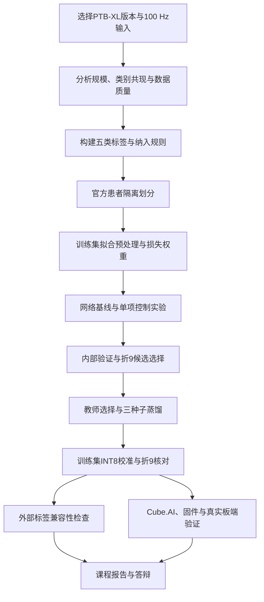

# 项目总览、实验路线与运行入口

更新：2026-10-10。实际项目为`D:/MyProject/college/ecg1`，旧路径`D:/MyProject/college/大三上/ecg1`已不存在。项目使用公开数据库波形回放，不要求人体采集。

<!-- validation-redo-notice-20261010:start -->
**评价状态（2026-10-10）：** 当前验证候选为单教师蒸馏CNN seed43 INT8，折9宏F1为75.893%；现有完整HEX仍为原seed44及原部署阈值。折10在历史研发中已反复使用，且部分追加方案受测试反馈影响，所有已有折10成绩按历史探索结果解释。重做没有恢复折10的独立性；新候选没有本轮独立测试或完整固件。
<!-- validation-redo-notice-20261010:end -->

<a id="overview-route"></a>

## 1. 项目路线与文档分工

实验流程从数据集选择和分析开始，随后定义标签/人群、固定患者划分，才进入网络与训练比较。下面是逻辑依赖顺序；真实历史上早期全队列实验在前，筛选规则后来引入，不能倒写成所有实验一开始就用了筛选后队列。



| 文档 | 职责 | 阅读时机 |
|---|---|---|
| 本文 | 全局流程、状态、启动和交付 | 首先阅读 |
| [模型训练与优化](模型训练与优化.md) | 数据选择、分析、标签、划分、预处理、网络、损失、实验推进、纠正 | 理解完整实验过程 |
| [各模型整体与逐类指标总表](各模型整体与逐类指标总表.md) | 当前折9结果与历史各队列/条件原始指标 | 核对分数与评估口径 |
| [STM32部署与串口验证](STM32部署与串口验证.md) | 模型/芯片版本、资源、协议、运行、实板验收 | 转换或上板前 |
| [Chapman冻结模型外部验证](Chapman_冻结模型外部验证总结.md) | 输入/标签对齐、明确阳性结果、条件指标、质量及限制 | 讨论外部泛化前 |

核心MD仍仅五份；实验JSON、预测和自动报告位于各`outputs`目录。不要再用对话接续长段落或日期追加代替完整实验主线。

<a id="overview-contract"></a>

## 2. 固定任务与数据规则

| 项目 | 约定 |
|---|---|
| 数据 | PTB-XL v1.0.3，`D:/datasets/ptb-xl`，元数据21799条/18869患者 |
| 输入 | 12导联、100 Hz、10秒、`[B,12,1000]` |
| 输出 | NORM、MI、STTC、CD、HYP，五个独立sigmoid及阈值，允许多标签 |
| 官方划分 | folds1–8训练、9验证、10历史测试，患者隔离 |
| 原始/当前记录 | 17418/2183/2198 → 剔除五类全零后17084/2146/2158 |
| 拟合规则 | 训练集计算标准化/类别权重/量化校准；折9选epoch、模型及阈值 |
| 全零标签 | 不自动补NORM，不等于一定使用起搏器；筛选是人群定义 |
| 实验限制 | 历史折10反复使用及测试反馈已记录；不得称新盲测 |

LUDB方向已取消，不恢复相关工作。Chapman用于有限标签的外部检查，不能当作完整五类验证。训练采用加权BCE，HYP训练阳性2119/17084（12.40%），正类权重约7.06；不是尚未尝试类别加权。

<a id="overview-status"></a>

## 3. 当前成果及版本对应

| 层级 | 已完成 | 仍未完成/限制 |
|---|---|---|
| 数据和软件 | 标签映射、划分、预处理、信号分析、网页/API、串口程序 | HRV跨无效RR缺口问题未修复 |
| 模型研究 | 多网络、损失/增强、内部验证、三种子、蒸馏、量化、26版本复核、Ribeiro适配 | 不能声称所有类别或外部泛化全面提升 |
| 评价纠正 | 原9教师复算、联合阈值重做、6新学生、独立INT8折9选择 | 不能恢复历史测试独立性 |
| 旧seed44固件 | Cube.AI/C生成、完整VE编译、HEX/源码ZIP、主机C核对 | VG目标/时钟/接线及真实板端未完成 |
| 新seed43候选 | 折9选择、FP32/INT8 ONNX、训练校准和独立复核 | 无独立测试、Chapman、新Cube.AI资源或完整固件 |
| 外部验证 | 六个旧冻结版本的Chapman结果 | NORM无可靠真值，条件阴性指标需带假设 |
| 课程材料 | 开题稿及第3–10周个人记录已有文件 | 中期/最终报告、第11–16周记录、答辩稿待制作/确认 |

<!-- validation-redo-results-20261010:start -->
### 当前纠正结果（2026-10-10）

6个学生均已重训，教师9候选仅复算选择、权重沿用。仅按折9推荐`single_teacher_kd_seed43_int8`，验证宏F1 75.893%。原seed44相同细阈值口径为75.683%，差异较小，整体Recall略降。

完整方法与验证见[训练文档](模型训练与优化.md#step-12)，整体/逐类结果见[指标总表](各模型整体与逐类指标总表.md#metric-current)。当前新候选无完整固件或独立测试，原seed44 HEX未替换。
<!-- validation-redo-results-20261010:end -->

旧追加集成教师及其派生seed42保留为历史探索版本，已撤回纠正推荐。网页/API默认模型、最新验证候选与已编译HEX是三个独立配置，整理文档不会替换它们。

<!-- unet-overview-20261010:start -->
### 新增网络研究：1D U-Net

已完成12次新训练及30组整体/逐类指标、30组阈值独立复核；仅折9评估。

筛选后训练/验证：U-Net三种子F1均值75.778%，样本标准差0.454个百分点；编码器对照均值75.293%，平均差+0.486个百分点，U-Net胜出2/3种子。

未筛选训练/验证：U-Net三种子F1均值75.023%，样本标准差0.233个百分点；编码器对照均值75.014%，平均差+0.009个百分点，U-Net胜出1/3种子。

筛选后同训练人群的旧InceptionTime三种子折9均值76.287%，U-Net差-0.508个百分点。

这些是用来选择模型和阈值的验证成绩，不能据此宣布泛化提升；三种子不足以证明统计显著性。本轮按冻结方案保留全部结果，既有部署候选保持原状态。

本轮训练分别使用筛选后17084条与未筛选17418条，对应两套折9验证；两结构×三种子，数据与选择口径见[训练流程](模型训练与优化.md#unet-study-20261010)、[指标总表](各模型整体与逐类指标总表.md#metric-unet)。没有新增折10、外部或板端结果，当前seed43部署候选与旧HEX保持原状态。
<!-- unet-overview-20261010:end -->

<a id="overview-files"></a>

## 4. 关键目录与产物

| 内容 | 位置 |
|---|---|
| 配置 | `configs/default.yaml`，本机路径由不上传的`configs/local.yaml`覆盖 |
| 源码 | `src/data`、`src/signal_processing`、`src/models`、`src/training`、`src/inference` |
| 展示 | `app/`、`api/`、`scripts/ecg_stm32_viz.py` |
| 原seed44学生/导出 | `outputs/distillation/distilled_seed44/`、`outputs/distillation/distilled_export/` |
| 原完整固件 | `outputs/board_release/seed44_int8_stm32f407ve/` |
| 当前纠正结果 | `outputs/validation_only_redo_20261010/` |
| 当前学生 | `single_teacher_kd_seed43/checkpoint/cnn1d_best.pt`，相对上行目录 |
| 当前导出 | `selected_export/ptbxl_cnn1d_int8.onnx`、`deployment_manifest.json`、`candidate_thresholds.json` |
| Chapman | `outputs/external_validation/chapman_audited/` |
| 审查证据 | `outputs/reports/`及各实验`independent_audit.json` |
| 报告材料 | `报告材料/` |

原模型、ONNX、HEX均保留回退；缓存可重建，但原始配置、权重、阈值、预测和清单是复现证据，不随意清理。完整数据/缓存和部分实验产物不随普通Git克隆提供；本轮没有推送GitHub，不能把本机文件存在解释为远程已同步。

<a id="overview-run"></a>

## 5. 安装、数据检查与软件启动

命令在实际项目根目录运行。现有`.venv`可复用，无需因整理文档重复安装。

```powershell
python -m venv .venv
.venv/Scripts/python.exe -m pip install -r requirements-dev.txt -r requirements-train.txt -r requirements-app.txt -r requirements-api.txt -r requirements-stm32.txt
.venv/Scripts/python.exe scripts/prepare_data.py --dataset-root D:/datasets/ptb-xl
.venv/Scripts/python.exe scripts/inspect_record.py --ecg-id 1
.venv/Scripts/python.exe scripts/predict_record.py --ecg-id 1
.venv/Scripts/python.exe -m streamlit run app/streamlit_app.py
.venv/Scripts/python.exe -m uvicorn api.main:app --host 127.0.0.1 --port 8000
```

缺少数据时再运行`download_ptbxl.py --workers 8`，下载位置按当前配置，不强制写回项目`data/`。API文档为`http://localhost:8000/docs`。网页/API默认仍加载原正式模型，不能展示新候选分数却把原模型预测说成新模型输出。

串口学生入口为`start_ecg_student_viz.cmd`；现有包对应旧seed44/旧阈值。USART1使用PA9/PA10、115200、8N1、3.3 V TTL、共地。实板最新记录VG，旧包工程VE；烧录前按[部署文档](STM32部署与串口验证.md#deployment-run)核对工程、Flash、晶振与接线。界面显示一条导联，实际发送全部十二导联。

模拟器、主机C和ONNX对照不计为板端验证，真实烧录、串口闭环和推理耗时仍待完成。

<a id="overview-materials"></a>

## 6. 课程材料与个人分工

个人分工是模型训练、蒸馏与量化，不能把小组其他工作自动写成本人经历。当前`报告材料/`存在四份文件：

- [原开题报告](../报告材料/《科技实习与创新》开题报告_十二导联心电五类识别.docx)。
- [第4–5周修订版](../报告材料/《科技实习与创新》开题报告_十二导联心电五类识别_第4至5周修订版.docx)。
- [第4–5周VG确认版](../报告材料/《科技实习与创新》开题报告_十二导联心电五类识别_第4至5周修订版_VG确认版.docx)。
- [个人第3–10周记录](../报告材料/个人实习记录_第3至10周.docx)。

原开题稿包含后期成果及旧资源数字，不作为早期开题当时已经完成的证明。修订稿将后期蒸馏/固件改为计划；VG字段若为后续统一更正，应注明修订，而不是断言当周已核实实物。个人日期、信息和讨论经历仍需本人核对，本次未改Word或重新读取课程PPT。

小组中期/最终报告、第11–16周个人记录、答辩PPT仍需制作或确认。旧课程阅读记录要求第11周中期、第16周最终、第17–18周约7分钟答辩；该安排来自已有记录，实际提交时间以课程和本人确认为准。技术MD整理完成不等于课程材料交付完成。

<a id="overview-next"></a>

## 7. 待办与完成标准

| 工作 | 完成标准 |
|---|---|
| 代码防错 | 修复HRV无效RR位置、串口量化/预处理指纹检查；保留错误参数回归证据 |
| VG工程 | 打包器支持明确芯片目标，模型/工具/配置/C代码/HEX哈希绑定，核对时钟和下载器 |
| 真实板端 | 同版本实际烧录、固定样本回放、概率/标签对照，传输和推理分开计时，连续与断线测试 |
| 最终部署包 | 选定实际展示版本后独立打包；新seed43目前仅是验证候选，旧包不覆盖 |
| 课程交付 | 核对形成/修订时间，完成小组报告、剩余个人记录和答辩稿 |
| 新模型研究 | 先固定验证目标与候选；不重复已完成实验，不按折10追加调参 |

<a id="overview-maintenance"></a>

## 8. 文档维护与本次整理记录

后续实验按本主线补到对应阶段：先写问题、候选和固定配置，再记录数据人群、选择规则、整体/逐类结果、无效方案、产物和限制。更新当前候选时同时核对指标与部署状态，不能只改一个“推荐”字样。

前一阶段的文档整理本身未重训、未新增折10评估、未改原模型/固件/Word、未推送；后续E15的12次训练另按本轮协议执行，仍不新增折10评估。整理前七份项目MD（五核心、根README、data README）原文完整保存在[备份ZIP](../outputs/documentation_reorganization_20261010/original_markdown.zip)；保留指标总表、部署和Chapman的全部原表格行，并补充元数据描述与架构参数实算。

来源见[清单](../outputs/documentation_reorganization_20261010/source_inventory.json)，整理核对见[核验记录](../outputs/documentation_reorganization_20261010/verification.json)。不用聊天摘要替代实验来源，也不把本次说明的逻辑顺序改写成真实历史日期。
